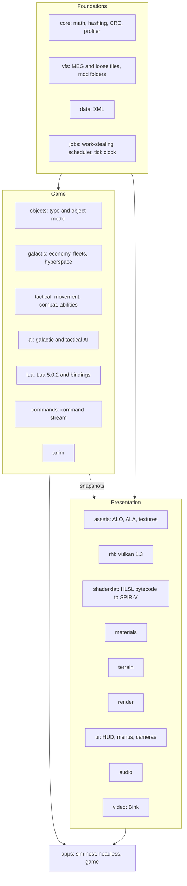

> **AI-assisted development.** This project is built with heavy use of AI coding agents (Anthropic's Claude, through
> Claude Code). Most of the engine code, tests, tools and documentation, including the behaviour specs in `docs/re/`,
> were written by AI agents working under the direction of the project's maintainer, who sets the goals, makes the
> design decisions, runs the in-game checks against the original game and decides what lands. Every change goes through
> the same build, test and determinism gates, but expect mistakes, and treat the specs as reconstructions rather than
> authoritative documentation of the original game.

<details>
<summary><b>Tools used in development</b></summary>

| Area | Tools |
|---|---|
| AI assistance | Claude Code (Anthropic): desktop app and CLI, parallel agent sessions in separate git worktrees, and computer use to drive the original game for in-game probe runs |
| Build | MSVC 14.51 and Windows SDK 10.0.28000 (project-local), CMake 4.4, Ninja 1.13, clang / LLVM 20.1.8 (check build and AddressSanitizer), sccache 0.19 (optional compiler cache), Python 3 (lint, build summaries, roadmap, parity harness, probe kits) |
| Graphics and shaders | Vulkan SDK 1.3.296 headers and validation layers, Vulkan Memory Allocator 3.3.0, DXC 1.8.2407 (HLSL to SPIR-V), fxc from the Windows SDK (compiling mod `.fx` sources) |
| Libraries in the engine | Lua 5.0.2 (vendored), miniaudio 0.11.25, FFmpeg 8.1.3's Bink decoder (built with MSYS2), the reference SMAA, AMD FidelityFX SDK 2.4.0 (FSR upscaler DLLs), Intel XeSS SDK 3.0.2 (`libxess.dll`) |
| Launcher | Rust 1.100 (project-local) with egui / eframe for the Command Center launcher |
| Reverse engineering (specs only, never engine code) | Ghidra 12.2 (headless decompiler export with project scripts), Python with pefile, Capstone and LIEF for static analysis, DXVK 3.1.1 and apitrace 14.0 for capturing the original's rendering, in-game probe mods and a debugger-based tracer for the running game |
| Version control | Git (MinGit 2.47, project-local), GitHub and the GitHub CLI |

</details>

# Empire at War: Vulkan

A clean-room C++20 rewrite of the *Star Wars: Empire at War: Forces of Corruption* engine (Petroglyph's "Alamo").
The simulation is rebuilt from scratch as a headless, multithreaded, deterministic core, with a Vulkan 1.3 renderer
on top. The goal is the game you already own, running on an engine that uses a modern PC.

**Windows (x64) only, single player only.** There is no multiplayer, no support for other platforms, and saves from the
original game cannot be loaded; all three are out of scope by design.

**Forks are welcome.** If you want something this project leaves out, such as multiplayer, another platform or a
feature of your own, you are more than welcome to fork it and add whatever features and systems you like. The code is
released into the public domain under [the Unlicense](LICENSE).

> **Status (2026-11-13, evening):** active development, playable end to end through its own host, `alamo_game`, and
> handed out as packaged test builds (the newest on 2026-11-13, started from the new **Command Center** launcher or a
> double-click `Play.exe`). Simulation, renderer, Lua layer, AI, UI, story and save/load are in place, and **Thrawn's
> Revenge loads and plays**. Since 2026-11-10 the work is limited to **parity** with the original (rules, data and feel
> exactly; random-driven outcomes by their distribution over many seeds): land movement and combat were ported in full
> from the specs, the galactic AI's production and task-force rules follow the original, and the land skirmish AI plays a
> full game. A few **named exceptions** were built on 2026-11-13: a reworked graphics and display menu (SMAA / TAA /
> MSAA, **AMD FSR and Intel XeSS upscaling**, render and UI scale, exclusive full screen), and port features for space
> battles (fleet groups, fleet cohesion, fighter squadrons of 12, fleet and ship names, unit path lines). Open findings go
> to a triaged backlog instead of growing the plan.
>
> **Tests:** the suite now has **261 tests**. The fast tier (165 tests) passes on the tip of `dev` with 0 warnings. The
> newest full runs (2026-11-13) have about 20 slow tests failing (game smokes and benchmarks, galactic AI with a human
> player, two land skirmish seeds and the parity harness), so `dev` is not release-ready yet. The last full gate that
> passed was on 2026-11-12: 246 tests and 0 warnings on MSVC and on clang, and 67 under the sanitizer.
>
> Task tracking is the project roadmap, kept in its own repository and not in this one (1,097 roadmap tasks done and 79
> open, 145 of 168 groups done). Results and notes per phase are in [`docs/PHASE2.md`](docs/PHASE2.md),
> [`docs/PHASE3.md`](docs/PHASE3.md) and [`docs/PHASE4.md`](docs/PHASE4.md), and every document is indexed in
> [`docs/README.md`](docs/README.md).

This repository contains **no game assets and no original code**. You need your own copy of the game (Steam:
*Star Wars: Empire at War - Forces of Corruption*). Behaviour was recovered by studying the shipped binary and data
and written up as specs in [`docs/re/`](docs/re/) (about 145 documents) before any engine code was written.

**Contents:** [Goals](#goals) · [Features](#features) · [Performance](#performance) · [Architecture](#architecture) ·
[Quality](#quality-and-process) · [Where the project is](#where-the-project-is) · [Building](#building-and-running) ·
[Layout](#repository-layout) · [Legal](#legal)

---

## Goals

### Core goals

1. **Play the real game.** Base *Forces of Corruption* is the parity target: the same content, rules and feel.
   Parity is judged by **behaviour** (travel and build times, damage, income, AI choices, battle outcomes), not by
   matching the original's internal hashes. Rules, data and Lua handling must match exactly; outcomes that depend on
   random draws must match the original's distribution over many seeds; internals such as the order of random draws
   are the port's own choice and are recorded as such.
2. **Near-full compatibility with Forces of Corruption mods, without special-casing any of them.** A mod that uses
   the original's data mechanisms (XML, Lua, asset formats, shaders) should play in the port as it does in the
   original: what works there works here, and only what the original also rejects may fail. *Thrawn's Revenge* is
   the first and hardest test, but compatibility is **mod-agnostic**: no engine code may depend on a mod's names or
   content. What "plays" means and the set of mods it is checked on are in `docs/MODS.md` §10.
3. **Use the whole PC.** The original runs simulation and rendering on one thread over Direct3D 9. This port spreads
   work over every core, keeps big AI and script updates off single ticks, and drives the GPU through Vulkan.
4. **Deterministic by design.** The same inputs give the same results on any number of threads, on any run, and on
   both supported compilers. That is what makes saves, replays, parallelism and debugging trustworthy.
5. **Quality-of-life the original never had.** Smooth motion at any refresh rate, modern anti-aliasing, upscaling and
   ambient occlusion, pause on both levels, a free camera, order queues, fleet groups, and built-in profiling tools.
   Fleet groups are off by default and fleet cohesion defaults to the retail behaviour. The one deliberate rule change
   (fighter and bomber squadrons of 12, with prices scaled to match) is recorded as a departure from parity.

**Scope.** Windows x64 only, single player. Multiplayer, loading the original game's save files, non-Windows
platforms and RenderDoc support are deliberately out of scope.

### Side goals (not required for a playable game)

These are on the roadmap as separate lanes, each with a written plan and a recommended model/effort preset.

| Side goal | What it is | Roadmap |
|---|---|---|
| **Repeatable benchmark** | The same input every run (fixed saves, recorded orders, scripted camera) with per-tick CRCs proving each run matched; sim-only, real-time and fixed-frame modes; shared stress scenes and comparison reports. **BM1-BM3 are done**; the in-game benchmark screen (BM4) and the first quiet-machine baseline are open | BM1-BM4 |
| **First-person ground unit** | Possess a ground unit and play it in first person, Battlefront style. The sim side is a command in the stream, so it replays. Planned | FP1-FP3 |
| **Captain's view** | A bridge camera and holo-table for a capital ship, subsystem targeting, squadron orders and optional cinematic camera moves; presentation plus ordinary commands. Planned | CB1-CB4 |

Deferred on 2026-11-06 until the core game and the mod platform are complete: shader precompile, loading and build speed, CPU efficiency, GPU efficiency and graphics fidelity (`docs/DEFERRED_SIDE_GOALS.md`).

Dropped on purpose: AVX2 dispatch (the build stays on baseline SSE2), Tracy (the in-house profiler and overlay are
the tools), a compiled XML cache and Lua bytecode cache (never measured as a cost), original-save loading, and all
networking.

---

## Features

### Simulation and game rules
- Full object model: about 4,000 unit definitions with about 1,000 fields each, and the original behaviour set.
- **Galactic layer:** economy, production, fleets and hyperspace, planets and garrisons, fog of war, black market,
  sabotage, hacking, hero respawn, corruption (Underworld), special weapons.
- **Tactical layer:** land and space combat, formations, abilities, hardpoint destruction, garrisons and hangars,
  landing drops, weather, fog of war, construction pads, reinforcement, victory conditions.
- **Land movement as the original does it:** infantry squads move as one container with members on formation slots,
  one formation path per land formation, the original's collision decisions between moving and stopped units, attack
  approach arcs, garrison approach and exit, hover units and walking while deployed.
- **Hero clashes** on land, the vehicle thief, Bribe, Hack, Saber Throw and bombing runs.
- **Story campaigns** with the original event system (shared flags, prerequisites, perpetual events), **linked story
  battles** that start from a galactic event, and corruption missions.
- **Skirmish and galactic conquest**, including the original's Capture Control Points skirmish type, plus the
  main-menu attract battle (the shipped attract script runs as it does in the original).
- Behaviour comes from written specs ([`docs/re/`](docs/re/)): movement, combat, AI, fog of war, story, commands.

### AI and scripting
- The **original AI**, including its Lua plans and perception, runs on a vendored **Lua 5.0.2** with the original
  semantics.
- Galactic and tactical AI with the original goal, plan, task-force and learning systems, including the original's
  free-store claims, build-queue slots and goal cadence; the land skirmish AI builds its base and plays a game to the end.
- Galactic victory is checked on events, as in the original, so mods that hold or grant victory from their scripts work.
- Map hint names from the map files reach the Lua hint queries (`Find_Hint`, `Find_All_Objects_With_Hint`).
- A full Lua binding layer for game objects, players, story, fog, presentation and scoring.

### Renderer (Vulkan 1.3)
- Vulkan 1.3 with synchronization2, bindless textures and a persistent on-disk pipeline cache.
- The original game's shaders are translated to SPIR-V by an in-house HLSL-bytecode translator plus DXC; **all 291
  shipped shaders translate**.
- Draw recording runs on the job system across all cores; draw lists are identical at any thread count.
- Terrain, water, decals, tracks, stencil shadows, fog of war, space backdrops, hardpoint destruction and a GPU
  particle system.
- Presentation-only options never feed the simulation, so turning them on or off cannot change a battle.

### Graphics and display options
The options menu has separate **Display** and **Graphics** pages (2026-11-13).
- **Refresh-rate aware.** The sim ticks at 30 Hz; views interpolate between ticks, so motion is smooth at 60, 144 or
  240 Hz instead of stepping.
- **Display mode:** Fullscreen (exclusive Vulkan full screen, as the original's D3D9 one was), Borderless fullscreen or
  Windowed. The galactic camera keeps its vertical view and widens on wide screens (Hor+).
- **V-sync mode** (Off, FIFO, Mailbox) and a **frame-rate cap** (Off, the display's refresh rate, or a custom
  20-500 fps) that works with V-sync on.
- **Anti-aliasing**, one choice: Off, **SMAA** (the reference implementation), **TAA** (Halton jitter, depth
  reprojection, per-object motion vectors, disocclusion rejection and variance clipping, so movers do not smear) or
  **MSAA 2x / 4x / 8x**.
- **Upscaling:** **AMD FSR** (FSR 4.1 on GPUs that support it, FSR 3.1 otherwise) or **Intel XeSS** Super Resolution, with
  a quality list from Native AA to Ultra Performance. Both are loaded at run time; a missing DLL or an unsupported GPU
  falls back to TAA.
- **Render scale** (50-100 % of the window's pixels) and **UI scale** (100-500 %, DPI style; 100 % is the original's size
  on a 1440p screen, and on very large screens past the fitted size only the text grows).
- **Screen-space ambient occlusion** in land battles (half resolution, depth-aware blur).
- **Anisotropic filtering** up to 16x.
- **Frame-time overlay** (F11 in game, or `--frame-overlay`): the last 120 sim ticks and host frames against the
  16.7 ms and 33.3 ms lines, with the worst tick's biggest cost.
- The original's Auto Detect, Widescreen and Hardware Mouse options are gone (the game always draws its own cursor).

### Controls and camera
- **Pause** on both the galactic and tactical level, rebindable, and issued through the command stream so replays stay valid.
- **Adjustable field of view**, separate for the galactic and tactical cameras.
- **Free tactical camera:** full 360 degree rotation on all axes; W A S D moves by default.
- **Shift+click order queues:** line up attacks, moves and abilities; a plain click replaces the queue. Queued orders
  are ordinary commands, so they replay deterministically.

### Port features (not in the original)
Built on 2026-11-13 as named exceptions to the parity focus. Each goes through the command stream, so replays and
saves carry it.
- **Fleet groups** (off by default): persistent unit groups in tactical battles, shown inside the selected-unit bar. A
  locked group keeps its formation, moves at its slowest member's speed and waits for stragglers (hotkeys N, U, Y).
  Phase 1 is done; phases 2 and 3 are on the backlog.
- **Fleet cohesion** (hotkey O): Loose (retail, the default) or Tight, where the player's moves cap every non-fighter ship
  at the slowest one's speed so the fleet keeps its spacing.
- **Fighter and bomber squadrons of 12**, with build prices and AI combat power scaled to match, and FIGHTERS / BOMBERS
  wing buttons (F2 / F3) in the tactical HUD. This one departs from the retail rules on purpose.
- **Fleet and ship names**, renamed in the galactic fleet organiser.
- **Unit path lines** (optional): a thin line along each own moving unit's path, one per squadron or company.

### Interface
- The original menus and HUD, drawn from the original dialog data, fonts and art.
- **Skirmish setup** that follows the original's staging rules: numbered start positions, colour combinations and clash
  rules, Land / Space game type with the last map remembered per type, map preview, and a map list that merges loose
  folders, MEG archives and **mod folders** (Official and Custom tabs).
- Fleet organiser (drag units between fleet slots, stacks with counts), tech-tree arrows, results and auto-resolve
  dialogs, story dialogs and subtitles, and the linked-battle banner and letterbox for story battles.
- **Tactical HUD:** order buttons and hotkeys, retreat and reinforcement, the space special-weapon button, battle-end
  scoring with the retry dialog, tooltips, and a cursor that changes with the object under it.
- **Galactic HUD:** hero roster, build-pad prices and the reason a build is blocked, map filters and planet-label icons,
  on-screen galactic messages and announcer events.
- **Front end and options:** key rebinding (clear, conflict prompt, apply prompt), drop-down, list and edit-box
  behaviour with selection and the Windows clipboard, and options kept between runs.
- **Save and load dialogs** list saves as a tree (map, faction with its emblem, playthrough), each save showing its week
  and when it was saved. A new campaign opens the mission holocron by itself.

### Save and load
- The port's own compact format: a Forces of Corruption story save is about 50-60 KB, a mid-battle save about 150 KB.
- Galactic and **mid-battle** saves, save/load menus, and replay of recorded command streams.
- Saves include in-flight scheduled work (background AI jobs), so a loaded run continues tick-for-tick like the
  uninterrupted one. This is tested.

### Tooling
- `alamo_headless`: runs the whole simulation without a window, for tests, benchmarks and AI experiments.
- **Per-tick state checksums** with a per-system breakdown, recorded and compared across thread counts and compilers.
- A **tick profiler** (`--profile`): p50/p99/max per tick and per system, worker utilisation, the 20 worst ticks.
- **Benchmark tooling** (`tools/benchmark/`, scenarios in `tests/benchmark/`): versioned scenario files (save, recorded
  orders, scripted camera, expected per-tick CRC fingerprint). `alamo_headless --bench` times the sim alone,
  `alamo_game --bench-scenario` renders the same run in real-time or fixed-frame mode with GPU timers, and a run whose CRCs
  differ is flagged "not comparable" instead of reported as a speedup. Reports are JSON and can be compared.
- **Mod load report** (`alamo_mod_check`): for any mod folder or workshop id, lists loader diagnostics, missing files,
  unread XML tags, shader issues and scripts that error, with a machine-readable summary. The same summary is shown by
  the **mod picker** in the game's menus before a mod is launched. A lint step fails the gate on a mod or faction
  name written into engine code.
- **Visual regression** checks (screenshot diffs against stored baselines) and a scheduled nightly gate.
- Tools for the original formats: MEG archives, ALO/ALA models and animations, shaders.
- **Parity tooling** (`tools/probe_mod/`, index in [`docs/PROBES.md`](docs/PROBES.md)): a read-only external recorder that
  samples the original game's state per tick, in-game probe mods for questions the binary alone cannot answer, and a
  compare script that runs the port on the same scenario and reports the first divergence per metric.
- **Parity harness** (`tools/parity/`): replays recorded scenarios of the original in the port and grades travel and build
  timings, income, AI choices, damage and battle outcomes against tolerances taken from several retail runs; the result is
  kept as a baseline that is re-recorded, like a golden, when an intended behaviour change moves a metric. A
  distribution mode compares random-driven outcomes over many seeds against several retail captures.
- **Command Center launcher** (`launcher/`, Rust and egui, built by `build_launcher.cmd`): starts `alamo_game` with
  profiles, mods and Workshop items, saves, graphics options and diagnostics. It is a separate program that never links
  engine code.
- **Test builds** (`tools/testbuild/`): packages the game with the Command Center, a double-click `Play.exe` that finds
  the game install by itself, and launchers for the base game and for any installed mod (workshop or local, submods
  stacked on the mod they need), each mod with its own saves, shader cache and log.

---

## Performance

The simulation runs on a work-stealing job system with order-stable results (parallel jobs write per-index outputs and reduce in index order), the AI players' clocks are staggered, long AI work runs as fixed-latency background jobs, Lua garbage collection is scheduled by tick number, and the renderer records on several threads. Everything is scheduled **by tick number, never by wall clock or thread timing**, so results are bit-identical for any worker count. The measurements (AMD Ryzen 7 7800X3D, one tick = 33.3 ms), what each fix bought, what was tried and not shipped, and the caveats are in [`docs/PERFORMANCE.md`](docs/PERFORMANCE.md). The budget is p99 under 16.7 ms and no tick over 33.3 ms: p99 is met in every measured scenario, and the one miss is the setup tick that starts a battle (see "Where the project is" below). Performance work is paused while the project concentrates on parity.

---

## Architecture



- **One static library per module**, each with its own test executable.
- **The sim never reads presentation state.** The renderer and UI consume snapshots of the sim, interpolated between ticks.
  Anything the player can toggle in Video options is therefore unable to change a battle.
- **Everything the player does is a command** in a stream (orders, pause, queued orders, retreat). The stream plus the
  initial state fully determines a run, which is what makes replays, saves and the CRC checks work.
- **`alamo_headless`** runs the same sim without a window. Tests, benchmarks and AI experiments use it, and it is the
  reference for determinism.

### The determinism contract
Results read by game logic must be bit-identical across thread counts, runs, and the MSVC and clang builds:
- Parallel jobs write **per-index outputs**; reductions run **in index order**.
- No FMA contraction (`/fp:precise`, `-ffp-contract=off`).
- No iteration over pointer-keyed or seeded-hash containers in sim code.
- Scheduling decisions (AI stagger, background-job latency, GC timing) depend on **tick numbers only**.
- Timing data is write-only: no sim code branches on a profiler value.

It is checked by recording a per-tick CRC (with a per-system breakdown) and comparing logs across **0, 1, 4, 16 and
(hardware threads - 1) workers**, naming the first diverging tick and system. Long battles run one ctest entry per
worker count so the counts run side by side. Clang's logs equal MSVC's.

---

## Quality and process

- **Two compilers in the loop.** MSVC ships; clang 20 checks (extra warnings: `-Wconversion -Wshadow`) and provides a
  second compiler for determinism. Sim changes get both; threading changes also run under a clang sanitizer.
- **Zero warnings** at MSVC `/W4 /permissive-` and clang `-Wall -Wextra -Wpedantic -Wconversion -Wshadow`.
- **261 tests** on each of MSVC and clang (the last passing full gate, on 2026-11-12, had 246, plus 67 sim-module
  tests under the sanitizer), with golden-file checks of whole battles and campaigns, each compared across worker counts.
  Goldens store a checkpoint every 64 ticks, so a behaviour change is a small diff. The full suite takes about 4 minutes
  on the development PC; slow tests carry a label, and the 165-test fast tier is what quick iteration and landing run.
- **Pre-merge gate** (`build_gate.cmd`): MSVC, clang and sanitizer builds, each recorded on the roadmap. A nightly
  gate runs on the tip of `dev`. Landing on `dev` (`tools\land_on_dev.cmd`) first merges `dev` in and refuses a merged
  result without a passing MSVC build and fast-tier test run, so `dev` is never pushed red; an identical failing rerun is
  refused, and build summaries separate real failures from golden drift.
- **Parity is checked against the real game.** Reference traces recorded from the original (credits, owners, production,
  RNG draws per tick) and in-game probe runs settle questions the binary leaves open; each answer is written into the
  matching spec in `docs/re/` before the engine follows it.
- **Parallel agent workflow.** Work is split by roadmap group across agent sessions, each in its own git worktree, with
  claims so two sessions do not take the same group. **`dev` is the development branch** (GitHub's default); sessions land
  on it directly, and `main` is the released branch, updated from `dev` by a release pull request once the full gate
  passes. The roadmap lives in its own repository so every session shares one copy. Each roadmap group has an exit test;
  findings that do not block it go to a triaged backlog (about 250 entries, each with a parity tier and severity) and
  become work only when picked. Parity groups (Stage 6) keep their follow-ups as their own tasks.
- **Clean-room.** Engine code is written from the specs in `docs/re/`, never from decompiled output, which is kept out of
  the engine tree.
- **Project-local toolchain.** MSVC 14.51, Windows SDK, CMake, Ninja, DXC, LLVM, Rust and FFmpeg's Bink decoder live under
  `toolchain\` with pinned versions and hashes. Nothing is installed system-wide.
- **Third-party code** in `engine/` is limited to approved dependencies: Vulkan-Headers, DXC, VMA, Lua 5.0.2 (vendored,
  original semantics), miniaudio, FFmpeg's Bink decoder (LGPL, dynamically linked), the reference SMAA, and the AMD
  FidelityFX (FSR) and Intel XeSS runtime DLLs (loaded at run time, optional).
- About **437,000 lines** of C++ in `engine/` (tests included), across 21 modules plus a shared test-support library.

---

## Where the project is

| Area | State |
|---|---|
| Simulation, renderer, Lua, AI, UI, save/load, story | **Done and playable**; remaining work is parity polish |
| Current focus (since 2026-11-10) | **Parity only**: work that changes what the player sees or the rules (tier 1) or random-driven outcomes (tier 2). Internals, performance and save-format work (tier 3) are paused; crashes, hangs and save corruption are still fixed |
| Clean-up and production audit (CU1-CU18, PA) | **Done** (2026-11-08): dead code and bring-up guards removed, shared core and test helpers, each XML file read once, save helpers unified, ported-but-unwired original behaviour wired in |
| Movement and combat parity (S78, MOVE) | **Done** (2026-11-11): land squads, formation paths, the collision decisions, attack and garrison approaches, hover units, hero clashes and the vehicle thief follow the specs; follow-ups are in the backlog |
| Galactic AI parity (A2, AIVIEW) | **Done** (2026-11-12): free-store claims, build-queue slots, budget, goal cadence and task-force rules follow the original; Shola attack timing matches retail in 11 of 12 seeds. Remaining tier-2 metrics are worked from the backlog |
| Land skirmish AI and Capture Control Points | The land AI builds its base, charges its pads and plays to the end; control-point skirmish and its announcer are in. Open: Imperial self-repair in long idle games, and a foc-land seed that does not end in time |
| Parity check against the original (Q4) | **Harness built** (`tools/parity/`) with a baseline from several retail runs and a many-seed distribution mode. Open: the Geonosis skirmish, where the port's Rebel AI attacks about a minute early, and the final Q4 run |
| Interface gaps from the 2026-11-12 test build (UI1, UI3-UI5) | **Mostly done** (2026-11-13): tactical and galactic HUD controls, cursor, key rebinding, list / combo / edit widgets, clipboard, full screen. Left: install-language detection, unit-cap and under-attack feedback in the tactical HUD, the FoC planet map and fleet route preview, UI sounds and a few dialog details |
| Story and tutorial presentation (UI2) | **Not started**: story text rewards, tutorial pointers and flashes, the story cinematic camera and screen fades |
| Story campaigns end to end | Event system, linked tactical battles, victory handling and corruption missions in; map hints now load, so the Kessel mission script runs further; Kessel story parity checks remain |
| Animation-driven gameplay (R3g, R3h) | **Open**: reinforcement transport landing timing, AT-AT troop deployment, structures that spawn squadrons, tow cables, and ability and hero-clash clips |
| Graphics and display menu (2026-11-13) | **Built**: separate Display and Graphics pages, display modes with exclusive full screen, SMAA / TAA / MSAA, FSR and XeSS upscaling, render and UI scale, custom frame-rate cap. Waiting for Gabriel's in-game look at the anti-aliasing and upscaler modes |
| Port features (2026-11-13) | **Built**: fleet groups phase 1, fleet cohesion, squadrons of 12 with wing buttons, fleet and ship names, unit path lines. Waiting for in-game checks; fleet groups phases 2-3 are on the backlog |
| Command Center launcher | **In the repository** (`launcher/`, imported 2026-11-13) and shipped with the test build |
| Full test suite | Fast tier passes on `dev`; about 20 slow tests fail in the newest full runs (game smokes and benchmarks, galactic AI with a human player, land skirmish seeds 2 and 4, the parity harness), so the full gate has not passed since 2026-11-12 |
| Mod diagnostics (Q5) | Done |
| Thrawn's Revenge (Q6) | **Plays**: the mod loads with no loader diagnostics, its skirmish, land and campaign smoke runs pass, and its galactic AI plays. 2026-11-13: an event-driven galactic victory monitor (the mod's campaign menu holds and grants victory), base-game objects run their Lua scripts, and map hint names reach Lua. Left: two map-hint details and a final re-check after the parity check |
| Mod platform (MODC) | **In progress**; the goal was widened on 2026-11-13 to near-full compatibility with FoC mods, checked on a reference set of four mods (`docs/MODS.md` §10). Done so far: the loading contract (`docs/MODS.md`), a lint against mod and faction names in engine code, the mod load report, a `STEAMMOD=` resolver, a mod picker in the game UI, shader model 3 translation, compiling mod `.fx` sources, and a synthetic fixture mod in the tests; two non-TR workshop mods load, start skirmishes and run galactic-AI sessions headless. Left: the §10 checklist on every reference mod, Gabriel playing a second mod in game, the game's front end with other mods, shader model 3 leftovers, an automatic `.fx` prebuild, field-schema and load-report fixes, and picker polish |
| Performance (OPT1-OPT3) | **Paused** (tier 3): p99 budget met everywhere; the first tick of a battle (setup) is still over 33.3 ms (group OPT3f, parked) |
| Full QA pass | **Open**: a playtest to confirm what only tests and smoke shots have covered, and a fresh 4K capture pass over galactic, land, space and menus |
| Benchmark (side goal) | BM1-BM3 and their follow-ups done (scenarios, sim-only and rendered runs, stress scenes, reports); the in-game screen (BM4) is in progress on a branch, not on `dev` yet |
| First-person and captain's view (side goals) | Planned |

The detail, task by task, is on the project roadmap, which is kept in its own repository (not this one) and is the only place for status.

---

## Building and running

Everything is built with a project-local toolchain under `toolchain\` (MSVC, Windows SDK, CMake, Ninja, DXC, LLVM). The
toolchain, the game data and the roadmap are **not stored in this repository**: the toolchain is rebuilt by the
`toolchain\*.cmd` setup scripts on the development PC, and the full build and test rules are in
[`docs/BUILD.md`](docs/BUILD.md).

```bat
build_msvc.cmd        :: configure, build and run all tests with MSVC
build_clang.cmd       :: the clang 20 check build
build_asan.cmd        :: sanitizer build of the sim modules
build_gate.cmd        :: MSVC + clang + sanitizer gate used before merging
build_module.cmd      :: build and test one module (or a ;-separated list)
build_agent.cmd       :: fast tier of tests only, for quick iteration ("changed" = only the changed modules)
bench_msvc.cmd        :: re-run the profiler scenarios
build_launcher.cmd    :: the Command Center launcher (Rust; not part of the engine gates)
```

Data-driven tests read `ALAMO_FOC_DATA` and `ALAMO_EAW_DATA` (folders containing `Data\XML`). The build scripts default
them to a Steam install when it exists; tests print a skip message when the data is missing, and each build script ends
with a skip count so a pass without data is visible.

Useful entry points (executables are in `build-msvc\bin`):

```bat
alamo_game.exe                      :: the game
alamo_game.exe --frame-overlay      :: with the frame-time overlay (F11 toggles it)
alamo_game.exe --profile            :: per-phase frame table at exit
alamo_headless.exe --profile --economy --galactic-ai --ticks 18000   :: tick profile of a full galactic run
alamo_headless.exe --skirmish-ai foc-land --ticks 3000 --workers 0 --crc-out run.crc   :: record a serial CRC log
alamo_render.exe                    :: renderer test app
```

## Repository layout

| Path | What |
|---|---|
| `engine/` | The engine, one static library per module: `core`, `vfs`, `data`, `jobs`, `galactic`, `assets`, `rhi`, `materials`, `shaderxlat`, `terrain`, `render`, `objects`, `tactical`, `ai`, `lua`, `anim`, `commands`, `audio`, `video`, `ui`, `apps`, plus `test_support` (shared test helpers) |
| `launcher/` | The Command Center launcher (Rust / egui), a separate program that starts `alamo_game.exe` |
| `tools/` | MEG archive tool, format readers, shader tools, in-game probe kits and trace recorder (`probe_mod/`), benchmark runner (`benchmark/`), golden regeneration, worktree and landing scripts, analysis scripts, the parity harness (`parity/`), visual diff, lint and build-summary scripts |
| `docs/` | All documentation, indexed in [`docs/README.md`](docs/README.md): decisions, build and test, performance, probes, phase results, behaviour specs recovered from the original (`docs/re/`), asset, format and shader specs |
| `tests/` | Screenshot baselines for visual regression (`visual_baselines/`) and benchmark scenarios (`benchmark/`) |
| `CLAUDE.md` | Working rules for contributors and agents |

Not tracked here, by design: `toolchain/` (rebuilt locally), `Data/` and `extracted/` (game data from your own install),
`re_reference/` (decompiled output, kept out of the engine tree), build trees and logs, and `roadmap-store/`, which is the
project roadmap and flowchart in its own repository (the only place for status).

Good starting points: [`docs/README.md`](docs/README.md) (index of every document), [`docs/PERFORMANCE.md`](docs/PERFORMANCE.md) for every performance measurement (status is on the roadmap),
[`docs/OPT_RESEARCH.md`](docs/OPT_RESEARCH.md) for the optimisation techniques considered,
[`docs/re/`](docs/re/) for how the original behaves.

## Legal
*Star Wars* and *Empire at War* are trademarks of their respective owners. This is an unofficial fan project, not
affiliated with or endorsed by Lucasfilm, Disney, Petroglyph or any other rights holder. You must own a legitimate copy
of the game to use it. This repository contains no game assets and no original code.

The project's own code and documentation are released into the public domain under [the Unlicense](LICENSE). This does
not cover the game, its assets or its trademarks. Third-party libraries keep their own licenses: Lua 5.0.2 (MIT), miniaudio (public
domain or MIT No Attribution), Vulkan Memory Allocator (MIT), Vulkan-Headers (Apache 2.0 or MIT), DXC (LLVM Release License and
MIT; the prebuilt `dxil.dll` is under Microsoft's own license terms), FFmpeg's Bink decoder (LGPL 2.1 or later, loaded as separate DLLs that ship with their license text), the reference SMAA (MIT), the AMD FidelityFX SDK (MIT) and the Intel XeSS SDK (Intel Simplified Software License; the unmodified
`libxess.dll` ships with its notice). The Command Center launcher's Rust crates keep their own licenses, and the
`steam_api64.dll` shipped next to it is Valve's, under the Steamworks SDK Access Agreement; the test build lists all of
them in `THIRD_PARTY_NOTICES.txt`.
