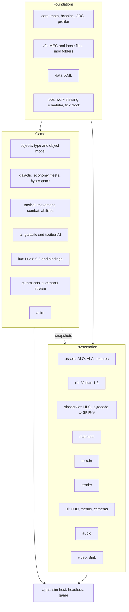

> **AI-assisted development.** This project is built with heavy use of AI coding agents (Anthropic's Claude, through
> Claude Code). Most of the engine code, tests, tools and documentation, including the behaviour specs in `docs/re/`,
> were written by AI agents working under the direction of the project's maintainer, who sets the goals, makes the
> design decisions, runs the in-game checks against the original game and decides what lands. Every change goes through
> the same build, test and determinism gates, but expect mistakes, and treat the specs as reconstructions rather than
> authoritative documentation of the original game.

<details>
<summary><b>Tools used in development</b></summary>

| Area | Tools |
|---|---|
| AI assistance | Claude Code (Anthropic): desktop app and CLI, parallel agent sessions in separate git worktrees, and computer use to drive the original game for in-game probe runs |
| Build | MSVC 14.51 and Windows SDK 10.0.28000 (project-local), CMake 4.4, Ninja 1.13, clang / LLVM 20.1.8 (check build and AddressSanitizer), sccache 0.19 (optional compiler cache), Python 3 (lint, build summaries, roadmap, parity harness, probe kits) |
| Graphics and shaders | Vulkan SDK 1.3.296 headers and validation layers, Vulkan Memory Allocator 3.3.0, DXC 1.8.2407 (HLSL to SPIR-V), fxc from the Windows SDK (compiling mod `.fx` sources) |
| Libraries in the engine | Lua 5.0.2 (vendored), miniaudio 0.11.25, FFmpeg 8.1.3's Bink decoder (built with MSYS2) |
| Reverse engineering (specs only, never engine code) | Ghidra 12.2 (headless decompiler export with project scripts), Python with pefile, Capstone and LIEF for static analysis, DXVK 3.1.1 and apitrace 14.0 for capturing the original's rendering, in-game probe mods and a debugger-based tracer for the running game |
| Version control | Git (MinGit 2.47, project-local), GitHub and the GitHub CLI |

</details>

# Empire at War: Vulkan

A clean-room C++20 rewrite of the *Star Wars: Empire at War: Forces of Corruption* engine (Petroglyph's "Alamo").
The simulation is rebuilt from scratch as a headless, multithreaded, deterministic core, with a Vulkan 1.3 renderer
on top. The goal is the game you already own, running on an engine that uses a modern PC.

**Windows (x64) only, single player only.** There is no multiplayer, no support for other platforms, and saves from the
original game cannot be loaded; all three are out of scope by design.

**Forks are welcome.** If you want something this project leaves out, such as multiplayer, another platform or a
feature of your own, you are more than welcome to fork it and add whatever features and systems you like. The code is
released into the public domain under [the Unlicense](LICENSE).

> **Status (2026-11-08):** active development, playable end to end through its own host, `alamo_game`.
> Simulation, renderer, Lua layer, AI, UI, story and save/load are in place, and **Thrawn's Revenge loads and plays**
> (its skirmish, land and campaign smoke runs pass and its galactic AI plays). A project-wide **clean-up pass** (CU1-CU18)
> has finished: dead code removed, shared helpers moved into `core`, a shared test-support library, and original
> behaviour that was ported but never called is now wired in. The work now is **parity** (a behavioural comparison
> harness against recorded runs of the original is built and has a baseline; the galactic AI's Rebel production is the
> biggest gap it shows), the **mod platform** (mod picker, load report, workshop resolver, shader model 3 and `.fx`
> compilation are in; a second mod has been loaded, skirmished and run with the galactic AI) and the last
> **performance** item (the first tick of a battle). The newest full builds (2026-11-08) pass with **0 warnings and
> 230 tests** on MSVC and on clang, and 61 under the sanitizer. Task tracking is the project roadmap, kept in its own
> repository and not in this one (881 of 976 roadmap tasks done, 117 of 143 groups); results and notes per phase are in
> [`docs/PHASE2.md`](docs/PHASE2.md), [`docs/PHASE3.md`](docs/PHASE3.md) and [`docs/PHASE4.md`](docs/PHASE4.md), and every
> document is indexed in [`docs/README.md`](docs/README.md).

This repository contains **no game assets and no original code**. You need your own copy of the game (Steam:
*Star Wars: Empire at War - Forces of Corruption*). Behaviour was recovered by studying the shipped binary and data
and written up as specs in [`docs/re/`](docs/re/) (109 documents) before any engine code was written.

**Contents:** [Goals](#goals) · [Features](#features) · [Performance](#performance) · [Architecture](#architecture) ·
[Quality](#quality-and-process) · [Where the project is](#where-the-project-is) · [Building](#building-and-running) ·
[Layout](#repository-layout) · [Legal](#legal)

---

## Goals

### Core goals

1. **Play the real game.** Base *Forces of Corruption* is the parity target: the same content, rules and feel.
   Parity is judged by **behaviour** (travel and build times, damage, income, AI choices, battle outcomes), not by
   matching the original's internal hashes.
2. **Keep the mods alive, without special-casing any of them.** *Thrawn's Revenge* is the first and hardest test,
   but compatibility is **mod-agnostic**: no engine code may depend on a mod's names or content. A mod works when it
   uses the same data mechanisms (XML, Lua, asset formats) as the original, which the engine reads unchanged.
3. **Use the whole PC.** The original runs simulation and rendering on one thread over Direct3D 9. This port spreads
   work over every core, keeps big AI and script updates off single ticks, and drives the GPU through Vulkan.
4. **Deterministic by design.** The same inputs give the same results on any number of threads, on any run, and on
   both supported compilers. That is what makes saves, replays, parallelism and debugging trustworthy.
5. **Quality-of-life the original never had.** Smooth motion at any refresh rate, modern anti-aliasing and ambient
   occlusion, pause on both levels, a free camera, order queues, and built-in profiling tools.

**Scope.** Windows x64 only, single player. Multiplayer, loading the original game's save files, non-Windows
platforms and RenderDoc support are deliberately out of scope.

### Side goals (not required for a playable game)

These are on the roadmap as separate lanes, each with a written plan and a recommended model/effort preset.

| Side goal | What it is | Roadmap |
|---|---|---|
| **Repeatable benchmark** | The same input every run (fixed saves, recorded orders, scripted camera) with per-tick CRCs proving each run matched; sim-only, real-time and fixed-frame modes; shared stress scenes and comparison reports. **BM1-BM3 are done**; the in-game benchmark screen (BM4) and the first quiet-machine baseline are open | BM1-BM4 |
| **First-person ground unit** | Possess a ground unit and play it in first person, Battlefront style. The sim side is a command in the stream, so it replays. Planned | FP1-FP3 |
| **Captain's view** | A bridge camera and holo-table for a capital ship, subsystem targeting, squadron orders and optional cinematic camera moves; presentation plus ordinary commands. Planned | CB1-CB4 |

Deferred on 2026-11-06 until the core game and the mod platform are complete: shader precompile, loading and build speed, CPU efficiency, GPU efficiency and graphics fidelity (`docs/DEFERRED_SIDE_GOALS.md`).

Dropped on purpose: AVX2 dispatch (the build stays on baseline SSE2), Tracy (the in-house profiler and overlay are
the tools), a compiled XML cache and Lua bytecode cache (never measured as a cost), original-save loading, and all
networking.

---

## Features

### Simulation and game rules
- Full object model: about 4,000 unit definitions with about 1,000 fields each, and the original behaviour set.
- **Galactic layer:** economy, production, fleets and hyperspace, planets and garrisons, fog of war, black market,
  sabotage, hacking, hero respawn, corruption (Underworld), special weapons.
- **Tactical layer:** land and space combat, formations, abilities, hardpoint destruction, garrisons and hangars,
  landing drops, weather, fog of war, construction pads, reinforcement, victory conditions.
- **Story campaigns** with the original event system (shared flags, prerequisites, perpetual events), **linked story
  battles** that start from a galactic event, and corruption missions.
- **Skirmish and galactic conquest**, including the original's Capture Control Points skirmish type, plus the
  main-menu attract battle (the shipped attract script runs as it does in the original).
- Behaviour comes from written specs ([`docs/re/`](docs/re/)): movement, combat, AI, fog of war, story, commands.

### AI and scripting
- The **original AI**, including its Lua plans and perception, runs on a vendored **Lua 5.0.2** with the original
  semantics.
- Galactic and tactical AI with the original goal, plan, task-force and learning systems.
- A full Lua binding layer for game objects, players, story, fog, presentation and scoring.

### Renderer (Vulkan 1.3)
- Vulkan 1.3 with synchronization2, bindless textures and a persistent on-disk pipeline cache.
- The original game's shaders are translated to SPIR-V by an in-house HLSL-bytecode translator plus DXC; **all 291
  shipped shaders translate**.
- Draw recording runs on the job system across all cores; draw lists are identical at any thread count.
- Terrain, water, decals, tracks, stencil shadows, fog of war, space backdrops, hardpoint destruction and a GPU
  particle system.
- Presentation-only options never feed the simulation, so turning them on or off cannot change a battle.

### Graphics and display options
- **Refresh-rate aware.** The sim ticks at 30 Hz; views interpolate between ticks, so motion is smooth at 60, 144 or
  240 Hz instead of stepping.
- **V-sync modes:** FIFO, Mailbox (low latency) or off, plus a frame-rate cap (display rate, or 30-240 fps) that works
  with V-sync on.
- **Temporal anti-aliasing:** Halton jitter, depth reprojection, per-object motion vectors from a velocity pass, depth-based
  disocclusion rejection and variance clipping, so movers do not smear.
- **Screen-space ambient occlusion** in land battles (half resolution, depth-aware blur).
- **Anisotropic filtering** up to 16x.
- **Auto Detect** in the Video dialogs picks a quality level from the GPU (device memory, discrete or integrated),
  with anisotropy clamped to what the device supports.
- **Frame-time overlay** (F11 in game, or `--frame-overlay`): the last 120 sim ticks and host frames against the
  16.7 ms and 33.3 ms lines, with the worst tick's biggest cost.

### Controls and camera
- **Pause** on both the galactic and tactical level, rebindable, and issued through the command stream so replays stay valid.
- **Adjustable field of view**, separate for the galactic and tactical cameras.
- **Free tactical camera:** full 360 degree rotation on all axes; W A S D moves by default.
- **Shift+click order queues:** line up attacks, moves and abilities; a plain click replaces the queue. Queued orders
  are ordinary commands, so they replay deterministically.

### Interface
- The original menus and HUD, drawn from the original dialog data, fonts and art.
- **Skirmish setup** that follows the original's staging rules: numbered start positions, colour combinations and clash
  rules, Land / Space game type with the last map remembered per type, map preview, and a map list that merges loose
  folders, MEG archives and **mod folders** (Official and Custom tabs).
- Fleet organiser (drag units between fleet slots, stacks with counts), tech-tree arrows, results and auto-resolve
  dialogs, story dialogs and subtitles, and the linked-battle banner and letterbox for story battles.

### Save and load
- The port's own compact format: a Forces of Corruption story save is about 50-60 KB, a mid-battle save about 150 KB.
- Galactic and **mid-battle** saves, save/load menus, and replay of recorded command streams.
- Saves include in-flight scheduled work (background AI jobs), so a loaded run continues tick-for-tick like the
  uninterrupted one. This is tested.

### Tooling
- `alamo_headless`: runs the whole simulation without a window, for tests, benchmarks and AI experiments.
- **Per-tick state checksums** with a per-system breakdown, recorded and compared across thread counts and compilers.
- A **tick profiler** (`--profile`): p50/p99/max per tick and per system, worker utilisation, the 20 worst ticks.
- **Benchmark tooling** (`tools/benchmark/`, scenarios in `tests/benchmark/`): versioned scenario files (save, recorded
  orders, scripted camera, expected per-tick CRC fingerprint). `alamo_headless --bench` times the sim alone,
  `alamo_game --bench-scenario` renders the same run in real-time or fixed-frame mode with GPU timers, and a run whose CRCs
  differ is flagged "not comparable" instead of reported as a speedup. Reports are JSON and can be compared.
- **Mod load report** (`alamo_mod_check`): for any mod folder or workshop id, lists loader diagnostics, missing files,
  unread XML tags, shader issues and scripts that error, with a machine-readable summary. The same summary is shown by
  the **mod picker** in the game's menus before a mod is launched. A lint step fails the gate on a mod or faction
  name written into engine code.
- **Visual regression** checks (screenshot diffs against stored baselines) and a scheduled nightly gate.
- Tools for the original formats: MEG archives, ALO/ALA models and animations, shaders.
- **Parity tooling** (`tools/probe_mod/`, index in [`docs/PROBES.md`](docs/PROBES.md)): a read-only external recorder that
  samples the original game's state per tick, in-game probe mods for questions the binary alone cannot answer, and a
  compare script that runs the port on the same scenario and reports the first divergence per metric.
- **Parity harness** (`tools/parity/`): replays recorded scenarios of the original in the port and grades travel and build
  timings, income, AI choices, damage and battle outcomes against tolerances taken from several retail runs; the result is
  kept as a baseline that is re-recorded, like a golden, when an intended behaviour change moves a metric.

---

## Performance

The simulation runs on a work-stealing job system with order-stable results (parallel jobs write per-index outputs and reduce in index order), the AI players' clocks are staggered, long AI work runs as fixed-latency background jobs, Lua garbage collection is scheduled by tick number, and the renderer records on several threads. Everything is scheduled **by tick number, never by wall clock or thread timing**, so results are bit-identical for any worker count. The measurements (AMD Ryzen 7 7800X3D, one tick = 33.3 ms), what each fix bought, what was tried and not shipped, and the caveats are in [`docs/PERFORMANCE.md`](docs/PERFORMANCE.md). The budget is p99 under 16.7 ms and no tick over 33.3 ms: p99 is met in every measured scenario, and the one miss is the setup tick that starts a battle (see "Where the project is" below).

---

## Architecture



- **One static library per module**, each with its own test executable.
- **The sim never reads presentation state.** The renderer and UI consume snapshots of the sim, interpolated between ticks.
  Anything the player can toggle in Video options is therefore unable to change a battle.
- **Everything the player does is a command** in a stream (orders, pause, queued orders, retreat). The stream plus the
  initial state fully determines a run, which is what makes replays, saves and the CRC checks work.
- **`alamo_headless`** runs the same sim without a window. Tests, benchmarks and AI experiments use it, and it is the
  reference for determinism.

### The determinism contract
Results read by game logic must be bit-identical across thread counts, runs, and the MSVC and clang builds:
- Parallel jobs write **per-index outputs**; reductions run **in index order**.
- No FMA contraction (`/fp:precise`, `-ffp-contract=off`).
- No iteration over pointer-keyed or seeded-hash containers in sim code.
- Scheduling decisions (AI stagger, background-job latency, GC timing) depend on **tick numbers only**.
- Timing data is write-only: no sim code branches on a profiler value.

It is checked by recording a per-tick CRC (with a per-system breakdown) and comparing logs across **0, 1, 4, 16 and
(hardware threads - 1) workers**, naming the first diverging tick and system. Long battles run one ctest entry per
worker count so the counts run side by side. Clang's logs equal MSVC's.

---

## Quality and process

- **Two compilers in the loop.** MSVC ships; clang 20 checks (extra warnings: `-Wconversion -Wshadow`) and provides a
  second compiler for determinism. Sim changes get both; threading changes also run under a clang sanitizer.
- **Zero warnings** at MSVC `/W4 /permissive-` and clang `-Wall -Wextra -Wpedantic -Wconversion -Wshadow`.
- **230 tests** in the newest full builds (2026-11-08), on each of MSVC and clang (sanitizer build: 61 sim-module
  tests), plus golden-file checks of whole battles and campaigns, each compared across worker counts. Goldens store a
  checkpoint every 64 ticks, so a behaviour change is a small diff. The full suite takes about 4 minutes on the
  development PC; slow tests carry a label so quick iteration can skip them.
- **Pre-merge gate** (`build_gate.cmd`): MSVC, clang and sanitizer builds, each recorded on the roadmap. A nightly
  scheduled gate can run on the development PC.
- **Parity is checked against the real game.** Reference traces recorded from the original (credits, owners, production,
  RNG draws per tick) and in-game probe runs settle questions the binary leaves open; each answer is written into the
  matching spec in `docs/re/` before the engine follows it.
- **Parallel agent workflow.** Work is split by roadmap group across agent sessions, each in its own git worktree, with
  claims so two sessions do not take the same group. **`dev` is the development branch** (GitHub's default); sessions land
  on it directly, and `main` is the released branch, updated from `dev` by a release pull request once the full gate
  passes (the current release pull request is open, waiting on a clean gate run). The roadmap lives in its own repository
  so every session shares one copy.
- **Clean-room.** Engine code is written from the specs in `docs/re/`, never from decompiled output, which is kept out of
  the engine tree.
- **Project-local toolchain.** MSVC 14.51, Windows SDK, CMake, Ninja, DXC, LLVM and FFmpeg's Bink decoder live under
  `toolchain\` with pinned versions and hashes. Nothing is installed system-wide.
- **Third-party code** in `engine/` is limited to approved dependencies: Vulkan-Headers, DXC, VMA, Lua 5.0.2 (vendored,
  original semantics), miniaudio and FFmpeg's Bink decoder (LGPL, dynamically linked).
- About **387,000 lines** of C++ in `engine/` (tests included), across 21 modules plus a shared test-support library.

---

## Where the project is

| Area | State |
|---|---|
| Simulation, renderer, Lua, AI, UI, save/load, story | **Done and playable**; remaining work is parity polish |
| Clean-up and production audit (CU1-CU18, PA) | **Done** (2026-11-08): dead code and bring-up guards removed, shared core and test helpers, each XML file read once, save helpers unified, ported-but-unwired original behaviour wired in (sabers, formations, bombing runs, income fields). Left: a few unwired sites (Saber_Throw as a real projectile, fleet placement at a campaign space start) and the skirmish bombing-run records |
| Performance (OPT1-OPT3) | **Mostly done**: p99 budget met everywhere. The first tick of a battle (setup) is still over 33.3 ms. OPT3 t12 took about a fifth off the land skirmish's first tick (to 123-152 ms on a loaded PC) and fixed a mid-battle space spike; the land campaign (about 55 ms) and space (about 42 ms) first ticks did not move. The rest (building plan Lua VMs before the battle tick, warming the remaining models, serial setup) is group OPT3f |
| Movement and combat parity | Ongoing, driven by in-game probes of the original (fighter formations, targeting, landing and unload facings, team speed and hand-over). Judged by behaviour within tolerance; tasks that only chase bit-exact agreement were dropped on 2026-11-06 |
| Parity check against the original (Q4) | **Harness built** (`tools/parity/`) and a baseline recorded against several retail runs: in the Heart of the Maw galactic scenario battle outcomes all pass and most timing and income metrics pass. Open: the Rebel AI's production (it builds 9 Y-wings for the Shola attack where the original builds 3, and few infantry squads afterwards), the Nal Hutta - Kashyyyk hyperspace lane, which the port flies slower than the original, and the Geonosis skirmish, which still fails most AI and outcome metrics (the port's Rebel AI builds early and attacks about a minute early). The final Q4 run follows once these land |
| Galactic AI parity (Q2 follow-ups, A2) | Ongoing: budget, goal, contrast, story-load and task-force rules follow the original; the Rebel production gap above is diagnosed and next; Underworld credits after the latest AI ports are being bisected |
| Story campaigns end to end | Event system, linked tactical battles, victory handling and corruption missions in; one comparison against a recorded original mission remains |
| Mod diagnostics (Q5) | Done |
| Thrawn's Revenge (Q6) | **Plays** (merged 2026-11-06): the mod loads with no loader diagnostics, its skirmish, land and campaign smoke runs pass, and its galactic AI plays. Left: Gabriel's retail probes for a few guessed rules, and a final re-check after the parity check |
| Mod platform (MODC) | **Mostly done** (24 of 34 tasks): the loading contract (`docs/MODS.md`), an audit and lint for mod and faction names in engine code (base-game names removed from sim and presentation code), the mod load report, a `STEAMMOD=` resolver, a mod picker in the game UI, shader model 3 translation, compiling mod `.fx` sources, and a synthetic fixture mod in the tests are in; a second workshop mod loads, starts a skirmish and runs a galactic-AI session. Left: Gabriel playing a second mod in game, the game's front end with mods other than Thrawn's Revenge, shader model 3 leftovers, an automatic `.fx` prebuild, and load-report and picker polish |
| Benchmark (side goal) | BM1-BM3 and their follow-ups done (scenarios, sim-only and rendered runs, stress scenes, reports); the in-game screen (BM4) is open |
| First-person and captain's view (side goals) | Planned |

The detail, task by task, is on the project roadmap, which is kept in its own repository (not this one) and is the only place for status.

---

## Building and running

Everything is built with a project-local toolchain under `toolchain\` (MSVC, Windows SDK, CMake, Ninja, DXC, LLVM). The
toolchain, the game data and the roadmap are **not stored in this repository**: the toolchain is rebuilt by the
`toolchain\*.cmd` setup scripts on the development PC, and the full build and test rules are in
[`docs/BUILD.md`](docs/BUILD.md).

```bat
build_msvc.cmd        :: configure, build and run all tests with MSVC
build_clang.cmd       :: the clang 20 check build
build_asan.cmd        :: sanitizer build of the sim modules
build_gate.cmd        :: MSVC + clang + sanitizer gate used before merging
build_module.cmd      :: build and test one module (or a ;-separated list)
build_agent.cmd       :: fast tier of tests only, for quick iteration
bench_msvc.cmd        :: re-run the profiler scenarios
```

Data-driven tests read `ALAMO_FOC_DATA` and `ALAMO_EAW_DATA` (folders containing `Data\XML`). The build scripts default
them to a Steam install when it exists; tests print a skip message when the data is missing, and each build script ends
with a skip count so a pass without data is visible.

Useful entry points (executables are in `build-msvc\bin`):

```bat
alamo_game.exe                      :: the game
alamo_game.exe --frame-overlay      :: with the frame-time overlay (F11 toggles it)
alamo_game.exe --profile            :: per-phase frame table at exit
alamo_headless.exe --profile --economy --galactic-ai --ticks 18000   :: tick profile of a full galactic run
alamo_headless.exe --skirmish-ai foc-land --ticks 3000 --workers 0 --crc-out run.crc   :: record a serial CRC log
alamo_render.exe                    :: renderer test app
```

## Repository layout

| Path | What |
|---|---|
| `engine/` | The engine, one static library per module: `core`, `vfs`, `data`, `jobs`, `galactic`, `assets`, `rhi`, `materials`, `shaderxlat`, `terrain`, `render`, `objects`, `tactical`, `ai`, `lua`, `anim`, `commands`, `audio`, `video`, `ui`, `apps`, plus `test_support` (shared test helpers) |
| `tools/` | MEG archive tool, format readers, shader tools, in-game probe kits and trace recorder (`probe_mod/`), benchmark runner (`benchmark/`), golden regeneration, worktree and landing scripts, analysis scripts, the parity harness (`parity/`), visual diff, lint and build-summary scripts |
| `docs/` | All documentation, indexed in [`docs/README.md`](docs/README.md): decisions, build and test, performance, probes, phase results, behaviour specs recovered from the original (`docs/re/`), asset, format and shader specs |
| `tests/` | Screenshot baselines for visual regression (`visual_baselines/`) and benchmark scenarios (`benchmark/`) |
| `CLAUDE.md` | Working rules for contributors and agents |

Not tracked here, by design: `toolchain/` (rebuilt locally), `Data/` and `extracted/` (game data from your own install),
`re_reference/` (decompiled output, kept out of the engine tree), build trees and logs, and `roadmap-store/`, which is the
project roadmap and flowchart in its own repository (the only place for status).

Good starting points: [`docs/README.md`](docs/README.md) (index of every document), [`docs/PERFORMANCE.md`](docs/PERFORMANCE.md) for every performance measurement (status is on the roadmap),
[`docs/OPT_RESEARCH.md`](docs/OPT_RESEARCH.md) for the optimisation techniques considered,
[`docs/re/`](docs/re/) for how the original behaves.

## Legal
*Star Wars* and *Empire at War* are trademarks of their respective owners. This is an unofficial fan project, not
affiliated with or endorsed by Lucasfilm, Disney, Petroglyph or any other rights holder. You must own a legitimate copy
of the game to use it. This repository contains no game assets and no original code.

The project's own code and documentation are released into the public domain under [the Unlicense](LICENSE). This does
not cover the game, its assets or its trademarks. Third-party libraries keep their own licenses: Lua 5.0.2 (MIT), miniaudio (public
domain or MIT No Attribution), Vulkan Memory Allocator (MIT), Vulkan-Headers (Apache 2.0 or MIT), DXC (LLVM Release License and
MIT; the prebuilt `dxil.dll` is under Microsoft's own license terms) and FFmpeg's Bink decoder (LGPL 2.1 or later, loaded as separate DLLs that ship with their license text).
