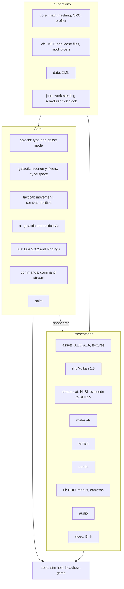

# Empire at War: Vulkan

A clean-room C++20 rewrite of the *Star Wars: Empire at War: Forces of Corruption* engine (Petroglyph's "Alamo").
The simulation is rebuilt from scratch as a headless, multithreaded, deterministic core, with a Vulkan 1.3 renderer
on top. The goal is the game you already own, running on an engine that uses a modern PC.

> **Status (2026-11-06):** active development, playable end to end through its own host, `alamo_game`.
> Simulation, renderer, Lua layer, AI, UI, story and save/load are in place. The work now is **parity** (checking
> behaviour against the original, mostly by recording the original game and probing it in game), **mod compatibility**
> (Thrawn's Revenge is the first target; that work is finished on an integration branch and not yet merged here) and
> **performance**. The last full gate (MSVC, clang, sanitizer, 2026-11-06) passed with **0 warnings and 170 tests** on
> each compiler (54 under the sanitizer). Task tracking is the project roadmap, kept in its own repository and not in this
> one (543 of 779 roadmap tasks done); results and notes per phase are in [`docs/PHASE2.md`](docs/PHASE2.md),
> [`docs/PHASE3.md`](docs/PHASE3.md) and [`docs/PHASE4.md`](docs/PHASE4.md), and every document is indexed in
> [`docs/README.md`](docs/README.md).

This repository contains **no game assets and no original code**. You need your own copy of the game (Steam:
*Star Wars: Empire at War - Forces of Corruption*). Behaviour was recovered by studying the shipped binary and data
and written up as specs in [`docs/re/`](docs/re/) (68 documents) before any engine code was written.

**Contents:** [Goals](#goals) · [Features](#features) · [Performance](#performance) · [Architecture](#architecture) ·
[Quality](#quality-and-process) · [Where the project is](#where-the-project-is) · [Building](#building-and-running) ·
[Layout](#repository-layout) · [Legal](#legal)

---

## Goals

### Core goals

1. **Play the real game.** Base *Forces of Corruption* is the parity target: the same content, rules and feel.
   Parity is judged by **behaviour** (travel and build times, damage, income, AI choices, battle outcomes), not by
   matching the original's internal hashes.
2. **Keep the mods alive, without special-casing any of them.** *Thrawn's Revenge* is the first and hardest test,
   but compatibility is **mod-agnostic**: no engine code may depend on a mod's names or content. A mod works when it
   uses the same data mechanisms (XML, Lua, asset formats) as the original, which the engine reads unchanged.
3. **Use the whole PC.** The original runs simulation and rendering on one thread over Direct3D 9. This port spreads
   work over every core, keeps big AI and script updates off single ticks, and drives the GPU through Vulkan.
4. **Deterministic by design.** The same inputs give the same results on any number of threads, on any run, and on
   both supported compilers. That is what makes saves, replays, parallelism and debugging trustworthy.
5. **Quality-of-life the original never had.** Smooth motion at any refresh rate, modern anti-aliasing and ambient
   occlusion, pause on both levels, a free camera, order queues, and built-in profiling tools.

**Scope.** Windows x64 only, single player. Multiplayer, loading the original game's save files, non-Windows
platforms and RenderDoc support are deliberately out of scope.

### Side goals (planned, not required for a playable game)

These are on the roadmap as separate lanes, each with a written plan and a recommended model/effort preset.

| Side goal | What it is | Roadmap |
|---|---|---|
| **Repeatable benchmark** | The same input every run (fixed saves, recorded orders, scripted camera) with per-tick CRCs proving each run matched; sim-only, real-time and fixed-frame modes; shared stress scenes and an in-game screen | BM1-BM4 |
| **CPU efficiency** | CPU-aware job system, scratch-arena rollout, parallel AI goal scoring, prefetch in hot loops, a check banning C runtime math in sim code | CP1-CP4, CP6 |
| **GPU efficiency** | A GPU stress benchmark first, then half-resolution particles and cheaper water reflections if the numbers justify them | GP1-GP3 |
| **First-launch shader precompile** | Compile every shader and pipeline the game can need behind a loading screen, so a fresh install or new driver never starts cold | SP1-SP6 |
| **Loading and build speed** | Per-map asset preload, LTO and PGO release builds, and a performance regression gate | LP1, LP4, LP5 |
| **Graphics fidelity** | HDR tonemapping, render scale and shadow maps, each a Video option the player can turn off | FX1 |
| **First-person ground unit** | Possess a ground unit and play it in first person, Battlefront style. The sim side is a command in the stream, so it replays | FP1-FP3 |
| **Captain's view** | A bridge camera and holo-table for a capital ship, subsystem targeting, squadron orders and optional cinematic camera moves; presentation plus ordinary commands | CB1-CB4 |

Dropped on purpose: AVX2 dispatch (the build stays on baseline SSE2), Tracy (the in-house profiler and overlay are
the tools), a compiled XML cache and Lua bytecode cache (never measured as a cost), original-save loading, and all
networking.

---

## Features

### Simulation and game rules
- Full object model: about 4,000 unit definitions with about 1,000 fields each, and the original behaviour set.
- **Galactic layer:** economy, production, fleets and hyperspace, planets and garrisons, fog of war, black market,
  sabotage, hacking, hero respawn, corruption (Underworld), special weapons.
- **Tactical layer:** land and space combat, formations, abilities, hardpoint destruction, garrisons and hangars,
  landing drops, weather, fog of war, construction pads, reinforcement, victory conditions.
- **Story campaigns** with the original event system (shared flags, prerequisites, perpetual events), **linked story
  battles** that start from a galactic event, and corruption missions.
- **Skirmish and galactic conquest**, plus the main-menu attract battle.
- Behaviour comes from written specs ([`docs/re/`](docs/re/)): movement, combat, AI, fog of war, story, commands.

### AI and scripting
- The **original AI**, including its Lua plans and perception, runs on a vendored **Lua 5.0.2** with the original
  semantics.
- Galactic and tactical AI with the original goal, plan, task-force and learning systems.
- A full Lua binding layer for game objects, players, story, fog, presentation and scoring.

### Renderer (Vulkan 1.3)
- Vulkan 1.3 with synchronization2, bindless textures and a persistent on-disk pipeline cache.
- The original game's shaders are translated to SPIR-V by an in-house HLSL-bytecode translator plus DXC; **all 291
  shipped shaders translate**.
- Draw recording runs on the job system across all cores; draw lists are identical at any thread count.
- Terrain, water, decals, tracks, stencil shadows, fog of war, space backdrops, hardpoint destruction and a GPU
  particle system.
- Presentation-only options never feed the simulation, so turning them on or off cannot change a battle.

### Graphics and display options
- **Refresh-rate aware.** The sim ticks at 30 Hz; views interpolate between ticks, so motion is smooth at 60, 144 or
  240 Hz instead of stepping.
- **V-sync modes:** FIFO, Mailbox (low latency) or off, plus a frame-rate cap (display rate, or 30-240 fps) that works
  with V-sync on.
- **Temporal anti-aliasing:** Halton jitter, depth reprojection, per-object motion vectors from a velocity pass, depth-based
  disocclusion rejection and variance clipping, so movers do not smear.
- **Screen-space ambient occlusion** in land battles (half resolution, depth-aware blur).
- **Anisotropic filtering** up to 16x.
- **Auto Detect** in the Video dialogs picks a quality level from the GPU (device memory, discrete or integrated),
  with anisotropy clamped to what the device supports.
- **Frame-time overlay** (F11 in game, or `--frame-overlay`): the last 120 sim ticks and host frames against the
  16.7 ms and 33.3 ms lines, with the worst tick's biggest cost.

### Controls and camera
- **Pause** on both the galactic and tactical level, rebindable, and issued through the command stream so replays stay valid.
- **Adjustable field of view**, separate for the galactic and tactical cameras.
- **Free tactical camera:** full 360 degree rotation on all axes; W A S D moves by default.
- **Shift+click order queues:** line up attacks, moves and abilities; a plain click replaces the queue. Queued orders
  are ordinary commands, so they replay deterministically.

### Interface
- The original menus and HUD, drawn from the original dialog data, fonts and art.
- **Skirmish setup** that follows the original's staging rules: numbered start positions, colour combinations and clash
  rules, Land / Space game type with the last map remembered per type, map preview, and a map list that merges loose
  folders, MEG archives and **mod folders** (Official and Custom tabs).
- Fleet organiser (drag units between fleet slots, stacks with counts), tech-tree arrows, results and auto-resolve
  dialogs, story dialogs and subtitles, and the linked-battle banner and letterbox for story battles.

### Save and load
- The port's own compact format: a Forces of Corruption story save is about 50-60 KB, a mid-battle save about 150 KB.
- Galactic and **mid-battle** saves, save/load menus, and replay of recorded command streams.
- Saves include in-flight scheduled work (background AI jobs), so a loaded run continues tick-for-tick like the
  uninterrupted one. This is tested.

### Tooling
- `alamo_headless`: runs the whole simulation without a window, for tests, benchmarks and AI experiments.
- **Per-tick state checksums** with a per-system breakdown, recorded and compared across thread counts and compilers.
- A **tick profiler** (`--profile`): p50/p99/max per tick and per system, worker utilisation, the 20 worst ticks.
- **Visual regression** checks (screenshot diffs against stored baselines) and a scheduled nightly gate.
- Tools for the original formats: MEG archives, ALO/ALA models and animations, shaders.
- **Parity tooling** (`tools/probe_mod/`, index in [`docs/PROBES.md`](docs/PROBES.md)): a read-only external recorder that
  samples the original game's state per tick, in-game probe mods for questions the binary alone cannot answer, and a
  compare script that runs the port on the same scenario and reports the first divergence per metric.

---

## Performance

The simulation runs on a work-stealing job system with order-stable results (parallel jobs write per-index outputs and reduce in index order), the AI players' clocks are staggered, long AI work runs as fixed-latency background jobs, Lua garbage collection is scheduled by tick number, and the renderer records on several threads. Everything is scheduled **by tick number, never by wall clock or thread timing**, so results are bit-identical for any worker count. The measurements (AMD Ryzen 7 7800X3D, one tick = 33.3 ms), what each fix bought, what was tried and not shipped, and the caveats are in [`docs/PERFORMANCE.md`](docs/PERFORMANCE.md). The budget is p99 under 16.7 ms and no tick over 33.3 ms: p99 is met in every measured scenario, and the one miss is the setup tick that starts a battle (see "Where the project is" below).

---

## Architecture



- **One static library per module**, each with its own test executable.
- **The sim never reads presentation state.** The renderer and UI consume snapshots of the sim, interpolated between ticks.
  Anything the player can toggle in Video options is therefore unable to change a battle.
- **Everything the player does is a command** in a stream (orders, pause, queued orders, retreat). The stream plus the
  initial state fully determines a run, which is what makes replays, saves and the CRC checks work.
- **`alamo_headless`** runs the same sim without a window. Tests, benchmarks and AI experiments use it, and it is the
  reference for determinism.

### The determinism contract
Results read by game logic must be bit-identical across thread counts, runs, and the MSVC and clang builds:
- Parallel jobs write **per-index outputs**; reductions run **in index order**.
- No FMA contraction (`/fp:precise`, `-ffp-contract=off`).
- No iteration over pointer-keyed or seeded-hash containers in sim code.
- Scheduling decisions (AI stagger, background-job latency, GC timing) depend on **tick numbers only**.
- Timing data is write-only: no sim code branches on a profiler value.

It is checked by recording a per-tick CRC (with a per-system breakdown) and comparing logs across **0, 1, 4, 16 and
(hardware threads - 1) workers**, naming the first diverging tick and system. Long battles run one ctest entry per
worker count so the counts run side by side. Clang's logs equal MSVC's.

---

## Quality and process

- **Two compilers in the loop.** MSVC ships; clang 20 checks (extra warnings: `-Wconversion -Wshadow`) and provides a
  second compiler for determinism. Sim changes get both; threading changes also run under a clang sanitizer.
- **Zero warnings** at MSVC `/W4 /permissive-` and clang `-Wall -Wextra -Wpedantic -Wconversion -Wshadow`.
- **170 tests** in the last full gate (2026-11-06), on each of MSVC and clang (sanitizer build: 54 sim-module tests),
  plus golden-file checks of whole battles and campaigns, each compared across worker counts. The full suite takes about
  2 minutes on the development PC; slow tests carry a label so quick iteration can skip them.
- **Pre-merge gate** (`build_gate.cmd`): MSVC, clang and sanitizer builds, each recorded on the roadmap. A nightly
  scheduled gate can run on the development PC.
- **Parity is checked against the real game.** Reference traces recorded from the original (credits, owners, production,
  RNG draws per tick) and in-game probe runs settle questions the binary leaves open; each answer is written into the
  matching spec in `docs/re/` before the engine follows it.
- **Parallel agent workflow.** Work is split by module across agent sessions, each in its own git worktree and branch and
  merged by pull request; the roadmap lives in its own repository so every session shares one copy.
- **Clean-room.** Engine code is written from the specs in `docs/re/`, never from decompiled output, which is kept out of
  the engine tree.
- **Project-local toolchain.** MSVC 14.51, Windows SDK, CMake, Ninja, DXC, LLVM and FFmpeg's Bink decoder live under
  `toolchain\` with pinned versions and hashes. Nothing is installed system-wide.
- **Third-party code** in `engine/` is limited to approved dependencies: Vulkan-Headers, DXC, VMA, Lua 5.0.2 (vendored,
  original semantics), miniaudio and FFmpeg's Bink decoder (LGPL, dynamically linked).
- About **360,000 lines** of C++ in `engine/` (tests included), across 21 modules.

---

## Where the project is

| Area | State |
|---|---|
| Simulation, renderer, Lua, AI, UI, save/load, story | **Done and playable**; remaining work is parity polish |
| Performance (OPT1-OPT3) | **Mostly done**: p99 budget met everywhere. The first tick of a battle (setup) is still over 33.3 ms: land campaign 55, space 42, land skirmish 139 ms at 15 workers; a plan to shorten it is open |
| Movement and combat parity | Ongoing, driven by in-game probes of the original: fighter formations, targeting, landing and unload facings, team speed and hand-over, idle animation draws. Corner cases and a few stand-in constants remain |
| Galactic AI parity (Q2 follow-ups, A2) | Ongoing: the AI's budget, goal, contrast and story-load rules now follow the original (in the Heart of the Maw scenario the Empire AI now captures a planet, as the original does); the Rebel and Empire opening production and the RNG draw count on tick 1 (84 of 130) still differ |
| Story campaigns end to end | Event system, linked tactical battles, victory handling and corruption missions in; one comparison against a recorded original mission remains |
| Mod diagnostics (Q5) | Done, on the integration branch |
| Thrawn's Revenge (Q6) | **Mostly done on the integration branch** `claude/q6-integration` (about 94 commits ahead of `main`, not yet merged): the mod loads, its skirmish, land and campaign smoke runs pass, and its galactic AI plays. Left: retail probes for the port's guessed rules, and a final re-check after the parity check |
| Parity check against the original (Q4) | Planned; the comparison harness comes first |
| Side goals (benchmark, CPU/GPU efficiency, shader precompile, fidelity, first-person, captain's view) | Planned |

The detail, task by task, is on the project roadmap, which is kept in its own repository (not this one) and is the only place for status.

---

## Building and running

Everything is built with a project-local toolchain under `toolchain\` (MSVC, Windows SDK, CMake, Ninja, DXC, LLVM). The
toolchain, the game data and the roadmap are **not stored in this repository**: the toolchain is rebuilt by the
`toolchain\*.cmd` setup scripts on the development PC, and the full build and test rules are in
[`docs/BUILD.md`](docs/BUILD.md).

```bat
build_msvc.cmd        :: configure, build and run all tests with MSVC
build_clang.cmd       :: the clang 20 check build
build_asan.cmd        :: sanitizer build of the sim modules
build_gate.cmd        :: MSVC + clang + sanitizer gate used before merging
build_module.cmd      :: build and test one module (or a ;-separated list)
build_agent.cmd       :: fast tier of tests only, for quick iteration
bench_msvc.cmd        :: re-run the profiler scenarios
```

Data-driven tests read `ALAMO_FOC_DATA` and `ALAMO_EAW_DATA` (folders containing `Data\XML`). The build scripts default
them to a Steam install when it exists; tests print a skip message when the data is missing, and each build script ends
with a skip count so a pass without data is visible.

Useful entry points (executables are in `build-msvc\bin`):

```bat
alamo_game.exe                      :: the game
alamo_game.exe --frame-overlay      :: with the frame-time overlay (F11 toggles it)
alamo_game.exe --profile            :: per-phase frame table at exit
alamo_headless.exe --profile --economy --galactic-ai --ticks 18000   :: tick profile of a full galactic run
alamo_headless.exe --skirmish-ai foc-land --ticks 3000 --workers 0 --crc-out run.crc   :: record a serial CRC log
alamo_render.exe                    :: renderer test app
```

## Repository layout

| Path | What |
|---|---|
| `engine/` | The engine, one static library per module: `core`, `vfs`, `data`, `jobs`, `galactic`, `assets`, `rhi`, `materials`, `shaderxlat`, `terrain`, `render`, `objects`, `tactical`, `ai`, `lua`, `anim`, `commands`, `audio`, `video`, `ui`, `apps` |
| `tools/` | MEG archive tool, format readers, shader tools, in-game probe kits and trace recorder (`probe_mod/`), analysis and parity-compare scripts, visual diff, lint and build-summary scripts |
| `docs/` | All documentation, indexed in [`docs/README.md`](docs/README.md): decisions, build and test, performance, probes, phase results, behaviour specs recovered from the original (`docs/re/`), asset, format and shader specs |
| `tests/visual_baselines/` | Screenshot baselines for visual regression |
| `CLAUDE.md` | Working rules for contributors and agents |

Not tracked here, by design: `toolchain/` (rebuilt locally), `Data/` and `extracted/` (game data from your own install),
`re_reference/` (decompiled output, kept out of the engine tree), build trees and logs, and `roadmap-store/`, which is the
project roadmap and flowchart in its own repository (the only place for status).

Good starting points: [`docs/README.md`](docs/README.md) (index of every document), [`docs/PERFORMANCE.md`](docs/PERFORMANCE.md) for every performance measurement (status is on the roadmap),
[`docs/OPT_RESEARCH.md`](docs/OPT_RESEARCH.md) for the optimisation techniques considered,
[`docs/re/`](docs/re/) for how the original behaves.

## Legal
*Star Wars* and *Empire at War* are trademarks of their respective owners. This is an unofficial fan project, not
affiliated with or endorsed by Lucasfilm, Disney, Petroglyph or any other rights holder. You must own a legitimate copy
of the game to use it. This repository contains no game assets and no original code.
