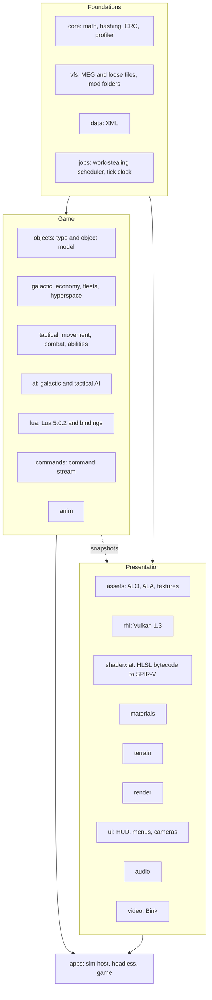

# Empire at War: Vulkan

A clean-room C++20 rewrite of the *Star Wars: Empire at War: Forces of Corruption* engine (Petroglyph's "Alamo").
The simulation is rebuilt from scratch as a headless, multithreaded, deterministic core, with a Vulkan 1.3 renderer
on top. The goal is the game you already own, running on an engine that uses a modern PC.

> **Status (2026-11-03):** active development, playable end to end through its own host, `alamo_game`.
> Simulation, renderer, Lua layer, AI, UI, story and save/load are in place. The work now is **parity** (checking
> behaviour against the original), **mod compatibility** (Thrawn's Revenge is the first target) and **performance**.
> The last full gate (MSVC, clang, sanitizer) passed with **0 warnings and 170 tests** on each compiler.
> The live plan and all status tracking is the project roadmap, `roadmap-store/ROADMAP.html`; results and notes per phase are in [`docs/PHASE2.md`](docs/PHASE2.md),
> [`docs/PHASE3.md`](docs/PHASE3.md) and [`docs/PHASE4.md`](docs/PHASE4.md).

This repository contains **no game assets and no original code**. You need your own copy of the game (Steam:
*Star Wars: Empire at War - Forces of Corruption*). Behaviour was recovered by studying the shipped binary and data
and written up as specs in [`docs/re/`](docs/re/) (73 documents) before any engine code was written.

**Contents:** [Goals](#goals) · [Features](#features) · [Performance](#performance) · [Architecture](#architecture) ·
[Quality](#quality-and-process) · [Where the project is](#where-the-project-is) · [Building](#building-and-running) ·
[Layout](#repository-layout) · [Legal](#legal)

---

## Goals

### Core goals

1. **Play the real game.** Base *Forces of Corruption* is the parity target: the same content, rules and feel.
   Parity is judged by **behaviour** (travel and build times, damage, income, AI choices, battle outcomes), not by
   matching the original's internal hashes.
2. **Keep the mods alive, without special-casing any of them.** *Thrawn's Revenge* is the first and hardest test,
   but compatibility is **mod-agnostic**: no engine code may depend on a mod's names or content. A mod works when it
   uses the same data mechanisms (XML, Lua, asset formats) as the original, which the engine reads unchanged.
3. **Use the whole PC.** The original runs simulation and rendering on one thread over Direct3D 9. This port spreads
   work over every core, keeps big AI and script updates off single ticks, and drives the GPU through Vulkan.
4. **Deterministic by design.** The same inputs give the same results on any number of threads, on any run, and on
   both supported compilers. That is what makes saves, replays, parallelism and debugging trustworthy.
5. **Quality-of-life the original never had.** Smooth motion at any refresh rate, modern anti-aliasing and ambient
   occlusion, pause on both levels, a free camera, order queues, and built-in profiling tools.

**Scope.** Windows x64 only, single player. Multiplayer, loading the original game's save files, non-Windows
platforms and RenderDoc support are deliberately out of scope.

### Side goals (planned, not required for a playable game)

These are on the roadmap as separate lanes, each with a written plan and a recommended model/effort preset.

| Side goal | What it is | Roadmap |
|---|---|---|
| **Repeatable benchmark** | The same input every run (fixed saves, recorded orders, scripted camera) with per-tick CRCs proving each run matched; sim-only, real-time and fixed-frame modes; shared stress scenes and an in-game screen | BM1-BM4 |
| **CPU efficiency** | CPU-aware job system, scratch-arena rollout, parallel AI goal scoring, prefetch in hot loops, a check banning C runtime math in sim code | CP1-CP4, CP6 |
| **GPU efficiency** | A GPU stress benchmark first, then half-resolution particles and cheaper water reflections if the numbers justify them | GP1-GP3 |
| **First-launch shader precompile** | Compile every shader and pipeline the game can need behind a loading screen, so a fresh install or new driver never starts cold | SP1-SP6 |
| **Loading and build speed** | Per-map asset preload, LTO and PGO release builds, and a performance regression gate | LP1, LP4, LP5 |
| **Graphics fidelity** | HDR tonemapping, render scale and shadow maps, each a Video option the player can turn off | FX1 |
| **First-person ground unit** | Possess a ground unit and play it in first person, Battlefront style. The sim side is a command in the stream, so it replays | FP1-FP3 |
| **Captain's view** | A bridge camera and holo-table for a capital ship, subsystem targeting, squadron orders and optional cinematic camera moves; presentation plus ordinary commands | CB1-CB4 |

Dropped on purpose: AVX2 dispatch (the build stays on baseline SSE2), Tracy (the in-house profiler and overlay are
the tools), a compiled XML cache and Lua bytecode cache (never measured as a cost), original-save loading, and all
networking.

---

## Features

### Simulation and game rules
- Full object model: about 4,000 unit definitions with about 1,000 fields each, and the original behaviour set.
- **Galactic layer:** economy, production, fleets and hyperspace, planets and garrisons, fog of war, black market,
  sabotage, hacking, hero respawn, corruption (Underworld), special weapons.
- **Tactical layer:** land and space combat, formations, abilities, hardpoint destruction, garrisons and hangars,
  landing drops, weather, fog of war, construction pads, reinforcement, victory conditions.
- **Story campaigns** with the original event system (shared flags, prerequisites, perpetual events), **linked story
  battles** that start from a galactic event, and corruption missions.
- **Skirmish and galactic conquest**, plus the main-menu attract battle.
- Behaviour comes from written specs ([`docs/re/`](docs/re/)): movement, combat, AI, fog of war, story, commands.

### AI and scripting
- The **original AI**, including its Lua plans and perception, runs on a vendored **Lua 5.0.2** with the original
  semantics.
- Galactic and tactical AI with the original goal, plan, task-force and learning systems.
- A full Lua binding layer for game objects, players, story, fog, presentation and scoring.

### Renderer (Vulkan 1.3)
- Vulkan 1.3 with synchronization2, bindless textures and a persistent on-disk pipeline cache.
- The original game's shaders are translated to SPIR-V by an in-house HLSL-bytecode translator plus DXC; **all 291
  shipped shaders translate**.
- Draw recording runs on the job system across all cores; draw lists are identical at any thread count.
- Terrain, water, decals, tracks, stencil shadows, fog of war, space backdrops, hardpoint destruction and a GPU
  particle system.
- Presentation-only options never feed the simulation, so turning them on or off cannot change a battle.

### Graphics and display options
- **Refresh-rate aware.** The sim ticks at 30 Hz; views interpolate between ticks, so motion is smooth at 60, 144 or
  240 Hz instead of stepping.
- **V-sync modes:** FIFO, Mailbox (low latency) or off, plus a frame-rate cap (display rate, or 30-240 fps) that works
  with V-sync on.
- **Temporal anti-aliasing:** Halton jitter, depth reprojection, per-object motion vectors from a velocity pass, depth-based
  disocclusion rejection and variance clipping, so movers do not smear.
- **Screen-space ambient occlusion** in land battles (half resolution, depth-aware blur).
- **Anisotropic filtering** up to 16x.
- **Frame-time overlay** (F11 in game, or `--frame-overlay`): the last 120 sim ticks and host frames against the
  16.7 ms and 33.3 ms lines, with the worst tick's biggest cost.

### Controls and camera
- **Pause** on both the galactic and tactical level, rebindable, and issued through the command stream so replays stay valid.
- **Adjustable field of view**, separate for the galactic and tactical cameras.
- **Free tactical camera:** full 360 degree rotation on all axes; W A S D moves by default.
- **Shift+click order queues:** line up attacks, moves and abilities; a plain click replaces the queue. Queued orders
  are ordinary commands, so they replay deterministically.

### Interface
- The original menus and HUD, drawn from the original dialog data, fonts and art.
- **Skirmish setup** that follows the original's staging rules: start numbers, colour combinations and clash rules,
  game type list, map preview and description, and a map list that merges loose folders, MEG archives and **mod
  folders** (Official and Custom tabs).
- Fleet organiser, tech-tree arrows, results and auto-resolve dialogs, story dialogs and subtitles.

### Save and load
- The port's own compact format: a Forces of Corruption story save is about 50-60 KB, a mid-battle save about 150 KB.
- Galactic and **mid-battle** saves, save/load menus, and replay of recorded command streams.
- Saves include in-flight scheduled work (background AI jobs), so a loaded run continues tick-for-tick like the
  uninterrupted one. This is tested.

### Tooling
- `alamo_headless`: runs the whole simulation without a window, for tests, benchmarks and AI experiments.
- **Per-tick state checksums** with a per-system breakdown, recorded and compared across thread counts and compilers.
- A **tick profiler** (`--profile`): p50/p99/max per tick and per system, worker utilisation, the 20 worst ticks.
- **Visual regression** checks (screenshot diffs against stored baselines) and a scheduled nightly gate.
- Tools for the original formats: MEG archives, ALO/ALA models and animations, shaders.

---

## Performance

### How it differs from the original

| | Original engine | This port |
|---|---|---|
| Simulation | One thread, run serially inside the frame | Parallel jobs across all cores: movement, combat, spatial queries, pathfinding, perception, animation, galactic graph, AI value scoring |
| Thread library | Intel TBB shipped but unused | Own work-stealing job system with order-stable results |
| Graphics API | Direct3D 9 | Vulkan 1.3, bindless, multithreaded recording |
| AI timing | All AI players think on the same frame | Each AI player's clocks are **staggered**, so players no longer plan on the same tick |
| Long AI work | Runs inside the tick that asks for it | Path recomputes and plan solves run as **fixed-latency background jobs**: started on tick N from a copy of their inputs, applied on tick N+k |
| Lua garbage collection | Collects whenever a VM hits its threshold, mid-script | Collections scheduled by tick number at a fixed point, run in parallel; 70-85% moved out of script calls |
| Frame pacing | Fixed 30 Hz steps shown as-is | Interpolated to the display refresh rate |

Everything is scheduled **by tick number, never by wall clock or thread timing**, so the result is bit-identical for
any worker count. That constraint is why parallelism here is mostly "per-index outputs, reduce in index order".

### Method
All numbers are from this project's own profiler (`alamo_headless --profile`, wall-clock and write-only: no simulation
code ever reads a timing) on an **AMD Ryzen 7 7800X3D (8 cores, 16 threads), Windows 11, MSVC `/O2`**, at 30 ticks per
second, so **one tick is 33.3 ms**. Each scenario is the median of 3 runs on a quiet machine; runs agree within about
2%. "W15" is the default 15 workers, "W0" is the serial reference. Full tables and flags are in
[`docs/PHASE4.md`](docs/PHASE4.md).

**Budget** (set by the project owner): per tick, **p99 below 16.7 ms** (half a tick) and **no tick above 33.3 ms**.

### Tick time on real Forces of Corruption content

The baseline was recorded on 2026-10-30 (OPT1); "now" is the re-run after the OPT2/OPT3 work on 2026-11-03.

| Scenario | Baseline p50 / p99 / max (ms) | Now p50 / p99 / max (ms) |
|---|---|---|
| Galactic conquest, Heart of the Maw, every faction an AI (18,000 ticks) | 0.19 / 0.52 / 3.1 | 0.18 / 0.51 / 4.4 |
| 400-planet synthetic galaxy, 4 AIs | 0.39 / 2.99 / 11.9 | 0.38 / **1.53** / **4.7** |
| Land battle | 3.06 / 6.39 / 104.7 | **1.32 / 2.21 / 55.1** |
| Space battle with station | 0.95 / 2.17 / 66.9 | 0.80 / 2.15 / 42.4 |

- **p99 is under 16.7 ms in every scenario, by a wide margin** (worst: 2.2 ms).
- The land battle's typical tick is **2.3x faster** and its p99 **2.9x** better. The 400-planet galaxy's p99 halved
  because its first-frame all-pairs recompute now runs in the background.
- The galactic run is dominated by AI goal proposal and was already tiny, so it did not move.
- The land and space battles are not the same games as in the baseline: AI fixes since then end them at different
  tick counts (land 12,374 -> 3,014; space 9,072 -> 12,173). Compare per-tick numbers, not totals.
- The 400-planet galaxy at W15 against W0 (serial): **3.1x faster on mean and 9x on p99** (1.53 against 14.2 ms).
- The job system itself scales well: **7.9x at 8 workers and 12x at 15** on a large Dijkstra, **16.9x** on a
  16-million-element float reduction, with identical results at every worker count.

### The one remaining miss
**One tick per battle is still above 33.3 ms: the first one.** It is one-off battle setup (loading models, building
the tactical AI's plan VMs, laying down map objects), already spread over the workers. After the OPT3 fixes it takes
**55 ms** on the land campaign battle, **42 ms** in space and about **139 ms** on a land skirmish (was 75 / 57 / 193).
Getting under 33.3 ms needs setup spread over several ticks or a sim-only model load. Every other tick is under about
12 ms; the next worst are the battle-end tick (land 5.3 ms) and the second battle tick (first perception, 8-11 ms).

### What changed, and what each fix bought

**Measure first (OPT1).** A zone-based tick profiler with per-system times, worker utilisation, a worst-20 table and
an in-game overlay. It found that the tactical AI, not the battle passes, was most of a land battle's tick.

**One slow equation (OPT2 t13).** On land, a single AI perception leaf, `OpenBuildPadCount`, ran a case-insensitive scan
of every object type name for every open build pad, 66,749 times at about 380 us each: 25.5 s of the run's 28.6 s in
perception. The result fed a hook that nothing installs. Doing the lookup once per call, and only when the hook is
present, changed no output. Land skirmish on a loaded machine, main against the fix: tick p99 **19.7 -> 2.6 ms**, goal
system p99 **18.1 -> 1.0 ms**, ticks over 33.3 ms **7 -> 1**.

**Plan solve and goal values (OPT2 t03/t10).** The PotentialPlan accept was about half of a land battle's tick. Most of
it was the host's build-pad query repeated per candidate, now answered once per proposal slice. The solves then run on
their own RNG streams as a background job applied one tick later, and the AI's per-object view of the battle
(`BattleAi::fill`) is built in parallel: **p50 1.6 -> 0.70 ms, p99 19 -> 1.3-3.5 ms**.

**Spread the AI out in time (OPT2 t01/t02, OPT3 t04).** Staggered per-player AI clocks and fixed-latency background
jobs for galactic all-pairs path recomputes and tactical zone reachability, with save rules so a mid-job save loads and
continues identically.

**Battle setup (OPT3 t05/t09/t11).**
- The battle's model files load on the job system before any spawn instead of one at a time inside each spawn; the
  region build runs one job per movement mask.
- The tactical AI's 54 land / 27 space plan scripts each get their own Lua VM, now built in parallel; their shared
  `require` reads go through a read cache (**98 -> 25 ms** of file reads per battle).
- Battle tables are built incrementally; each model is parsed once.
- Map obstacle stamps run in parallel (**60 -> 17 ms** on a land skirmish).
- ALO model decode is faster (**51 -> 29 ms** of thread time on a land battle).
- Combined effect on the first battle tick under a fully loaded PC: **3-4.5x shorter** on the land campaign battle and in
  space, about 2x on a land skirmish.

**Battle end (OPT3 t11).** The tactical AI's Lua VMs used to be closed one by one inside the final tick (about 23 ms).
Their finalizers now run on the sim thread and the memory is freed by a background job: land battle-end tick
**27.0 -> 5.3 ms**, space **23.5 ms -> under 8.4 ms**.

**End-of-tick checksum (OPT3 t05).** Computing the per-tick CRC was 46-54% of every battle tick. One system alone, the
tactical AI, fed about 65,000 fields through an out-of-line byte-by-byte hasher. Typed inline feeds produce the same byte
stream and the same digests at a fraction of the cost.

**Space movement spikes (OPT3 t06).** Occupancy queries walked two `std::map`s and rebuilt every track piece per query;
they are now sorted contiguous vectors with identical iteration order.

**Lua garbage collection (OPT2 t04).** Lua 5.0.2's collector is unchanged; what changed is *when* it runs. Each VM is
due on a tick determined by a hash of its own state, collected at a fixed point before scripts run, in parallel across
VMs. **70-85% of collections moved out of script calls**; the worst remaining in-script collection is about 2.8 ms. GC
was never a large cost (under 0.5% of tick time), so this removes spikes rather than lowering the average.

### Renderer and frame loop
- The attract-demo land battle at 1280x720 runs a **mean frame of 4.5-5.3 ms** (p50 4.0-4.8 ms). On frames that run a
  sim tick, that is about 2 ms of tick plus about 5 ms of render.
- With 2,000 ships on screen (2,502 draws): draw-list build **0.88 -> 0.67 ms**, sort **0.19 -> 0.09 ms**; draw lists are
  identical at 1, 4 and 15 threads.
- TAA costs about **0.10 ms** of GPU time at 720p; SSAO about **0.4 ms** at 1080p.

### Tried and not shipped
Documented so nobody repeats them without new evidence.
- **Overlapping the sim tick with rendering.** Measured: no gain beyond run-to-run noise (it can save at most the 0.2 ms
  prepare step), and it changed what the scripted input saw. A real overlap needs a snapshot-fed HUD, a Lua VM hand-off
  between threads or a render thread; worth doing only once tick + render exceeds 16.7 ms on target hardware.
- **Running AI players' Lua in parallel.** The scripts are a small share of AI time (0.5-1.5% of the battle AI on land,
  5.5% in space, under 7% in the galactic AI); the cost is the C++ behind each player's service. Not worth the shared
  state it would need.
- **Parallel galactic perception.** Investigated; the same frame's readers use its results, so it stays serial.
- **A shared Lua bytecode cache** for plan VMs: rejected because it would change VM serials and digests.

### Honest caveats
- There is **no side-by-side benchmark against the original executable yet**. The architecture table above describes how
  the designs differ; the measured numbers compare this port with its own earlier builds. The repeatable benchmark
  (BM1-BM4) is the planned fix.
- The test battles are two-AI skirmishes, not the largest scenes the game can produce, so the budget will be re-checked
  as bigger scenes are added.
- Several "before" measurements in the project notes were taken on a PC busy with other jobs, so those are upper bounds;
  the table above uses quiet-machine runs.
- Results come from one machine (16 logical processors). CPU-topology effects on hybrid or dual-chiplet CPUs have not been
  measured.

---

## Architecture



- **One static library per module**, each with its own test executable.
- **The sim never reads presentation state.** The renderer and UI consume snapshots of the sim, interpolated between ticks.
  Anything the player can toggle in Video options is therefore unable to change a battle.
- **Everything the player does is a command** in a stream (orders, pause, queued orders, retreat). The stream plus the
  initial state fully determines a run, which is what makes replays, saves and the CRC checks work.
- **`alamo_headless`** runs the same sim without a window. Tests, benchmarks and AI experiments use it, and it is the
  reference for determinism.

### The determinism contract
Results read by game logic must be bit-identical across thread counts, runs, and the MSVC and clang builds:
- Parallel jobs write **per-index outputs**; reductions run **in index order**.
- No FMA contraction (`/fp:precise`, `-ffp-contract=off`).
- No iteration over pointer-keyed or seeded-hash containers in sim code.
- Scheduling decisions (AI stagger, background-job latency, GC timing) depend on **tick numbers only**.
- Timing data is write-only: no sim code branches on a profiler value.

It is checked by recording a per-tick CRC (with a per-system breakdown) and comparing logs across **0, 1, 4, 16 and
(hardware threads - 1) workers**, naming the first diverging tick and system. Long battles run one ctest entry per
worker count so the counts run side by side. Clang's logs equal MSVC's.

---

## Quality and process

- **Two compilers in the loop.** MSVC ships; clang 20 checks (extra warnings: `-Wconversion -Wshadow`) and provides a
  second compiler for determinism. Sim changes get both; threading changes also run under a clang sanitizer.
- **Zero warnings** at MSVC `/W4 /permissive-` and clang `-Wall -Wextra -Wpedantic -Wconversion -Wshadow`.
- **170 tests** in the last full gate, on each of MSVC and clang (sanitizer build: 54 sim-module tests), plus
  golden-file checks of whole battles and campaigns. The full suite takes about 2 minutes on the development PC; slow
  tests carry a label so quick iteration can skip them.
- **Pre-merge gate** (`build_gate.cmd`): MSVC, clang and sanitizer builds, each recorded on the roadmap. A nightly
  scheduled gate can run on the development PC.
- **Clean-room.** Engine code is written from the specs in `docs/re/`, never from decompiled output, which is kept out of
  the engine tree.
- **Project-local toolchain.** MSVC 14.51, Windows SDK, CMake, Ninja, DXC, LLVM and FFmpeg's Bink decoder live under
  `toolchain\` with pinned versions and hashes. Nothing is installed system-wide.
- **Third-party code** in `engine/` is limited to approved dependencies: Vulkan-Headers, DXC, VMA, Lua 5.0.2 (vendored,
  original semantics), miniaudio and FFmpeg's Bink decoder (LGPL, dynamically linked).
- About **350,000 lines** of C++ in `engine/` (tests included), across 21 modules.

---

## Where the project is

| Area | State |
|---|---|
| Simulation, renderer, Lua, AI, UI, save/load, story | **Done and playable**; remaining work is parity polish |
| Performance (OPT1-OPT3) | **Mostly done**: budget p99 met everywhere; first-battle-tick setup is the one miss |
| Trace parity (Q2 follow-ups) | In progress: the AI and combat gaps found by comparing against reference traces of the original |
| Story campaigns end to end | Event system, linked tactical battles and corruption missions in; one comparison against a recorded original mission remains |
| Mod diagnostics (Q5) | Done |
| Thrawn's Revenge (Q6) | In progress: the mod loads and its campaign and land smoke runs pass on a working branch; the galactic AI barely acts yet and some scripting gaps remain |
| Parity check against the original (Q4) | Planned; the comparison harness comes first |
| Side goals (benchmark, CPU/GPU efficiency, shader precompile, fidelity, first-person, captain's view) | Planned |

The detail, task by task, is in `roadmap-store/ROADMAP.html`.

---

## Building and running

Everything is built with the project-local toolchain under `toolchain\`.

```bat
:: one-time: set up the toolchain (see toolchain\2_setup.cmd)
build_msvc.cmd        :: configure, build and run all tests with MSVC
build_clang.cmd       :: the clang 20 check build
build_asan.cmd        :: sanitizer build of the sim modules
build_gate.cmd        :: MSVC + clang + sanitizer gate used before merging
build_agent.cmd       :: fast tier of tests only, for quick iteration
bench_msvc.cmd        :: re-run the profiler scenarios
```

Data-driven tests read `ALAMO_FOC_DATA` and `ALAMO_EAW_DATA` (folders containing `Data\XML`). The build scripts default
them to a Steam install when it exists; tests print a skip message when the data is missing, and each build script ends
with a skip count so a pass without data is visible.

Useful entry points (executables are in `build-msvc\bin`):

```bat
alamo_game.exe                      :: the game
alamo_game.exe --frame-overlay      :: with the frame-time overlay (F11 toggles it)
alamo_game.exe --profile            :: per-phase frame table at exit
alamo_headless.exe --profile --economy --galactic-ai --ticks 18000   :: tick profile of a full galactic run
alamo_headless.exe --skirmish-ai foc-land --ticks 3000 --workers 0 --crc-out run.crc   :: record a serial CRC log
alamo_render.exe                    :: renderer test app
```

## Repository layout

| Path | What |
|---|---|
| `engine/` | The engine, one static library per module: `core`, `vfs`, `data`, `jobs`, `galactic`, `assets`, `rhi`, `materials`, `shaderxlat`, `terrain`, `render`, `objects`, `tactical`, `ai`, `lua`, `anim`, `commands`, `audio`, `video`, `ui`, `apps` |
| `tools/` | MEG archive tool, format readers, shader tools, probe kits, visual diff, lint and build-summary scripts |
| `docs/` | Phase status boards, optimisation plan and research, behaviour specs recovered from the original (`docs/re/`), asset, format and shader specs |
| `tests/visual_baselines/` | Screenshot baselines for visual regression |
| `roadmap-store/` | The project roadmap and flowchart, the one copy: data, generated `ROADMAP.html`, own repository (update with `roadmap-store/roadmap_store.py`) |
| `CLAUDE.md` | Working rules for contributors and agents |

Good starting points: [`docs/PHASE4.md`](docs/PHASE4.md) for decisions and every performance measurement (status is on the roadmap),
[`docs/OPT_RESEARCH.md`](docs/OPT_RESEARCH.md) for the optimisation techniques considered,
[`docs/re/`](docs/re/) for how the original behaves.

## Legal
*Star Wars* and *Empire at War* are trademarks of their respective owners. This is an unofficial fan project, not
affiliated with or endorsed by Lucasfilm, Disney, Petroglyph or any other rights holder. You must own a legitimate copy
of the game to use it. This repository contains no game assets and no original code.
