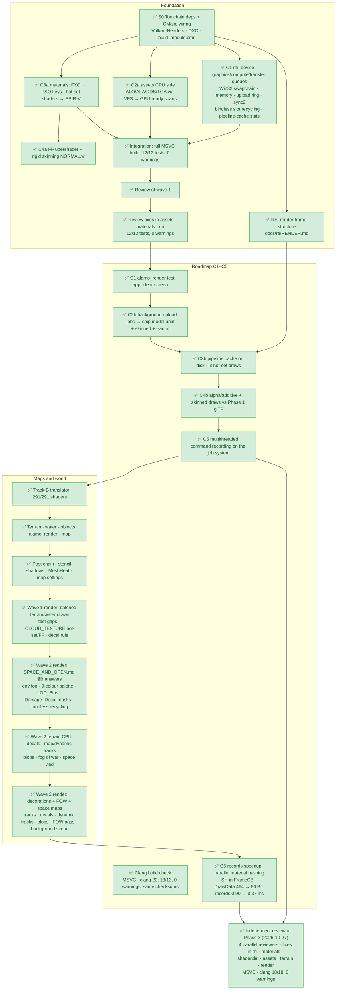

# Phase 3 status — Vulkan 1.3 renderer

Started 2026-10-26 · last updated 2026-10-27

## At a glance

| | Status |
|---|---|
| ✅ **Done** | All roadmap steps C1–C5, the track-B shader translator, terrain/water/map objects, post chain + shadows, decorations, fog of war, space maps, two review waves and their fixes, C5 records speedup (2000 ships: records 0.90 → 0.37 ms), independent review of all of Phase 3 (4 parallel reviewers) + fixes in every module |
| 🔄 **In progress** | Nothing active. |
| ⬜ **To do** | In-game capture (needs Gabriel) · the [open work list](#-to-do) below |
| Build | MSVC, clang 20: 18/18 tests, 0 warnings, GPU tests validation-clean |

Legend: ✅ done · 🔄 in progress / partly done · ⬜ not started · 👤 needs Gabriel

### Roadmap steps (claude/roadmap.md)

| Step | What | Status |
|---|---|---|
| C1 | Device, swapchain, queues, memory | ✅ |
| C2 | Assets onto the GPU | ✅ (C2a CPU side, C2b upload jobs) |
| C3 | Shader port + pipeline cache | ✅ (C3a, C3b, track-B translator) |
| C4 | Fixed-function emulation + rigid 24-bone skinning | ✅ (C4a, C4b) |
| C5 | Multithreaded command recording | ✅ |

The CPU-side parts of C2–C4 ran in parallel with C1 because they need no Vulkan.

### Flowchart

---

## ⬜ To do

### Next step
- ✅ **Independent review of Phase 3** (2026-10-27): split across 4 read-only reviewers (render + terrain; rhi; materials + shaderxlat; assets + formats, ~300k ASan/UBSan fuzz iterations on real files). Fixed: rhi 11 (device-lost spin, pool growth, failed partial uploads, cube-array/sampler/fill-mode caps, swapchain rollback + semaphore lifetime, overflow-safe checks, checksummed cache files); shaderxlat 7 (ps_1_x tex-op OOB write/read, bump flag, DLL search path, cache key incl. HLSL + DXC args, CTAB name escaping, bounds-checked test build); materials + fx2_reader 6 (108-byte FXO hang, nested-struct stack overflow, bump env only for ps_1_x bump ops, program-id collisions, int saturation, fuzz tests); assets 6 (32bpp TGA alpha — MT_COMMANDBAR.TGA, non-finite ALA fps + 256 MiB ALA budget, cache by resolved file 1284 names → 1260 decodes, RSkin bone_index[0], 256 MiB texture budget, megtool long paths); terrain 3 (decal budgets, non-finite spline, arc-table budget); render 3 (deferred buffer destruction, budgeted decals, MapScene::load exception boundary). Integration: MSVC, clang 18/18, 0 warnings; map luma unchanged. Note: program-id collision probing depends on registration order (no clashes in vanilla). Details in the wave-3 sections below.

### 👤 Needs Gabriel
- 🔄 **In-game capture** (RENDER.md §7.2; results in **RENDER.md §7.3**, 2026-10-29: runs are now unattended, `g1.py --drive K,E --probe-mod admonitor`; RenderDoc out of scope). It would settle:
  - RENDER.md §7.1 open questions: water-phase string, StencilDarken variant + stencil func, bloom constants, galactic camera FOV/near/far, team colour → `Colorization`, shadow extrusion source, Heat → Transparent remap flag, LOD_Bias (several now answered from SPACE_AND_OPEN.md §B, see the Wave 2 rows).
  - ✅ Engine cull mode: answered (`apitrace_20261027_103544`): the startup default is CCW (first CULLMODE set, before any draw); every lit mesh draw runs with CW, shadow volumes / full-screen / most FF draws with NONE. `engine_device_defaults()` should start from CCW, and mesh effects must carry CW.
  - ✅ Blue cast on Imperial ships: answered (`apitrace_20261027_103544`): `Colorization` is the owner's team colour per draw (Empire player (0.306, 0.588, 0.929, 1), AI red (0.929, 0.306, 0.306, 1), white for objects without one). No FXO default reaches a draw, so the cast is real team colouring. Thrawn's SD itself was built in `dxvk_20261029_231246` / `apitrace_20261029_231628` but not framed on screen (follow-up).
  - ✅ Heat 0x80 bias: measured (`apitrace_20261029_232301`, Bloom/Heat switched on for the run and restored). With a flat 0x80 distortion buffer, SceneHeat shifts the scene by +0.8 px x / +0.3 px y at 1920×1080 (AMD, native D3D9 replay). Real, but smaller than the 1.9 px − ½ texel estimate. The heat clear goes to the back buffer itself; bloom is 5 ping-pong draws on the two 480×270 targets. Details in RENDER.md §7.3. The player's own options have Bloom and Heat off.

### Open work
- ✅ **Hardpoint destruction** (SPACE_AND_OPEN.md §B.10): `render/hardpoints.hpp` — setup hides Damage_Decal (first match) + Damage_Particles subtrees; destruction shows decal + Damage_Particles subtree, then hides the Engine_Particles subtree (`Engine_Death_Hide_Engine_Particles`, default true); DUMMY_ART / non-destroyable never change; destruction order kept (last write wins); `set_destroyed(false)` is a debug reset only. ALO-hidden render meshes are now uploaded (masked). Model_To_Attach turrets attached at Attachment_Bone (MapScene, `--type`). Open: particles (damage proxies, Death_Explosion_Particles, Death_Breakoff_Prop) not drawn. ALO-hidden shadow volumes are uploaded masked too (2026-10-27, `drawable_submeshes(.., true, true)`); the Shadow bucket follows the per-instance mask. None exist in the Endor / Dagobah / Hoth models (0 of 110).
- ✅ **Planet**: its 42 alD3dVertN submeshes carry UVs, T = B = 0 (D.2): the effect's `_ALAMO_VERTEX_TYPE` wins (materials `MaterialEffect::vertex_type_override()`, Planet.fx = NU2U3U3). Assets side done (2026-10-27): `ModelLoadOptions::vertex_type_override` (callback material → vertex type, also `AssetCache(files, options)`) packs the records in the effect's type; `Submesh::effective_vertex_format` / `vertex_type_overridden` / `format` follow it. Real data with the shader catalog's 40 typed effects: 145 submeshes (122 render) in 43 models overridden (N→NU2U3U3 45, N→NU2 26, NU2→N 5, NU2U3U3C→NU2U3U3 17 (colour → white), B4I4→RSkin 52), 15 with different vertex bytes; W_PLANET_DEATHSTAR_II_DESTROYED 42/42 NU2U3U3 with stored UVs and T = B = 0. Render side done: `EffectCache::model_load_options()` (the effect's annotation via get()) passed to the AssetCaches of the tests and alamo_render; upload uses the effective format. Death Star II: 42/42 NU2U3U3, bucket 3, lit. Placement / scale / depth per SPACE_AND_OPEN.md D.7 (2026-10-27): the DESTROYED model has the `Death_Star_Chunks` geometry (Scale_Factor 1.0, main scene); the scale-4.2 background workaround is gone, the test draws it at scale 1 as a main-scene instance (logs/render_deathstar2_destroyed.png, 7.3% covered); FoC `_SPACE_PLANET_YAVIN_01` places `Death_Star_Chunks` (chunks model, scale 1, main scene, not background; logs/render_space_yavin01_ds2_chunks.png). Background camera = `render::background_view()`: the main view / eye / FOV terms bit for bit, a plain perspective with near 10 / far 100000 (renderer sky pass + space FOW plane; an oblique water-reflection row is not inherited), fade off, fills 0, fog off, no shadows (verified). Space background placements and skydomes play `<model>_IDLE_00` (`MapScene::set_sim_tick`, 30 Hz ticks × `Idle_Anim_00_Rate_Mod`, `Loop_Idle_Anim_00`; alamo_render drives it). Framings with the default Space_Mode camera (analytic D.7 centres within 0.03 NDC; measured lit pixels incl. glow): Kuat top limb NDC −0.24 → planet in the lower 38% (lit to 43% with the glow); Endor 1.18 vertical FOVs at (0.45, −0.99); Endor gas giant centre x −1.07, cols 0..278 (half visible); Kessel moon 0.43 FOVs at (−0.33, 0.67), upper left (logs/render_space_{kuat,endor_fow,kessel,yavin01}.png + per-backdrop `render_space_<type>.png`). Tests: background camera = main except depth; Scale_Factor 500/300 only; spin 90° at t = 60 s (synthetic clip); real clips 90.38° (vanilla keys +360° at frame 239 of 240). Land luma / PNGs (Endor, Dagobah, Hoth, Mandalore, Bothawui) byte-identical. ✅ (2026-10-27) 0x4B0 mini 03 is the starting health fraction (TERRAIN_WATER_POST.md §1.6), not a scale: engine/terrain stores it as `ObjectPlacement::health_fraction` (written back byte-identically, 269/269 maps), no longer applies it to scale, and exposes `ResolvedPlacement::initial_health_fraction` (non-finite → 1.0 + warning); the 4 Endor `Skirmish_Mineral_Processor_Pad` objects (0.08) now resolve at Scale_Factor 1. Render: `MapSceneStats::mini03_not_one` replaced by `health_not_full` (placements with `initial_health_fraction` ≠ 1; Endor 4, test checks none is scaled by it); land luma unchanged (Endor 185.52 / 38.05; the pads are outside the test view). Open: whether the clip wraps at 239 or 240 frames is not settled.
- ✅ **C5 performance** (2026-10-27): SH once per build (cached per light set) instead of per translated draw; sort = 64-bit packed key (bucket | depth-writing | effect rank | pass | material-hash rank) with a stable LSD radix sort that skips constant bytes (comparison sort kept as fallback); A2 reuses A1's per-submesh visibility / readiness / pass variants; compact per-instance stats; main draw list and sort scratch reused across frames. 2000 ships, same fleet (2502 draws), validation off: sort 0.19 → 0.09 ms, cull/LOD/keys 0.33 → 0.24 ms, build 0.88 → 0.67 ms. Draw lists identical 1/4/15 threads. Open: serial memo (~0.08 ms, PipelineManager lookups per pass) and material interning.
- ✅ **SH lighting contract** (2026-10-27): every FrameCB (main, shadow bucket, decorations / prim geometry, stencil darken) is built by `Renderer::frame_constants()` (camera, lights, SH always; fog / fade / world matrices by flag) and uploaded through `upload_frame_cb()`, which counts FrameCBs with zero SH under a lit scene (`frame_cb_violations()`, logged once). Tests: CPU contract check + 0 violations over all real-data frames.
- ✅ **Opaque grouping** (SPACE_AND_OPEN.md D.1, 2026-10-27): non-sorted buckets group by `GpuSubmesh::effect_order` (EffectCache sets the shader files from the VFS; `load_rank()`), names outside the list after it by name, then pass, material hash, submission order. Endor: 0 order inversions.
- ✅ **Unlit pass** (2026-10-27): shared `Epilogue()` — the material's alpha test (first pass ALPHAFUNC/REF, `GpuSubmesh::unlit_alpha_*`) and scene fog (vertex fog factor). Test: alpha-0 texel discarded, fog within 1 of the expected lerp.
- ✅ **Binormal handedness** (SPACE_AND_OPEN.md B.7/D.5, 2026-10-27): moot — the engine generates no frame. Assets now uploads T/B as stored for formats with a frame (no repair: 943 submeshes / 432 models / 106,509 vertices keep their zero stored T or B) and zero for formats without one (7,097 submeshes in 1,274 models no longer get generated frames). The old repair/generation stays behind `ModelLoadOptions::generate_tangent_frames` (off). Shaders: AlamoMesh/Planet project unnormalised T/B and `SafeNormalize` the result, shaderxlat uses D3D9 0·inf = 0 → no NaN from zero frames (exactly N·L = 0 gives +Z instead of the original's inf seam).
- ✅ **Long paths** (2026-10-27): core `long_path()` (Windows: absolute, normalised, `\\?\` / `\\?\UNC\`; no-op elsewhere), `list_directory()` and `remove_all_long()` (Win32 APIs; the standard library's `directory_iterator` was found unreliable on `\\?\` paths over 260 characters); `read_host_file()` uses `long_path()`. rhi `PipelineCache` (load, temp write, rename + retry, directory creation) and shaderxlat `ShaderCache` (share-delete reader, temp write, multi-process `MoveFileExW`) use it. Tests: core, rhi and shaderxlat cache round trips (incl. concurrent / multi-process renames) in temp folders over 320 characters; MSVC, clang 0 warnings. Render (2026-10-27): key list load/save/rename + `create_directories` via `long_path()` (the `.vkcache` path stays plain: rhi applies `long_path` itself, a `\\?\` path does not survive its UTF-8 round trip), `png.cpp` writes, `app/main.cpp` `remove_all_long`. Test: save + reload in a 344-character dir. Fix wave (2026-10-27): the `\\?\` failure was rhi `PipelineCache::init` reading via `read_host_file(path_to_utf8(file))` — the generic UTF-8 form turns `\\?\C:\x` into `//?/C:/x` (MSVC) / `/?/C:/x` (libstdc++), which Win32 no longer treats as a literal long path. Now: core `read_host_file(const fs::path&)` (CreateFileW share read/write/delete on `long_path`, used by rhi), `long_path` restores `//?/` and `/?/` generic forms; rhi rename retry bounded (10 attempts, back-off 1..50 ms). `remove_all_long` audit: no unbounded loop found (the earlier runaway did not reproduce); hardened anyway — symlinks/junctions (name-surrogate reparse tags) removed as links, other reparse points recursed, read-only cleared, sharing/pending-delete/access-denied retried ~0.1 s then fail, `GetFullPathNameW` loop bounded; refuses roots, drive-relative `C:x`, trailing `.`/space components, final `.`/`..`, `\\.\`. Tests: rhi cache save/load in a >320-char dir as plain and `\\?\` path; core junction-to-outside (FSCTL_SET_REPARSE_POINT, no admin) keeps its target, locked file fails in ~120 ms, refused inputs; `alamo_core_tests` TIMEOUT 60. MSVC, clang 0 warnings. Render can now pass `long_path()` for the `.vkcache` path (`PipelineManager::cache_path()`, `render/src/pipelines.cpp:416`).
- ✅ (2026-10-27) Clang (LLVM 20) rebuild of the C4b cache numbers, whole-install `--sweep` (1379 ALOs, 4740 drawable submeshes, 38 PsoKeys, 17 track-B programs — identical counts to MSVC). `%LOCALAPPDATA%\alamo\render` cleared + `--cold`: clang 172 ms wall / 1795 ms summed vkCreateGraphicsPipelines (first run, 3 programs freshly translated so the driver cache was cold too), MSVC right after 43.5 / 319 ms; repeated cold runs (driver cache warm) clang 1.7 / 23 ms, MSVC 1.9 / 27 ms; all 0/38 hits. Warm: clang 1.1 ms / 38/38 hits, MSVC 1.2 ms / 38/38 hits (21 keys preloaded, 36 ms reload). No compiler-dependent difference; cold numbers are dominated by the AMD driver's own cache.
- ✅ Legacy colour (SPACE_AND_OPEN.md D.4, 2026-10-27): the original overwrites both colours of 128-byte `0x10005` records with 1.0; assets now does the same (144-byte records keep the stored colour). Touches 1 submesh, W_STARS_BACK02 (alD3dVertNU2C, MeshAdditiveVColor.fx, 1,984 vertices), which now renders at full brightness. Real-data digests (default options) plain f75507c1da6fed83 → 4e356ca818c298e6, legacy 394ed5c469a09463 → f4f7fe3ccf4b3736 (expected: D.4 + D.5). MSVC/clang (core;vfs;assets) 0 warnings, tests pass.
- ✅ `FissureMeshGloss.fx` not found in the install (1 submesh with a missing effect). D.3 done: submesh effects resolve through `EffectCache::get_or_default()` (`EffectLibrary::load_or_default()`, green FF `TNoShader`, bucket 3); post / engine effects keep get(). **Investigated (2026-10-27): it ships nowhere** — byte scan of every MEG and loose file in FoC `corruption\` and EaW `GameData\` (no loose `Data\Art\Shaders\` dirs exist; both `shaders.meg` hold only `ENGINE\PHASEFISSURE.FXO`), no .fx/.fxo/.fxh, so no VFS search-order bug. Its only user is `W_TEST_FISSURE.ALO` (EaW `models.meg`, submesh `Line01`, params Emissive/Diffuse/Specular/Shininess + BaseTexture `W_TatRock01.tga`); no XML, map or other MEG references the model (a test asset). Default stays faithful green. Opt-in compat: `LoadOptions::missing_effect_remap` / `EffectLibrary::set_missing_effect_remap()`, built-in table `compat_missing_effect_remap()` = {FISSUREMESHGLOSS → MeshGloss.fx} (identical material interface to MeshGloss/TerrainMeshGloss/BatchMeshGloss; MeshGloss keeps the Opaque bucket); result has `remapped_from` set, fallback None. Only missing names remap. Tests both modes (materials MSVC/Clang 0 warnings, 82/82 FXOs, hashes unchanged). ✅ (2026-10-27) Render wiring: `alamo_render --compat-effect-remap` sets the remap on every EffectCache of the run (default off = faithful green); `EffectCache::Stats::remapped` counts remaps separately from `defaulted`; `model_load_options()` resolves through `get_or_default()` so a remapped effect's `_ALAMO_VERTEX_TYPE` applies. Test: W_TEST_FISSURE `Line01` draws lit with MESHGLOSS with the remap (1 remapped / 0 defaulted), with the green default without (1 defaulted / 0 remapped).
- ✅ FF inputs hook (2026-10-27): `Instance::ff_hook` (`FfDrawHook`, called per FF draw after the template update, thread-safe); the `ff_data` memcmp shim is gone; the reference test uses the hook.
- ✅ (2026-10-27) Fleet picks from the game XML (`render/fleet.hpp`): `<SpaceUnit>`/`<UniqueUnit>` with `<Space_Model_Name>`, no `_Death_Clone`, class from `<CategoryMask>` (Capital/Frigate → capital, Corvette, Fighter/Bomber → fighter; Structure/Super/Transport/Upgrade/… excluded), one per model, seeded shuffle per class. FoC install: 51 ship models (19 capital, 11 corvette, 20 fighter loadable); default 6 + 4 + 10 types, layout 1 capital : 2 corvettes : 7 fighters. Track-B coverage: if no pick has a translated pass (EffectCache, render submeshes not ALO-hidden; 2 candidates in the install), one is swapped in from the same RNG, so the fleet identity test checks translated draws unconditionally again (12 translated draws, 0 bytes differ 1 vs 15 threads). 200/2000 ships render, validation 0/0. Frame ring: `ring_recording_threads()` clamps `recording_threads` up to `JobSystem::thread_count()`; the app fails with a message if it is still lower.
- ✅ Housekeeping (2026-10-27): deleted VVL `toolchain\src` + `toolchain\build` (2.4 GB; incl. the throwaway `build\vvl_check`). `4_validation_layers.cmd` now skips when `vvl\bin` has the manifest and `vvl\VERSION.txt` names the pinned tag; otherwise it wipes src/build, re-clones, builds, installs, writes the marker and deletes src/build again. Removed 14 stale extra build dirs (datafix*, reference, review, review2, rhi/shaderxlat/terrain -clang; 1.4 GB). Toolchain 10.6 → 8.2 GB. LLVM (4.0 GB) kept (build_clang). `build_module.cmd rhi` passes, GPU test validation 0 errors / 0 warnings. Open: `toolchain\downloads` (1.5 GB: LLVM tar.xz 896 MB, MSVC/SDK packages ~480 MB, MinGit 45 MB, DXC 25 MB) is only an offline re-install cache, kept for Gabriel to decide.

---

## 🔄 In progress

Nothing is being worked on right now.

---

## ✅ Done

Short version first; click a row's details below for the full result.

| # | Item | Headline result | Where |
|---|---|---|---|
| 1 | S0 Toolchain + wiring | Pinned deps, `build_module.cmd`, renderer modules in the build | toolchain, engine/CMakeLists.txt |
| 2 | C1 rhi (library) | Vulkan 1.3 context, queues, VMA, uploader, swapchain; validation 0/0 | engine/rhi |
| 3 | C2a assets | 1379/1379 models, 2408/2408 ALA, glTF exports bit-exact | engine/assets |
| 4 | C3a + C4a materials | 82/82 FXOs; hot set + FF cover 95.2% of drawn submeshes | engine/materials |
| 5 | RE render frame doc | `docs/re/RENDER.md`: phase buckets, post chain, camera, lighting | docs/re |
| 6 | Integration | Full build 12/12, 0 warnings | build_msvc.cmd |
| 7 | Review wave 1 | 3 reproduced OOB/alloc bugs + 13 integration mismatches | review notes |
| 8 | Review fixes (wave 1) | All three modules fixed, 12/12, 0 warnings | rhi, materials, assets |
| 9 | Small cross-module follow-ups | White slot 0, cull mapping, demote-to-helper, mouse API | materials, rhi |
| 10 | C1T + C2b render module | `alamo_render.exe`: clear screen, Thrawn SD 0.199 ms/frame, skinned `--anim` | engine/render |
| 11 | C3b lit draws + pipeline cache | Whole install: 38 PsoKeys, warm 20 ms; 3,653 lit submeshes | engine/render |
| 12 | Clang check | MSVC, clang 13/13, 0 warnings, identical checksums | toolchain, CMake |
| 13 | C4b FF + skinning (materials) | GPU vs CPU D3D9 reference ≤ 0.60/255; skinning matches glTF | engine/materials |
| 14 | C4b renderer merge | Per-draw FF templates, 37/37 cache hits, 14/14 tests | engine/render |
| 15 | C5 multithreaded recording | Byte-identical across 1/4/15 threads; 2000 ships CPU 1.77 → 1.14 ms (records later sped up, row 34) | engine/render |
| 16 | Terrain/water/post RE doc | `docs/re/TERRAIN_WATER_POST.md`; all 26 land maps parse | docs/re, docs/formats |
| 17 | Track-B translator | 291/291 shaders translate + compile; 0 out of tolerance. 2026-10-27 review fixes (v2): ps_1_x operand-kind/range validation (no OOB on `texcoord r31` & co.), bump_env only for texbem/texbeml/bem, escaped sampler names, cache key hashes HLSL + DXC args (+ DLL hash fallback), DXC loaded by absolute path only; tests use an STL-hardened library copy | engine/shaderxlat |
| 18 | Translator integration | 46/46 passes translate; 3,670/3,672 submeshes lit | render, materials, rhi |
| 19 | rhi support | 3D textures, render targets, stretch-rect, depth-stencil pick | engine/rhi |
| 20 | Terrain module (CPU) | `.ted` reader/writer byte-stable on 269 maps; Endor 1,514/1,514 placements | engine/terrain |
| 21 | Data test crash (Phase 2) | Test fixed (not the library); real install via VFS matches Phase 2 | engine/data |
| 22 | Post chain, shadows, Heat, environment | Full frame order, stencil shadows, bloom, skydomes; 18/18 undrawables draw | engine/render |
| 23 | Terrain + water + map objects | `alamo_render --map`: Endor 2.6 ms frame, 0 unknown types | engine/render |
| 24 | rhi timestamps + creation feedback | `rhi::GpuTimer`, pipeline cache-hit feedback (MSVC only at the time) | engine/rhi |
| 25 | Review (terrain/post wave) | Washed-out maps traced to the wrong camera distance; sync hazards found | review notes |
| 26 | Review fixes (terrain/post wave) | Land_Mode camera, 0 sync hazards, safe `.ted` allocation; 18/18 | render, terrain |
| 27 | Open items wave 1 | RE docs, formats fixes, render + rhi items | several |
| 28 | Open items wave 1: render | Batched world draws: Endor wide 20.1 → 5.0 ms (validation on), pixel-identical | render, materials |
| 29 | Terrain decorations + FOW + space (CPU) | Decals, tracks, blobs, FOW grid, 112 space maps decoded | engine/terrain |
| 30 | rhi bindless recycling + cache stats + surface | `BindlessTextureTable`, `PipelineCache::stats()`, surface abstraction | engine/rhi |
| 31 | terrain review fixes | Track geometry budgets, determinism fix | engine/terrain |
| 32 | Open items wave 2: render | SPACE_AND_OPEN.md §B applied: fog, palette, LOD_Bias, hardpoints, bindless | engine/render |
| 33 | Wave 2 render: decorations, FOW, space maps | Tracks, decals, blobs, FOW pass, space background scene; 18/18 | engine/render |
| 34 | C5 records speedup | 2000 ships: records 0.90 → 0.37 ms, build 1.55 → 1.00 ms; DrawData 464 → 80 B; draw lists identical 1/4/15 threads | render, materials |
| 35 | Hardpoint destruction (§B.10) | 3 vanilla examples exact (SD Weapon_FL / Engines, Station One_01); SD turrets attached; `--destroy-hardpoints`; map luma unchanged | engine/render |

### Details

<b>1. S0 Toolchain + wiring</b>

`toolchain\3_renderer_deps.cmd` (called from `2_setup.cmd`), `alamo_vulkan_headers` INTERFACE target (`VK_NO_PROTOTYPES`), `ALAMO_DXC` cache var, modules `assets;rhi;materials` added to `ALAMO_ENGINE_MODULES`, `build_module.cmd`. Location: toolchain, engine/CMakeLists.txt.

<b>2. C1 rhi (library)</b> — engine/rhi

`alamo_rhi`: runtime `vulkan-1` loader + hand-written fn tables; 1.3 context (dynamicRendering, sync2, timeline, descriptor indexing), graphics/compute/transfer queues with per-queue submit mutex; VMA behind allocate/free/map interface; thread-safe uploader (timeline tickets, queue-ownership transfers, non-stalling per-frame acquires); FrameRing (1–3 in flight, per-thread pools for later parallel recording); Win32 window + swapchain (FIFO/Mailbox/Immediate fallbacks, resize); disk `PipelineCache`; PORTING.md set 0/1 layouts; 64-bit `SamplerKey` cache. MSVC /W4 clean, 2/2 tests on RX 9070 XT with validation **required: 0 errors, 0 warnings** (clear + triangle readback, RGBA8/BC1 mip uploads on both queue modes, 4-thread upload stress, cache round-trip). Window demo: 300 frames, ~121 fps FIFO, clean exit. The `alamo_render` clear-screen app followed after integration (item 10).

<b>3. C2a assets</b> — engine/assets

`alamo_assets`: ALO → per-submesh 64-byte vertex buffers (static; rigid-skinned with palette index in NORMAL.w + u16 skeleton bone at 60), U16/U32 indices, bounds, `MaterialRef`, ≤24-bone palettes, non-render geometry flagged not dropped; skeleton + ALA sampling + skin palette; DDS/TGA → BC1/2/3, RGBA8, BGRA8, R8, R8G8 mips/layers; thread-safe `AssetCache` (once per key). MSVC /W4 clean, tests pass. **Real install: 1379/1379 models, 2408/2408 ALA, 1270/1284 textures (14 named .tga files not shipped → fallback); 3 Phase 1 glTF exports match bit-exact incl. 1071 skinned bone assignments.** Milestone ship: `EV_STARDESTOYER_THRAWN.ALO` (75 bones, 11 render submeshes, 8/8 textures).

<b>4. C3a + C4a materials</b> — engine/materials

`alamo_materials`: D3D9 state model (defaults ← phase pass 0 ← material pass) → `PsoKey` 40 B / `SamplerKey` / dynamic state / 16 B push constants (enum values = Vulkan values); FNV-1a 64 stable hashing with golden test + `programs_fingerprint()` for cache invalidation; static_assert-checked `FrameCB`/`DrawData`/`MeshMaterial`/`BoneMatrix`/FF layouts; FXLC expression + preshader evaluation, CTAB register-file fill; 22 SPIR-V blobs (DXC `-WX`): mesh bump/gloss/tree/additive (+skinned), Planet, shadow volume, FF ubershader (FF config in a per-draw buffer, not permutations); rigid skinning reads NORMAL.w. **Real install: 82/82 FXOs parse; 52 non-empty render-state sets (matches Phase 1); hot set + FF = 6,579/6,911 drawn submeshes (95.2%)**; 75 vanilla draw passes = 12 hand-written, 17 FF, 46 need track-B translation (done since, items 17–18).

<b>5. RE render frame doc</b> — docs/re

`docs/re/RENDER.md` (prose only, confidence + evidence per claim): 12 phase buckets in enum order bracketed by `Phase*.fxo` pass 0/1; `_ALAMO_RENDER_PHASE` picks the bucket; Transparent/Heat back-to-front by AABB centre, others grouped by effect → material; post chain (stencil shadows + StencilDarken, SceneTexture copy, Heat → DistortionTexture, 4× 1/4-size bloom), all RTs A8R8G8B8; RH Z-up, column-vector 3×4 matrices, horizontal FOV, land near 10 / far 7000; 1 sun + SH fill/ambient, `LIGHT_SCALE.w` = fade; every parameter re-set per draw (a per-frame CB is a pure win); 24-bone palette per draw, animation on the 30 Hz tick; whole-model AABB culling, `_LOD<n>` by screen size × Mesh Detail; mod shader search order. Corrections in HOTSPOTS.md §6, PORTING.md §2.4/§3.1, SUBSYSTEMS.md. Capture plan (DXVK HUD, RenderDoc, apitrace) prepared, not run.

<b>6. Integration</b> — build_msvc.cmd

Full `build_msvc.cmd`: **12/12 tests pass (incl. GPU test with validation required), 0 warnings**. `build_msvc.cmd` now passes `-U ALAMO_ENGINE_MODULES` so a stale cached module list can't silently drop modules (the first run built only the 8 Phase 2 tests).

<b>7. Independent review (wave 1)</b> — review notes → item 8

Fresh read-only agent, Debug /MTd + malformed-input harness. **Reproduced:** ALA with 0 frames + animated index → OOB read (fixed in `tools/formats/src/ala.cpp`); materials phase-baseline state indices dereferenced against the material pass → OOB / wrong state; FXLC register counts from untrusted offsets → 16 GiB allocation. Also: non-ParseError exceptions escape the materials loader; TGA header can reserve 1 GiB before the size check; rhi uniform ring not flushed on non-coherent memory, depth Undefined transition races the previous frame, pending-upload handles can dangle, `-Wmissing-field-initializers` warnings throughout rhi. Clean: DDS math, ALO path, AssetCache, Uploader concurrency, submit locking, key hashing determinism. 13 integration mismatches (descriptor layout for the hot set, MirrorClampToEdge feature, dynamic stencil masks, depth-bias units, texture swizzle, skinned FF path, missing tangents → NaN, colour byte order, two VertexLayout enums, two SamplerKeys, palette in model vs world space).

<b>8. Review fixes (wave 1)</b> — rhi, materials, assets

All three ✅ — full `build_msvc.cmd` after fixes: **12/12, 0 warnings**.

- **rhi**: Dynamic memory requires HOST_COHERENT + ring flush; Undefined→X transitions wait on X's stages; buffer ownership tracked (partial re-upload via transfer queue refused); `Uploader::forget()` cancels pending acquires before destroy; no host-signalling on failed submits; empty ring rewinds; `vk_struct<T>` helper (no partial initialisers); compiler-specific pragmas in `vma_impl.cpp`; `HotSetLayouts` matching `common.hlsli` (bindless array fixed count 16384, update-after-bind + update-unused-while-pending now required); MirrorClampToEdge when supported; dynamic stencil compare/write masks; `depth_bias_from_d3d9` (D16 ×2¹⁶, D24/float ×2²⁴; float exact only in [0.5,1)); image-view `Swizzle`; compute pipelines. GPU tests validation-clean.
- **materials**: state indices tagged with the serial of the pass that set them (phase baseline never dereferenced against the material pass); FXLC register tables capped at 256 in 64-bit math; `std::exception` caught at every load boundary; NaN/out-of-range FXLC indices read 0; program-id bit 31 separates hand-written from translated; skinned FF vertex shaders (`ff_vs_n_skin`, `ff_vs_nc_skin`, 24 blobs); `SafeNormalize` everywhere; `VertexInput.format` (COLOR0 always location 5, RGBA8 for mesh vertices, BGRA8 for D3DCOLOR sources). Sweep unchanged: 82/82 FXOs, 52 sets, 0 warnings.
- **assets**: zero-frame/track validation before any ALA accessor; TGA size checked before allocating, RLE capped at 8192²; skinned layout rev 2 (RGBA8 colour @60, skeleton bone = `bone_palette[uint(normal.w)]`); valid tangent frames always (authored repaired, else generated from UVs, else around the normal; `has_tangents`); `VertexFormatTraits` + table of the 10 vertex formats in the data. Real-data counts and glTF matches unchanged, 0 warnings.

<b>9. Small cross-module follow-ups</b> — materials, rhi

Full build after both: **13/13, 0 warnings**.

- **materials**: `kNoTexture = 0` (white slot 0); cull fixed — front face always CCW with negative viewport, `D3DCULL_CW`→Back, `CCW`→Front; `engine_device_defaults()` = D3D9 defaults + CULLMODE=CW (inferred from ALO winding, RH projection and the z-fail shadow-volume passes; no source shows the engine setting it — confirm in the capture plan); two-sided stencil ops swapped to match. Sweep unchanged (82/82, 52), golden hash unchanged.
- **rhi**: `shaderDemoteToHelperInvocation` required (`discard` test validation-clean), Window mouse API (buttons, position, wheel, capture while dragging), `min_storage_buffer_offset_alignment` + `Frame::alloc_storage`; engine/render can drop its window-proc subclass and its own storage alignment.

<b>10. C1T + C2b render module</b> — engine/render

`alamo_render` lib + `alamo_render.exe`: all integration conversions (texture format/swizzle, vertex-format name → materials layout, SamplerKey, vertex input asserted against assets); RH Z-up camera with 0..1 depth and negative-height viewport; `_LOD`/`_ALT` pick; bindless set 1 (slot 0 = white) + per-frame set 0; opaque/alpha/additive pipelines (static + skinned); `ModelStreamer` loads + uploads as background jobs. `--clear` (validation required; `--exercise-window`: 4 swapchain recreates, minimise OK, 0 messages). `--game … --model EV_STARDESTOYER_THRAWN.ALO`: 11 draws, 4,237 tris, resident in 6 ms; **0.199 ms/frame at 1280×720 (validation off)**. Skinned + `--anim` on the 30 Hz tick (Royal Guard IDLE_00 differs from bind pose). Full `build_msvc.cmd`: **13/13 tests, 0 warnings**. Renders: `logs/render_thrawn_sd.png`, `logs/render_royalguard_idle.png`.

<b>11. C3b lit draws + pipeline cache</b> — engine/render

Each submesh's effect via materials `EffectLibrary` (FF fallback for untranslated) → `select(lightScale.w)` PsoKey → rhi pipeline (blend/depth/stencil/cull CCW, reflected vertex inputs, HotSetLayouts, dynamic stencil masks + `depth_bias_from_d3d9`), created on worker jobs, never stalling (unlit until ready). Disk cache in `%LOCALAPPDATA%\alamo\render\` (`.keys` + `.vkcache` per vendor/device; wiped on `programs_fingerprint()`/driver/device/UUID change). Lighting: FrameCB sun + SH fill/all (fills off in space), DrawData World/LIGHT_SCALE/bone base, `MaterialTable` dedup per frame, FF draw data, parameter textures bindless. 12 phase buckets; Transparent/Heat back-to-front. `_BLAST` meshes hidden unless `--show-damage` (8 on the Thrawn SD, 655 in the install). **Thrawn SD: 3 PsoKeys, cold 164 ms summed / warm 2.8 ms; whole-install sweep (1,379 models, 3,672 drawable submeshes): 38 PsoKeys, cold 970 ms wall on 15 workers / warm 20 ms; 3,653 lit, 18 untranslated, 1 missing effect (FissureMeshGloss.fx). Lit SD 0.231 ms/frame at 1280×720.** Tests 10/10, 0 validation messages (sun-direction response 194 vs 41, alpha-test discard, cache round-trip + invalidation). PNGs: `logs/render_thrawn_sd_lit.png`, `logs/render_ev_executorstardestroyer_lit.png`.

Notes from C3b that were later resolved: FF draw data evaluated once at load (fixed in item 14), shadow volumes + Heat not drawn (item 22), guessed space light defaults (sun 0.6 @ yaw 225°/elev 35°, ambient 0.16; replaced by per-map environments, item 18/22), rhi pipeline-creation feedback request (item 24).

<b>12. Clang check</b> — toolchain, CMake, tools, engine

`toolchain\5_portability_compilers.cmd` (called from `2_setup.cmd`): LLVM 20.1.8 (19.x is rejected by the MSVC 14.51 STL, STL1000; SHA-256 F229769F…107F) (the GCC half of this step was removed on 2026-10-29). `build_clang.cmd` (+`-Wconversion -Wshadow`, MSVC ABI). Fixes: Windows defines (`NOMINMAX` etc.) and static CRT for every Windows compiler, warning flags on tools' exes/tests, explicit casts in tools/formats + fx2_reader + rhi, two warning-only rewrites, `kFrontFaceCounterClockwise` moved into its namespace. **MSVC and clang: 13/13 tests, 0 warnings each. Headless checksums identical between MSVC and clang (6 selfcheck lines + 35 campaign/benchmark lines).**

<b>13. C4b FF + skinning vs reference (materials side)</b> — engine/materials, engine/render/tests/reference

`FfDrawTemplate` (build once, `update(ExprInputs)` per draw: const, allocation-free, thread-safe; only expressions that read light_scale/time/colorization/view_inv/FOW are re-run via `CompiledExpression`); `select_exact` evaluates the AlphaBlendEnable expression itself. **GPU vs hand-transcribed CPU D3D9 reference, 8 effects (MeshAlpha, MeshAlphaScroll, MeshAdditive, PrimAlpha, PrimAdditive, PrimDiffuseAlpha, PrimOpaque, PrimAlphaScanlines): max error ≤ 0.60/255.** Bugs fixed: PrimDiffuseAlpha drew without normals (max error was 170); FF lighting now 3 directional lights + ambient on light 0 (FrameCB 512 → 608 B); `AlamoCleanup` annotation overrides the restore-only guess. **Skinning vs Phase 1 glTF: positions max 2.8e-7 × radius (Royal Guard bind + idle f20); silhouette IoU 0.87–0.99 over 4 frames × 3 views incl. Dark Trooper jetpack f30.** alPrimVert: two buffers, 24 B pre-lit (pos, BGRA colour, uv) and 36 B lit (+normal) → `PrimVert` / `PrimVertLit`. `alamo_render_reference_tests` validation-clean; materials sweep 82/82, 52.

<b>14. C4b renderer merge</b> — engine/render

Per-draw `FfDrawTemplate::update` in the parallel records step (light_scale, time, VIEWINVERSE, FOW, team colour); `select_exact` variant pick; FF program from the mesh layout (NU2C → `ff_vs_nc` feeds COLOR0, RSkin on FF-fallback effects → `ff_vs_n_skin`); fill lights → FrameCB light1/2; `Renderer::set_time()` (app: wall time × `--time-scale`, tests fixed at 0); app uses `rhi::GpuTimer`; `PipelineManager` counts cache hits from `PipelineFeedback`. New GPU tests: MeshAlpha fade (w=0.5 renders half-way), vertex colour via COLOR0, posed RSkin on MeshAlpha, every warm pipeline a cache hit. **Sweep: 37 keys, warm reload 19 ms with 37/37 cache hits. Fleet 2000 via GpuTimer: CPU 2.17 → 1.23 ms (1 → 15 threads), GPU 0.54 ms. Thread-count identity still holds. MSVC and clang: 14/14 tests, 0 warnings each (logs checked).**

<b>15. C5 multithreaded recording</b> — engine/render

`Renderer::render()`: per-model memo (pipeline mutex ~16 hits/frame, was ~4000), parallel cull + dynamic per-instance LOD (all LOD meshes uploaded), prefix-sum placement, integer-key `stable_sort`, parallel DrawData/bone records straight into the frame ring (serial in-order `MaterialTable` dedup), each phase bucket split into ≥128-draw chunks recorded into per-thread secondaries (dynamic-rendering inheritance) and executed in order. `--record-threads`, `--min-chunk`, `--fleet N --seed S`. **Byte-identical draw lists and pixels for 1/4/15 threads (synthetic 200 instances; real 200-ship fleet). 2000 ships at 1280×720: CPU 1.77 → 1.14 ms (validation off), 12.4 → 3.0 ms (on); GPU 0.53 ms.** Tests 10/10, 0 validation messages. PNG: `logs/render_fleet_200.png`.

<b>16. Terrain/water/post RE doc</b> — docs/re, docs/formats

`docs/re/TERRAIN_WATER_POST.md` (prose only, confidence + evidence per claim). `.ted` layout (map info, start positions, world chunk: environments, terrain, objects, bounds, passability column-major, AI zones, camera). Terrain: (31n+1)² grid, 20 units apart, heights s16 × 0.048828125, **one material index per vertex (no weights in the file) → per 31×31-quad patch one pass per used material with a 32×32 A4R4G4B4 blend texture, ascending order, SRCALPHA/INVSRCALPHA (up to 24 passes)**, no LOD, `TerrainRenderBump` technique `bump`. Water: one plane per map, drawn only on patches below it, shore alpha fade; DX9 path needs 512² reflection + refraction targets and a 128² sky cube. Post: `RESOLUTION_CONSTANTS` = bound RT size; bloom constants from environment fields 23/24/28 (13 of 24 MP space maps have bloom 0); StencilDarken (NOTEQUAL 0, mask 0x4F) vs soft-shadow ToAlpha + 4-tap blur; shadow extrusion = 200. Real lighting per map (Kuat space, Endor land). **All 26 land maps parse**; Endor/Dagobah/Hoth checked field by field. Resolved RENDER.md Q1/2/3/8/9; corrections in RENDER.md and SPEC.md §1.1/§6/§8.

<b>17. Track-B translator</b> — engine/shaderxlat

`alamo_shaderxlat` (deps: core only): bounds-checked d3dbc SM1–2 parser (`disassemble()` round-trips all 291 blobs) → SM6 HLSL (PORTING §1 interface, `ShaderInterface` with fixed input/varying locations, 64 B `TranslatedPush` for alpha test/fog/half-pixel) → SPIR-V via runtime `dxcompiler.dll` (own COM declarations; thread-safe instance pool) or `alamo_shaderxlat_tool` + dxc.exe; disk cache `%LOCALAPPDATA%\alamo\shaders` (atomic, multi-process safe). Semantics table in `src/translate.cpp` (D3D9 0×anything=0, rcp(0)=+inf, refrast expp/logp, ps_1_x clamps, co-issue, tex* family, bump env). **291/291 blobs translate + compile (incl. all 61 vkd3d failures); GPU vs independent CPU interpreter over ~2.7M elements: 0 out of tolerance (vs_1_1 max 1.1e-5; PS texture-free ≤ 6e-8), validation-clean.** Deterministic (1 vs 8 threads, HLSL byte-identical across compilers); 34k-input fuzz, no crash. clang: 16/16 tests, 0 warnings (logs checked).

<b>18. Translator integration</b> — render, materials, rhi

MSVC, clang: **16/16 tests, 0 warnings each (logs checked)**.

- **render**: FF fallback off; one `RuntimeDxc` + `ShaderCache`; `translate_pass` once per (vs_id, ps_id) on worker jobs (unlit until ready; unlit if dxcompiler.dll is missing); second pipeline layout (StandardLayouts, 64 B push); unfed inputs read a stride-0 zero buffer; register files with original D3DX engine semantics + bump env + int/bool, filled in the parallel records step; depth-writing draws sort last in their bucket. **Sweep: 289 submeshes on translated passes (16 effects incl. BatchMeshGloss, TerrainMeshBump, SkyDome, Nebula, RSkinAlpha, Grass); 17/18 previously undrawable now draw (MeshHeat waits for the Heat bucket); 3,670/3,672 drawable submeshes lit. 16 program pairs: cold 79 ms / warm 1 ms (16/16 shader-cache hits); 44 pipeline keys warm 1.3 ms (44/44 hits).** GPU vs `shaderxlat::Interpreter` on BatchMeshGloss ≤ 0.50/255; half-pixel offset (+1/W, −1/H) verified; fleet thread identity holds with translated MeshShield draws. Real lighting: Kuat space default, `--land` (Endor Sunrise_Clear), `--env <map.ted>` reads the start TEE record (new reusable `ted.hpp`). PNGs: `logs/render_thrawn_sd_lit.png` (Kuat light), `logs/render_uv_crusaderclasscorvette_dc_translated.png`.
- **materials**: `ProgramStatus::Translated` at load (no DXC needed), `translate_pass()` on demand (thread-safe) → `TranslatedProgram` (VS/PS SPIR-V + interfaces, fed/unfed inputs, bindings, writes_depth), stable `translated_program_id()`, `PsoKey.flags` (kPsoTranslated, kPsoWritesDepth; 0 elsewhere so old hashes hold), `fill_bump_env`, `fill_int_bool_constants`, `translated_push` from alpha/fog state. **Sweep: 46/46 passes translate + compile through runtime DXC, 0 untranslatable; 82/82, 52 sets, 83 keys, golden hash unchanged**; clang 16/16, 0 warnings.
- **rhi**: `StandardLayouts::init(ctx, kLayoutIntBoolConstants)` adds set 0 bindings 2/3 (320 B int/bool UBOs), `create_pipeline_layout(kTranslatedPushBytes = 64, …, int_bool)`, `write_int_bool_constants()`; RG32F/RGBA32F; bind-memory + memory-requirements fns; cube images validated (square faces, layers % 6) with a 6-face sampling test; validation-clean.

<b>19. rhi support</b> — engine/rhi

3D textures (`ImageDesc::depth`, mip-major slice uploads); `rendertarget.hpp`: `RenderTarget` (absolute or scaled size, resize, tracked states, attachment vs sampling views, begin/end rendering) + `cmd_stretch_rect` (copy or blit with format conversion; NEAREST like the original); swapchain requests TRANSFER_SRC; `pick_depth_stencil_format` (D32FS8 on this AMD card) + optional dynamic stencil op; `B4G4R4A4` + `Swizzle::ARGB4_IN_BGRA4`. MSVC, clang (core+rhi) 0 warnings, GPU tests validation-clean.

<b>20. Terrain module (CPU)</b> — engine/terrain

`alamo_terrain` (core + assets; no Vulkan, no engine/data dependency): canonical bounds-checked `.ted` reader/writer (`MapData`: info, start positions, environments ⊇ `render::Environment`, terrain header + heights/material/brightness, 64 TEM materials, water scroll records, objects, playable boxes, passability → row-major, zones, cameras; parse→write→parse byte-stable over all 269 maps in the VFS; 6,000-input fuzz); `build_terrain_mesh` (36 B vertices, per-patch AABB + blend scale/offset, per-material passes with u16 indices + raw D3D A4R4G4B4 32×32 blend textures; parallel output byte-identical to serial); `build_water` (plane, effect, targets N×N 512 default + 128² sky cube, water patches with shore alpha) + `water_constants(t)` for water/lava/ice; `resolve_placements` via a TypeResolver hook. **All 26 land maps match the doc's §1.9 table from maps.meg** (4 maps are overridden by Patch/Patch2 MEGs in the VFS: Dathomir, Hoth, Hypori, Utapau; footnote for the doc). Endor 100 patches, 845 passes, 268k tris, 5.1 ms build on 16 threads; **Endor 1,514/1,514 placements resolve to models (38 ALOs, none missing)**, Dagobah and Hoth fully too. 0 warnings MSVC/clang.

<b>21. Data test crash (Phase 2)</b> — engine/data

The crash was in the test, not the library: with `ALAMO_FOC_DATA` = the real install (XML only in MEGs) the database loaded empty, and the test called `campaigns().front()` on it. The test now reads loose XML or mounts the VFS like `alamo_headless`, and skips with a reason otherwise; empty-table uses guarded; library adds a "XML is in MEGs, use the VFS" diagnostic only. Regression test for install layout + junk files. **Real install via VFS: 3,345 objects, 65/47 planets, 327/209 routes, 33/32 campaigns, merge 51 (= Phase 2 numbers); headless checksums unchanged.** 0 warnings MSVC/clang.

<b>22. Post chain, shadows, Heat, environment</b> — engine/render

Frame order via the real FXOs: sky → opaque + Shadow bucket → stencil darken → Water…Bloom buckets → SceneTexture copy → Heat into 0x8080FF target → DistortionTexture → SceneHeat → SceneBloom (1/4 size, 4 ping-pong, constants from env 23/24/28; off at strength 0 / galactic) → stretch-rect out. RenderTargets with D32FS8; RESOLUTION_CONSTANTS = bound RT; passes still compiling are skipped (`post_pending`; PNG-producing tests re-render until it is 0 and CHECK it, so captures are byte-identical run to run, warm or cold pipeline cache — 2026-10-27). Shadow / Heat submeshes never get an unlit stand-in in any draw mode (fix 2026-10-27: Unlit used to draw the Thrawn SD's `SHADOW` MeshShadowVolume submesh white through the hull; Thrawn unlit 4 draws / 8,467 tris → 3 / 4,017; test asserts no stand-in draw of a Shadow/Heat submesh). **Stencil shadow volumes** (MeshShadowVolume/RSkinShadowVolume, z-fail two-sided, 0.001 z-bias, extrusion 200; space disables) + StencilDarken (hard) or ToAlpha → copy → FinalBlur (`--soft-shadows`). **MeshHeat** (NB_BACTATANK, the only user) draws. **Environment applied**: fog, clear colour, shadow colour, bloom, skydomes via a new XML type→model scan (STARS_LOW → w_stars_low.alo …), drawn first camera-relative. Flags `--no-post --no-shadows --no-sky --soft-shadows`. Tests: shadowed 100 vs lit 200 (hard + soft), bloom strength 0 = byte-identical to no-post, heat shifts pixels inside its quad, fog, sky behind everything, thread identity, **18/18 previously undrawable submeshes now draw**, 1,077 shadow volumes in the sweep; validation-clean; MSVC/clang 17/17. Cost (validation on): Thrawn SD +0.13 ms CPU / +0.05 ms GPU for bloom; 2000-ship land fleet 5.2 → 6.1 ms CPU, 0.54 → 0.84 ms GPU with shadows + post. PNGs: `render_thrawn_sd_post.png`, `render_space_backdrop.png`, `render_land_shadows.png`, `render_nb_bactatank_heat.png`.

<b>23. Terrain + water + map objects in the renderer</b> — engine/render

`render/ted.hpp` now aliases engine/terrain's reader. `alamo_render --map <name>`: VFS load, terrain mesh + water on the job system, placements through a `GameTypeResolver` (render links data + terrain), environment from the map's start record; `MapScene` + `WorldRenderer`. Terrain = translated TerrainRenderBump splatting passes before the Shadow bucket (shadows land on it); water = surface t0 technique + `water_constants`, reflection (mirrored camera, oblique near-plane clip, skydomes first) and refraction targets + 128² sky cube; all placements on the parallel path with team colours. **Endor 1,514 placements / 38 models, 2.6 ms frame (GPU 0.81) validation off; Dagobah 1,388 / 31, 3.5 ms (GPU 2.07); Hoth 357 / 41, 1.4 ms (GPU 0.66); 0 unknown types, 0 failed models.** Tests: lowest-index blend rule on a synthetic 2-material terrain, mirrored reflection + clip-plane separation, Endor pixel-identical 1 vs 16 threads. **MSVC/clang 17/17, 0 warnings (logs checked).** PNGs `logs/render_map_{endor,dagobah,hoth}.png`. The visible problems at the time (Dagobah/Hoth washed out, shadows floating over the sky) were fixed in item 26.

<b>24. rhi timestamps + creation feedback</b> — engine/rhi

MSVC only at the time. Query-pool functions, `timestamp_valid_bits` in caps, `hostQueryReset` optional, `rhi::GpuTimer` (per-slot pools, non-stalling `collect`, wrap-safe); `PipelineFeedback*` on graphics/compute descs (`valid`/`cache_hit`/`duration_ms`; the AMD driver does report cache hits). GPU tests validation-clean. engine/render has since switched to both (items 14, 32).

<b>25. Independent review (terrain/post wave)</b> — review notes → item 26

Both visual problems = one root cause: tactical camera distance read from 0x10C mini 03 (Endor 1250, Dagobah 1750, Hoth 2300) instead of Land_Mode 460, so most of the view sat past linear fog end (3000–3500) and StencilDarken tinted the fogged hidden terrain under distant casters. Fog maths, fog-applied-once, bloom constants and the darken pass verified correct. Also: **sync-validation hazards on swapchain acquire/present (CONFIRMED, 120 in 60 frames)**; .ted header-sized allocations (48-byte map → 30 MB / 197 MB, CONFIRMED); `--no-sky` ignored for maps; sky-cube WAR; draw list overwritten per pass; cloud matrices a frame late; water target format on change; type-resolution precedence; object fade not implemented. Clean: .ted reader under 4,004 ASan-fuzzed real maps, thread-count determinism on Dagobah/Hoth, internal RT sync, pass order, blend rule, swizzle, reflection plane.

<b>26. Review fixes (terrain/post wave)</b> — render, terrain

MSVC/clang **18/18, 0 warnings (logs checked)**.

- **render**: Land_Mode start camera (pitch 50, distance 460, FOV 55; 0x10C minis 12/14/15 override when plausible, mapping inferred; `--camera-distance`), object fade 1100–1300 → DISTANCE_FADE_VALS with instances culled past fade end. **Dagobah luma 196/19.4 → 148.2/39.8, Hoth 223/15.6 → 204.4/54.5 (mean/stddev): washed-out look and floating shadows gone.** Swapchain acquire waits ALL_TRANSFER\|COLOR_ATTACHMENT_OUTPUT, signal ALL_COMMANDS: **0 sync-validation hazards** (was 39 in 20 frames); new ctest `alamo_render_app_sync`. `--no-sky` works for maps; sky-cube barrier from tracked state; only the main pass writes `last_draw_list()`; cloud matrices + CLOUD_TEXTURE before build; water/sky targets recreated on format change; failed resize handled; env reads via `environments_only`; type-resolution precedence fixed; reflection far plane pushed 8× before oblique clip; `--scene-fog` (env fog default, active source logged; later removed, item 32).
- **terrain**: grid allocated only after the vertex payload (≥ W·H·4) is found; short passability rejected (the reviewer's 48-byte map is now refused with nothing allocated; a terrain chunk without vertex data is an error instead of a flat map; all 269 maps still parse); `ParseOptions::environments_only` reads map info + environments only (a corrupted terrain chunk no longer fails it; matches the full parse on all 269 maps). 0 warnings MSVC/clang for its files.

<b>27. Open items wave 1</b> — several modules

RE agents → docs/re/DECORATIONS.md (FOW, decals, tracks) and docs/re/SPACE_AND_OPEN.md (space mode + §7.1 questions); formats+assets ✅: 128-byte 0x10005 / B4I4 / NU2U3U3C into tools/formats, assets workaround dropped (1379/1379 ALOs parse in alamo_formats, was 1328); render ✅ (item 28): per-material terrain/water batching, test gaps, CLOUD_TEXTURE on hot-set/FF, HP_*_Blast default hide; rhi: bindless slot recycling, pipeline-creation feedback. Followed by wave 2 (fog of war, decals/tracks, space mode: items 29, 32, 33). Still needs Gabriel: in-game capture (RENDER.md §7.2).

<b>28. Open items wave 1: render</b> — engine/render, engine/materials

MSVC (build-render: materials, terrain, render 5/5), clang 18/18, **0 warnings (logs checked)**; render tests validation-clean.

**Batched world draws** (`WorldOptions::batch_draws`, default; `--no-batch` = reference path): terrain/water patches in one merged VB + IB (firstIndex/vertexOffset), per call one pipeline/dynamic-state/push/buffer bind, terrain texture sets written once per (patch, pass), register images in persistent per-frame-slot uniform regions with pre-written set 0 (0 per-frame uniform allocs / descriptor writes), water = 1 constants region + 1 texture set + 1 set bind per call; draw order and register contents unchanged. **Pixel-identical: batched vs unbatched 0 bytes on Endor/Dagobah/Hoth (new test); map PNGs vs before 0 bytes (luma 185.45/38.11, 148.24/39.76, 204.36/54.51).** Endor wide view (`--camera-distance 2500`, 1,286 world draws): pipeline binds 1,286 → 4, buffer binds 2,572 → 8, set allocs/writes/uniform allocs 2,572 → ≤ 1 per frame; **frame 20.1 → 5.0 ms validation on, 2.09 → 1.55 ms off (GPU 1.16 → 0.35)**; Dagobah 13.2 → 3.6 / 1.59 → 1.22 ms, Hoth 7.2 → 2.1 / 0.85 → 0.65 ms; default camera on 4.4/4.7/2.2 → 2.7/3.1/1.4 ms, off 1.24/1.29/0.57 → 1.13/1.25/0.53 ms. **Post chain, validation off: CPU 0.03 ms, GPU 0.065–0.10 ms** (`RecordOptions::gpu_timer` scopes world/scene/post, `DrawTiming::world_ms/post_ms`, printed by the app).

Tests: type-resolution precedence (synthetic DB: mode field along the variant chain, fallbacks, Scale_Factor, duplicates, cycle); oblique far plane along the far-corner ray (cut at 1.2× far with ×1, kept with ×8, cut at 9×; near plane still clips below the water); `alamo_render_app_sync` runs `--hidden` (never-shown window, 30 frames presented, sync validation on, fails if fewer frames). Hot-set/FF passes bind the world's CLOUD_TEXTURE (bindless slot at world residency, `GpuPass::cloud_slots`), FrameCB CloudTexU/V filled, FF expressions read CLOUD_TEX_U/V (materials `ExprInputs`); in vanilla every CLOUD_TEXTURE user (TerrainMeshBump/Gloss, TerrainRenderBump/Dual) is translated, so no visible change. Damage decals: `RendererDesc::hide_damage_decals` (default on) + replaceable `damage_decal_rule` (`provisional_damage_decal_rule`: name contains `_BLAST`, all 193 such mesh names in the install are HP* hardpoints), documented provisional (replaced in item 32).

<b>29. Terrain decorations + FOW + space maps (CPU, wave 2)</b> — engine/terrain

From docs/re/DECORATIONS.md + SPACE_AND_OPEN.md §A; API in `decorations.hpp` / `fow.hpp` (header comments say what the renderer draws per type). `.ted` chunk 6 → `Terrain::decals` (`TerrainDecal`), chunk 9 → `Terrain::tracks` (`TerrainTrack`), both written back (parse→write→parse byte-stable); **track mini 02 (sample spacing) is a u32 in every map, not f32**. `build_decal_geometry` (Sutherland–Hodgman clip of the terrain triangles to the rectangle, +1.0, `D_master_decal.tga` 4×4 atlas UVs, mode/colour, `decal_fade`), `build_blob_geometry` + `ShadowBlobMaterials.xml`, `build_track_geometry` (Catmull-Rom ribbon, profile alpha, height modes 0/1/2 → type 5/3, `track_uv_offset`), `DynamicTrackGenerator` (per-tick head positions, drops every `segment_length`, smoothstep fade + fade/s, mitred ribbon) + `DynamicTrackFX.xml`, `FowGrid` (15/100-unit cells ≤ 512 over the playable box, border → 1-2-1 blur → palette → RGBA8, `fow_tex_u/v`), `SpaceMapDesc` (0x103 04/05 playable box, 07/08 camera box, camera fields) + `MapData::playable_box()`. alamo_terrain links alamo_data privately when present (XML only). **Real data: UM11 65 decals (64 MODULATE 15×15 slot (0,1) + 1 mode 6), all built (268 tris); VFS: 24 maps / 509 tracks (23 FoC maps / 497 + EaW EM09 12), height modes 107/381/21; with _MP_LAND_UTAPAU from maps.meg instead of Patch2 = the doc's 491 (363/107/21); 509/509 ribbons built; Endor FOW 375×260; DynamicTrackFX 11 entries, ShadowBlobMaterials 34 + 2 built-in; 112 space maps decoded.** MSVC/clang(+`-Wconversion -Wshadow`): terrain tests pass, 0 warnings (logs checked).

<b>30. rhi bindless recycling + cache stats + surface abstraction</b> — engine/rhi

MSVC/clang (core;rhi) 0 warnings, GPU tests validation-clean (0/0). `BindlessSlotAllocator` (CPU, thread-safe) + `BindlessTextureTable` (writes set 1 binding 0): `release(slot, FrameRing::current_value())`, `collect(FrameRing::completed_value())` retires slots whose frames finished and rewrites them to the default view; exhaustion returns `kInvalidBindlessSlot` (never stalls). `PipelineCache::stats()` / `reset_stats()` (created/failed/hits/misses/unknown/total_ms; feedback always chained). `surface.hpp` (`NativeWindow`, `create_surface`, `SwapchainDesc::native`).

Follow-up (2026-10-27): render uses the table and the stats. Retired slots are now reused first (FIFO), fresh ones only when none is free, so high-water = peak live + pending; free list is a fixed ring (storage O(capacity); 1e6-cycle test). `FrameRing` frame counter is atomic; new `retire_value()` (= current_value() + 1) is the release tag safe from any thread, and render uses it for bindless releases (one extra frame of latency; the recycling test collects twice). MSVC/clang core;rhi: 2/2 tests, 0 warnings, validation 0 messages.

<b>31. terrain review fixes (track budget, determinism)</b> — engine/terrain

MSVC/clang (core;vfs;data;jobs;assets;terrain) 0 warnings, real data passing. `build_track_geometry` budget: profile ≤ 32 columns, ≤ 16384 vertices / 98304 indices per track (rows clipped by widening the spline spacing, logged); new `build_map_track_geometry` caps a map at 65536 vertices / 393216 indices (over-budget tracks skipped, logged). Vanilla max: 642 vertices / 2556 indices per track (214 rows, profile 3), 3096 / 9612 per map. Malformed-input test (64 tracks, 1e6 long, 256-entry profile). `DynamicTrackGenerator::update` uses sqrt(dx·dx + dy·dy) instead of `std::hypot`; remaining cos/sin/hypot in terrain are render-only (commented). Render uses `build_map_track_geometry` for map ribbons (item 33).

Follow-up (2026-10-27, review wave 3): decal budget: `kMaxDecalCells` 1024 (AABB cells before clipping; non-finite/oversized rejected, logged), ≤ 14 vertices / 30 indices per cell; new `build_map_decal_geometry` (out[i] ↔ decals[i]) caps a map at 65536 vertices / 393216 indices, checked from the worst case before each decal is built. Vanilla (UM11, 65 decals): largest 4 cells / 14 / 36, map 402 / 804. Spline: ≤ `kMaxTrackPoints` 4096 control points checked before the arc table (vanilla max 37); non-finite arc length / samples reject the track (±1e37 points no longer reach NaN→size_t); `max_samples` 2 no longer divides by 0; float→int casts in decorations/fow are NaN/range-safe. `build_map_track_geometry` checks the budget after sampling, before allocating the ribbon. Tests `test_decal_budget` (10k 1e6 decals through the .ted reader, map budget), `test_track_malformed`. MSVC/clang (core;vfs;data;jobs;assets;terrain) 0 warnings, real data (509 tracks, 65 decals) passing. Render should switch its per-decal loop to `build_map_decal_geometry`.

<b>32. Open items wave 2: render (2026-10-27)</b> — engine/render

MSVC render 3/3 with real data, validation 0/0; clang 18/18; **0 warnings** (logs checked). SPACE_AND_OPEN.md §B [H] applied.

- **Fog**: environment fog only (`--scene-fog` and `MapScene::use_scene_fog` removed).
- **Team colour**: 9-colour MP palette (GameConstants `MP_Color_*`, doc order) via `GameTypeResolver::palette()`; owner = index into FactionFiles order [inferred: Endor/Dagobah/Hoth own 99% of objects by 3 = Neutral, a few by 4 = Hostile / 1 = Empire]; neutral owners → type `No_Colorization_Color`, else the faction's (Neutral 255,255,255); others → palette[owner % 9].
- **LOD**: `Instance::lod_bias` (type `LOD_Bias`, default 4), d = min(bias × coverage, (MeshDetail+1)/2).
- **Shadow volumes**: real MeshShadowVolume/RSkinShadowVolume keys checked (t0_zfail, colour 0, Z LESS no write, cull none, ALWAYS ref 1 masks 0x3F, CW→back z-fail INCR_WRAP, CCW→front DECR_WRAP; extrusion `kShadowExtrusionDistance` 200): already matched.
- **Heat**: never remapped; Heat/Shadow submeshes with pending pipelines are now skipped instead of drawn unlit in Opaque/Transparent.
- **Hardpoint meshes**: `provisional_damage_decal_rule` replaced: meshes are uploaded, `GpuModel::mesh_hidden` default (name rule `_BLAST` + STEALTH/buildup/charged when no XML) and per-instance `Instance::mesh_hidden` from the type's `Damage_Decal`s (HardPointDataFiles.xml via engine/data XML, read-only) + the substrings; `set_hardpoint_destroyed` / `MapScene::set_hardpoint_destroyed` toggle (Star_Destroyer: 8 decals = 8 name-rule meshes).
- **Galactic camera**: `make_galactic_view` (FOV atan 0.5 horizontal at every aspect, near 10, far 10000).
- **Bindless**: `rhi::BindlessTextureTable` (allocate / release at `FrameRing::current_value()` / collect after begin_frame, images destroyed after their slot retired); test: a 79-slot table holds Endor (70 slots) loaded + unloaded twice, 0 white, 0 pending.
- **Cache stats**: `PipelineManager::Stats` hits/misses from `PipelineCache::stats()`, blob-size check removed (app: 68/68 hits on Endor warm).
- **Map luma (mean/stddev)**: Endor 185.45/38.11 → 185.52/38.05, Dagobah 148.24/39.76 → 148.25/39.75, Hoth 204.36/54.51 → 204.40/54.47 (palette: 13,393 / 2,216 / 6,963 px; LOD_Bias: 913 / 14,258 / 0 px; hardpoint masks 0 px; no colour-fallback textures in view). Frames (validation off) 1.09/1.17/0.50 → 1.11/1.20/0.53 ms.

<b>33. Wave 2 render: decorations, fog of war, space maps (2026-10-27)</b> — engine/render

MSVC render 3/3 (+ real data, validation 0/0, sync on); clang 18/18; **0 warnings** (logs checked).

- **Decorations** (`src/decorations.cpp`, world.hpp): bucket 0 after the terrain patches in order 3 (map tracks), 2 (dynamic tracks), 1 (decals, `D_master_decal.tga`, one draw per mode), 0 (blobs per material), 4 (FOW: every visible patch redrawn with translated `TerrainFogOfWar`, DESTCOLOR/ZERO, full 31×31 list or the patch's rendered quads); camera near/far +0.3 for 0–4; type 5 after the water, plain camera. Prim modes through `Engine\Prim*`: FF passes via new `Renderer::ff_geometry_draws` (one FrameCB/set 0 per run, per-draw DrawData + FfDrawData from `FfDrawTemplate`, track scroll as stage-0 texture matrix), translated ones (PrimModulate t0, PrimDecalBumpAlpha) via `post_translated` (u32 indices, cull none, no depth write). Static tracks + decals in one merged VB/IB; per-frame (dynamic tracks, blobs, fading decals) in a host-visible buffer per frame slot. `MapScene` builds tracks with `build_map_track_geometry`, decals, parses DynamicTrackFX / ShadowBlobMaterials; `set_dynamic_tracks` / `set_shadow_blobs`.
- **FOW**: `FowGrid` per map (`fow()`, `reveal_circle`, `apply_fog_of_war`) → RGBA8 texture (deferred swap on upload); FOW_TEX_U/V of the playable box always fed (was 0) to engine semantics, FrameCB and FF expressions; FOW_TEXTURE (semantic or `m_FOWTexture`) bound in translated mesh draws, world draws and FOW passes, white when off.
- **Space** (`RecordOptions::space`, `MapScene` on space .ted): Space_Mode camera (FOV 55, pitch 50, distance 1000, near 10 / far 7000, fade 6000→7000), black clear, background = In_Background placements + env skydomes (origin, type Scale_Factor) in world space with near 10 / far 100000, no fade, no fog, fills zeroed, Shadow/Heat items skipped, SpaceFogOfWar plane at z −80 (with `--fow`), then depth-only clear, main scene with env lighting incl. fills and stencil shadows.
- **App**: `--fow`, `--dynamic-track-demo`, space maps.
- **Real data (1280×720)**: Mandalore 9/9 tracks (2 water), Bothawui 3/3, UM11 231 tracks + 65/65 decals; attribution (decorations off) 49–53k px on the track/decal shots; FOW on: Endor luma 185.2 → 141.5, Mandalore 170.9 → 122.4. **Luma unchanged with FOW off**: Endor 185.52/38.05, Dagobah 148.25/39.75, Hoth 204.40/54.47. Frame CPU build+record (validation on / off): Mandalore FOW+demo 3.7 / 1.7 ms, Endor FOW+demo 2.6 / 1.1, UM11 2.9 / 0.9, Kuat 0.55 / 0.16, space Endor FOW 0.58 / 0.15; GPU 0.21–0.45 ms.
- **PNGs**: `logs/render_map_{mandalore_tracks,bothawui_tracks,mandalore_fow,um11_decals,endor_fow}.png`, `logs/render_space_{kuat,coruscant,endor_fow}.png`, `logs/render_stars_back02{,_up}.png`.

<b>34. C5 records speedup (2026-10-27)</b> — engine/render, engine/materials

MSVC, clang: 18/18 each, 0 warnings (changed files force-recompiled under clang); `alamo_render_tests` (both compilers): outputs identical for 1 / 4 / 15 record threads, validation on 0/0, PASSED.

- **Profile** (2000-ship land fleet, 1280×720, validation off, 5,993 items): records 0.90 ms = per-item loop 0.21 + serial `MaterialTable::intern` 0.62 + bones 0.03 + tail 0.04.
- **Interning**: material hashes computed in the parallel per-item loop; the serial pass reuses the previous item's index when equal, else a hash → first-index map, and only first occurrences / hash collisions reach `MaterialTable::intern`, so indices equal per-item interning in item order (thread-count independent). `material_index` patched into the ring in parallel. 0.62 → ~0.14 ms.
- **SH out of DrawData**: `sph_all` / `sph_fill` (one value per frame) moved to `FrameCB` (608 → 992 B, at 608 / 800); `DrawData` 464 → 80 B. Readers: AlamoMesh.hlsl, Planet.hlsl; translated shaders get SH via `EngineParams` (unaffected). Main and shadow-bucket FrameCBs fill it; decorations.cpp too. Per-item loop 0.21 → ~0.15 ms; ~2.3 MB less ring writes per frame.
- **Result**: records 0.90 → 0.37 ms, build 1.55 → 1.00 ms, GPU 0.83 → 0.76 ms.

<b>Review wave 3: materials + fx2_reader (2026-10-27)</b> — engine/materials, tools/shaders/cpp

MSVC/clang (core;vfs;shaderxlat;materials) 0 warnings, `alamo_materials_tests` passing with real data (82/82 FXOs, 52 signatures, 46/46 translated passes compile).

- **fx2_reader**: work budget (64K + 16 × file size units; typedef nodes, value words, elements, states) and zero-size array elements with count > 1 rejected (108-byte 65535-element FXO was 11.9 s); struct typedef nesting capped at 32 (100,000 levels overflowed the stack).
- **Bump env**: `ResolvedPass::uses_bump_env` (ps_1_x PS with texbem/texbeml/bem, scanned at load); `fill_bump_env` is a no-op otherwise, so ps_2_x CTAB constants in c16..c31 are no longer overwritten (render unchanged; SceneHeat's ps_2_0 was affected). `TranslatedProgram::bump_env` = iface flag && ps_1_x; the sweep checks both agree (vanilla: 0 bump passes).
- **Program ids**: `register_program_id()` (process-wide id → 64-bit hash map) makes translated/blob ids unique: a 31-bit fold clash probes to the next free id. No clash in vanilla, so ids are the plain fold; the MeshShield key changed only because shaderxlat `kTranslatorVersion` went 1 → 2 (now 0x90fd25d05f31ebfc).
- **Int constants**: float → int32 saturates, NaN → 0 (was UB).
- Tests: synthetic fx2 fuzz (truncations + 3000 mutations, parser and load boundary), real-FXO mutations (MeshShield/SceneHeat/MeshBumpColorize), regressions for each item.

<b>Review wave 3: assets + megtool (2026-10-27)</b> — engine/assets, tools/meg

MSVC/clang (core;vfs;assets + tools) 0 warnings, 5/5 tests. Real FoC install unchanged: 1379/1379 models (digests plain f75507c1da6fed83 / legacy 394ed5c469a09463), 2408/2408 ALA, 1270/1284 texture refs resolve to the same files, glTF 0 mismatches.

- **TGA alpha**: 32 bpp is always A8R8G8B8 (descriptor alpha bits ignored, as D3DX). `MT_COMMANDBAR.TGA` (desc 0x00) now keeps its 256 alpha values.
- **ALA**: non-finite fps / track offset+scale rejected; `sample()` treats a non-finite clip fps as 30 and never converts NaN / out-of-range floats to uint32. The second reviewer was right: block-layout bones can all share one block element, so decoded keys (bones × frames) are not bounded by the file (formats only bounds the shared block arrays). `build_animation` now sums the decoded size first; budget 256 MiB (largest shipped clip: W_PLANET_DEATHSTAR_II_DESTROYED_IDLE_00, 1.15 MiB, 129 × 1801). A 0.36 MB file claiming 2000 bones × 20000 frames (~1.1 GB) is refused.
- **Texture cache**: written name → resolved file (first existing `texture_lookup()` candidate, via `exists()`) → one decode per resolved file. `W_FUEL_POD.TGA` / `.DDS` / `Data\Art\Textures\W_FUEL_POD.tga` share one entry when they find the same file; independent of request order (deviation from the original's base-name key documented in asset_cache.hpp). Real data: 1284 names → 1260 decodes. `Stats::texture_files` added.
- **RSkin**: bone_index[0] only (the parser checks only that index); heaviest-weight pick kept for B4I4.
- **Texture budget**: `kMaxDecodedTextureBytes` = 256 MiB per texture incl. all layers and (generated) mips, checked before allocating; source/pre-expansion buffers freed before mip generation. Largest shipped texture file (2214 in Data\Art\Textures): MT_COMMANDBAR.TGA, 21.3 MiB decoded.
- **megtool extract**: output paths use `\\?\` (Windows) so > MAX_PATH works (tested 400+ char paths, both compilers); per-file errors reported and counted (exit 1), no uncaught `filesystem_error`.

### Resolved notes

- ✅ `alamo::Vec3` was defined in both `engine/core/.../galaxy.hpp` and `tools/formats/.../common.hpp`; both now use one token-identical definition behind `ALAMO_VEC3_DEFINED` (verified in the integration build).
- ✅ (2026-10-27) `alamo_formats` decodes 128-byte 0x10005 vertices (`SubMesh::vertex_stride`) and B4I4 (`VertexFormatInfo::bone_influences` = 4, weighted indices range-checked); SPEC.md 2.5/2.6/8.3 updated; the assets rewrite is gone. **Formats parses 1379/1379 model ALOs directly (was 1328; 51 legacy models, 153 submeshes).** assets output byte-identical for the 1328 that already worked (real-data digest); in the 51 legacy models the only change is the `W_STARS_BACK02` star backdrop (NU2C, MeshAdditiveVColor): its colour is now used as stored, so 320 vertices with colour 0 are black instead of the workaround's white.
- ✅ (2026-10-27) `alD3dVertNU2U3U3C` is in the alamo_formats vertex-format table (known, tangent frame + colour; its 17 submeshes no longer carry `kSubmeshUnknownFormat`); unknown names get the trailing-C colour inference in alamo_formats, and assets no longer infers anything. MSVC/clang (core;vfs;assets + tools): 5/5 tests, 0 warnings.
- ✅ (2026-10-27) Texture lookup follows SPACE_AND_OPEN.md §B.2: name as written, `Data\Art\Textures\` + file part, then both with the name cut at its first `.` + `.dds`; no `.TGA` retry; first existing file wins (a decode failure there falls back, no further candidates). `texture_lookup()` reports the step. Real FoC install, 1284 distinct model texture refs: as named 0, Textures dir 14, .dds as named 0, Textures dir .dds 1256, missing 14 — identical to the old rule (0 regressions, 0 resolve to another file). Colour fallback = 256×256 like the original's embedded image (contents unknown: magenta/black 32-texel checker [inferred]), 9 mips; Normal/White fallbacks stay 4×4 (engine additions). Cache stays keyed by the written name (original: base name without extension, load-order dependent under threads) — superseded: now keyed by the resolved file, see review wave 3 (assets). MSVC/clang (core;vfs;assets): 0 warnings, tests pass.
- ✅ (2026-10-27) Mip generation: TGA and single-level uncompressed DDS (RGBA8/BGRA8/R8/R8G8, cubemap faces too) get a full chain from `generate_mips()`: integer 2×2 box mean, round half up, alpha unweighted, odd sizes drop the last row/column — bit-identical everywhere, approximating D3DX/autogen (exact original filter not recovered). Block-compressed DDS keep their shipped levels (no BC re-encode). The shipped install references no TGA, so this only affects mods.
- ✅ Validation layers: `toolchain\4_validation_layers.cmd` (MinGit 2.47.0, SHA-256 pinned; Vulkan-ValidationLayers vulkan-sdk-1.3.296.0 + its known_good deps built with the project MSVC in ~4 min) → `toolchain\vvl\bin`. Tests set `VK_LAYER_PATH` to it and `VK_LOADER_LAYERS_DISABLE=~implicit~` (this PC has OBS/Steam/RTSS/EOS/AMD implicit layers). Loader check in `toolchain\build\vvl_check` passes. Disk: src 926 MB, build 1.5 GB, install 102 MB, mingit 110 MB. The LunarG installer was ruled out (admin + registry, rule 5).
- ✅ VMA v3.3.0 approved and installed (`toolchain\vma`, target `alamo_vma`); rhi uses it instead of its own allocator.
- ✅ Fog source settled (environment fog, SPACE_AND_OPEN.md B.1; `--scene-fog` removed); Space_Mode camera/fade wired (MapScene loads space maps); CLOUD_TEXTURE on hot-set/FF, type-resolution precedence test, oblique-far-plane test, hidden-window sync smoke test done. The oblique far plane only touches the original frustum at its far corner, so ×1 never cuts inside the camera's far distance; ×8 adds margin beyond it.

---

## Assumptions and choices (not confirmed by RE)

Decisions taken where the RE docs were not high confidence. Not bugs, but worth checking against an in-game capture. [H]/[M]/[L] = confidence.

<b>Materials and shading</b>

- alPrimVert layout assumed (pos, colour, uv). Restore-only passes detected by heuristic. FF: 3 stages, no BUMPENVMAP, TEXCOORD0 only.
- Lighting in world space (original rigid shaders: object space; differs only under non-uniform scale).
- All textures UNORM (no sRGB), as in D3D9. LOD choice (`MeshInfo::lod`) is the renderer's job.

<b>Terrain and water</b>

- Sobel normals over 40 units quantised to the 256-entry table from index 0; water header defaults when minis are absent (0.5/0.5/0.5/α 0.5/fade 10) are the agent's own; lava/ice opaque per the FXO; t1 bump matrix element order low confidence; texcoord rotation X then Z. Placement z used as stored (already snapped; Endor max |dz| 2.7).
- Oblique near-plane clipping for water (translator has no clip-distance output); refraction plane normal flipped to keep what's below (doc silent); each water target owns its depth (original shares one); reflection/refraction draw the normal splatting passes, not TerrainRenderBaked.
- Terrain/water draws batched (one set bind + draw each; the draw count stays: every (patch, pass) has its own blend texture and the patch-major blend order is kept); a 4.6 KB register image is still copied per draw.

<b>Maps, camera and team colour</b>

- Skydome angles read as TEE 1F/20 = yaw about Z, 1D/1E = tilt about X (unconfirmed); skydome transform Rz·Rx·scale assumed.
- Tactical camera pitch 50°, FOV 55° (16:9-widened); Land_Mode distance 460 with 0x10C minis 12/14/15 override when plausible (mapping inferred).
- Team colours: 9-colour MP palette, owner read as a faction index (inferred; the lobby slot → colour mapping is not modelled).

<b>Post and shadows</b>

- StencilDarken stage 0 set to TEXTURE × DIFFUSE by the renderer (the FXOs set no stage states; inferred, not confirmed by RE).
- FinalBlur drawn as a prim pass with PrimVert under a 2D ortho camera.
- Passes still compiling are skipped in the first frames, never waited on.

<b>Decorations, fog of war, space</b>

- Depth-sprite decal modes 4–6 draw with PrimAdditive/Alpha/Modulate (no scene depth texture in the decoration pass); decorations drawn with cull none and no depth write when blended; mixed U/V clamp tracks use WRAP (engine samplers clamp both or neither).
- FF hot-set/mesh passes do not get FOW_TEXTURE (no vanilla FF mesh samples it; translated ones do).
- Dynamic-track/blob textures = DynamicTrackFX + blob materials, loaded at map start; `BlobStencilMasked` custom blob effect not drawn (prim mode used).
- Space FOW plane: texgen matrix maps camera space → FOW_TEX_U/V (the FXO's `×200`, translation-less expression is not used), grid UV one repeat per 500 units [L]; space camera yaw 0 = land convention (looking north), look-at from 0x103 mini 03.
- W_STARS_BACK02: renders as a dense blue starfield + nebula wash (not sparse); its 320 colour-0 vertices darken the nebula toward the zenith (up view luma 10.5 vs 25.3), stars still present there.
- ✅ Render review fixes (2026-10-27): draw() / set_world(nullptr) reset cloud + FOW views, slots and matrices (test: stop a map, 3 inline draw() frames, validation clean); space FOW plane in a per-frame-slot buffer rewritten only on a box change; GPU 'scene' scope closed on record failure; app --no-sky keeps space background placements; space background skips Shadow, Bloom and Heat items (mask 0xbbf). MSVC render + real data 0/0 validation, clang 18/18, 0 warnings.
- Not settled by DECORATIONS.md: spline kind (uniform Catmull-Rom, end points repeated) and width interpolation [L]; ribbon "+width/2" side = left of the tangent [L]; decal slot origin corner [M]; FOW blur leaves the border at 0 [M]; dynamic-track miter (standard (n1+n2)·2/|n1+n2|², capped 4×width; the doc's "2/|n1−n2|" read as a typo) and subdivision (one quad per 20 units) [L]; dropped-point distance proportional along the move [M]; direction tint on DIFFUSE_ALPHA dynamic tracks kept as read (`direction_in_color`) [L]; colour bytes rounded to nearest and clamped [M]; built-in blob material names invented.
- DECORATIONS.md §6 track totals mix the maps.meg and Patch2 copies of _MP_LAND_UTAPAU (note for the RE doc).

---

## Reference

- Code in `engine\`; one agent per module folder (CLAUDE.md "Parallel work"). Build one module with `build_module.cmd <module>` (logs `logs\module_<module>.txt`), everything with `build_msvc.cmd`.
- Deps (approved by Gabriel 2026-10-26, project-local, pinned + SHA-256 checked by `toolchain\3_renderer_deps.cmd`): Khronos Vulkan-Headers vulkan-sdk-1.3.296.0 (header-only; `vulkan-1.dll` from the driver, loaded at runtime), Microsoft DXC v1.8.2407 (build-time HLSL → SPIR-V), AMD VMA v3.3.0 (header-only, MIT), Khronos validation layers built from source (`toolchain\4_validation_layers.cmd`). No windowing library: plain Win32.
- Pre-Phase-3 snapshot: `backups\pre-phase3-2026-10-26.zip`.
- `claude/roadmap.md` / `claude/phase2-status.md` are not in this folder; Phase 3 status is tracked here.
