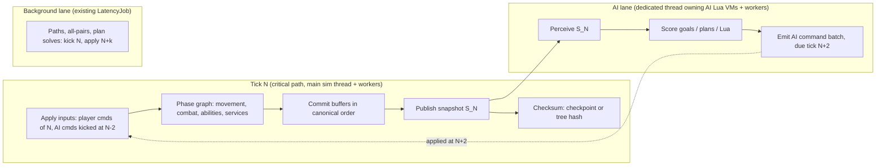

# Design: a simulation that uses every physical core, with the same outcomes and bounded latency

Status: **approved, in progress** (Gabriel, 2026-11-14: "full sim system redesign"). A named exception to the current focus
([`DECISIONS.md`](DECISIONS.md), "Parallel sim redesign"). Roadmap: stage Performance, box `SIMP`, groups `sp0`-`sp7` (one per
step P0-P7 of section 8). Inputs: the worker-count sweep in
[`PERFORMANCE.md`](PERFORMANCE.md) ("Worker-count sweep", 2026-11-14), [`PERF_SERIAL_2026-11-14.md`](PERF_SERIAL_2026-11-14.md),
[`PERF_AUDIT_2026-11-07.md`](PERF_AUDIT_2026-11-07.md) (finding ids J*, S*, L*) and [`OPT_RESEARCH.md`](OPT_RESEARCH.md).

## 1. Goal

Rebuild the per-tick simulation so that:
1. **Outcomes are the same** in the sense of the parity tiers: tier-1 rules, data / Lua handling and feel are unchanged; tier-2
   random-driven outcomes (AI decisions, battle results) keep retail's distribution over many seeds; internals are free.
2. **Rule 3 holds:** every result game logic reads is bit-identical for any worker count, run, and MSVC / clang.
3. **Every physical core does useful work** on large scenes, and adding cores never makes a tick slower.
4. **Latency stays bounded and known** (section 6): a player's order takes effect on the same tick as today; AI reaction delay grows
   by a fixed, small number of ticks; tick wall time meets the existing budget (p99 < 16.7 ms, no tick > 33.3 ms).

## 2. Why the current design stops scaling

Measured (2026-11-14 sweep, median tick, W0 = serial, W15 = 15 workers): land battle 3.46 -> 2.90 ms, water 3.00 -> 2.39 ms, space
1.20 -> 1.00 ms; **3 workers already give all of that**; the galactic scene is *slower* with workers (0.63 -> 0.71-0.83 ms). Where the
serial time goes (W0, share of tick):

| Cost | Land | Water | Galactic | Why it is serial today |
|---|---|---|---|---|
| Tactical AI perception (snapshot, diff, threat grid, signals) | 40 % | 46 % | — | one sim-thread pass that writes AI state as it reads |
| AI goal scoring / planning / Lua | 10-15 % | 6-10 % | 69 % | Lua VMs are single-threaded; AI state (ids, task forces, budgets) shared by all players |
| Per-tick checksum of AI state (`crc.battle.ai`) | 19 % | 16 % | (small) | one system = one big serial hash; captured every tick |
| Tactical services chain (~40 steps after movement) | most of the rest | | | each step reads the previous step's writes and draws from one synced RNG stream |

So the parallel parts (movement, combat sweeps, spatial trees, the AI's per-object fill, stamps) are already parallel; what is left is
**a long serial critical path built from (a) the AI, (b) the checksum, (c) a chain of order-dependent services with one shared RNG
stream.** More `parallel_for` calls cannot fix that. The design below removes the AI from the critical path, makes the checksum cheap,
and turns the services chain into phases that can each run wide.

## 3. Architecture

Three lanes per tick, all scheduled by tick number only:

- **Critical lane (the tick).** Runs on the sim thread, fanning out to workers inside each phase. Contains only what must be current:
  player commands, physics-like systems, rules, story Lua, victory checks.
- **AI lane.** The whole AI (tactical and galactic): perception, goals, plans, free store, AI Lua. It reads only an immutable
  snapshot of tick N and produces a command batch that the critical lane applies at the start of tick N + k_ai (default k_ai = 2).
  While the AI lane works on S_N, the critical lane runs tick N+1 on the other cores.
- **Background lane.** The existing fixed-latency jobs (`alamo/ai/latency_job.hpp`): path recomputes, galactic all-pairs, plan
  solves. Unchanged contract: kick on N, apply on N+k, block if late.

The rule that makes this deterministic is the one the project already uses for background jobs, extended to the AI: **what crosses a
lane boundary is a value copied at a tick, applied at a tick fixed when it was produced, never earlier, and the receiver blocks if it
is late.** Thread timing then decides only *when the CPU does the work*, never *what the sim sees*.

## 4. Building blocks

### 4.1 Topology-aware job system (CP1, J1-J3)
- **Pool = physical cores.** Read `GetLogicalProcessorInformationEx`: one worker per physical core (SMT siblings left to the OS, the
  render thread and audio), minus the sim thread and the AI thread. On a 7800X3D: 8 cores -> sim thread + AI thread + 6 workers. On
  hybrid CPUs, P-cores only for the critical and AI lanes (`EfficiencyClass` from CPU sets); E-cores take background work. On
  dual-CCD parts, keep the pool on one L3 domain (the V-cache CCD on X3D).
- **Three priorities**, strict: critical (the tick's phase jobs) > AI > background. A worker finishing a chunk always looks at the
  critical queue first, so AI and background work only fill gaps in the tick and never delay it.
- **Fork only when it pays.** `parallel_for` gets a cost estimate (items x cost class); below about 50 us of work it runs inline.
  Helpers = min(workers, chunks - 1, work / min_chunk).
- **Waits:** the caller waits for finished chunks, not exited helpers (J1); spin with `_mm_pause` for a few microseconds, then block
  on the counter with `std::atomic::wait` (J2); wake min(copies, idle) workers; no `std::this_thread::yield()` on the sim thread.
- **OS hints:** opt the process out of power throttling (`SetProcessInformation`, execution speed and timer resolution), sim and AI
  threads one priority step up. Wall-clock only; nothing reads it.

All of this is golden-neutral: results already do not depend on the worker count.

**As built (sp1, 2026-11-14; `alamo/jobs/job_system.hpp`, `topology.hpp`).** Port choices where the build differs from the text above:
- *Cost estimate:* measured, not declared. Each `parallel_for` call site (the lambda's type) keeps a wall-clock work-per-item
  estimate (inline: the loop's time; forked: time x threads that ran chunks); estimated work below 50 us runs inline, and at most one
  thread per 25 us of work joins. No call site changed. The first call of a site always forks (no estimate yet).
- *Strict priority:* only a loop's **helpers** run queued critical jobs between chunks, not its owner (the owner's stack may hold the
  job a critical job waits on: a self-wait deadlock found in review). Rule added: a critical job never waits on an AI or background
  counter.
- *Sleep:* one epoch per kind of sleeper (idle workers; waiters), `std::atomic::wait` on it, after a 5 us (waiter) / 30 us (worker)
  `_mm_pause` spin; not one wait per counter.
- *Pool:* P-cores of the largest cache domain (then the larger L3) minus 2; a hybrid part with few P-cores still gets up to 3 workers
  from its other cores. E-cores do not get a background-only queue yet. Workers are kept on the pool's cores (one logical processor
  each) only when workers + 2 fit (the default does; `ALAMO_JOBS_CPUSETS=0` turns it off).
- *OS hints:* power-throttling opt-out in `alamo_game` and `alamo_headless`; the sim thread one step up in `alamo_game` (above-normal
  process) and in `alamo_headless --bench`. The AI thread does not exist yet (P3); its slot is reserved in the worker count.

### 4.2 The snapshot (frozen read view)
- At the end of each tick the critical lane publishes `S_N`: the data the AI and other readers need, as **struct-of-arrays copied into
  a double (triple) buffer**: per-object id, type index, owner, position, facing, health / shield, order state, flags; per-player
  credits, tech, pop cap; the threat inputs; the event lists of the tick (deaths, production done, landings, ability ends: the
  signals the AI derives today in `refresh()`).
- Copying is parallel (one range of objects per worker) and costs about what `BattleAi::fill` costs today, which it replaces.
- Readers hold `S_N` by reference count; the buffer is reused when the last reader releases it. With k_ai = 2 three buffers suffice.
- Static data (type tables, XML) is shared read-only and never copied. The S6 string-keyed lookups are resolved once into a per-battle
  `TypeFacts[type]` table, so the snapshot holds type indices only.
- **Follow-on option: direct writes instead of the end-of-tick copy** (Gabriel, 2026-11-14). The critical lane writes the AI-read
  fields (position, health, owner, order, flags) straight into the buffer of the tick it is running, and publishing becomes a
  buffer-index flip with no copy. The AI-to-sim direction already works this way (orders are written into the slot for tick N+2).
  - What stays: one writer per buffer, and no reader opens it before it is sealed at the fixed tick. Reading a buffer still being
    written shows a half-finished tick whose content depends on thread timing, which breaks rule 3, saves and replays.
  - Stale fields: with three rotating buffers, the next buffer was last written two ticks ago. Either write every AI-read field
    every tick (cheap for fields that change anyway), or patch only the fields changed since (a dirty list; a small copy remains).
  - Cost: every system that writes those fields now writes into the buffer, a much wider change than one publish step.
  - Gain is small: ~2,000 objects × ~64 B ≈ 128 KB, tens of µs to copy. The 1.4 ms of `tac.ai.perception` today is lookups, sort
    and diff, not bytes moved.
  - Order: ship the end-of-tick copy first, profile it, and move the hottest fields to direct writes only if the copy shows up.

### 4.3 Deferred writes, committed in a canonical order
- Inside a phase, a parallel job **never writes shared state**. It writes (a) its own per-index output slot, or (b) records into a
  per-worker buffer: commands, damage, spawns, deaths, events, AI-state mutations.
- At the phase's end the buffers are merged by a **canonical key**, e.g. `(phase, source entity id, sequence within the source)`,
  never by worker or arrival order, and applied serially or in parallel by target.
- This is the "read old, write new, commit in index order" technique already used for movement and combat (OPT_RESEARCH.md §4),
  made general.

### 4.4 Counter-based random streams
- One synced stream drawn in call order is what forces most services to run one after another. Replace it, per system, with
  **counter-based draws**: `rand = hash(session_seed, tick, stream_id, entity_id, draw_index)` (a SplitMix / Philox-style mix), so
  each entity's draws are independent of every other entity's and of thread order.
- The OPT2 t10 PotentialPlan solves already do this (`pp_streams`: seeded by session seed, frame, player, goal source and target).
- **Parity:** the random stream layout and draw order are tier 3 (free). The distribution of each draw is unchanged (same ranges,
  same formulas), so per-seed outcomes move but distributions should not: verified by the tier-2 harness (section 7). Keep the old
  synced path behind a config flag per system, as `stagger` / `pp_streams` do, for A/B runs.

### 4.5 Checksums that do not serialise the tick
- **In `alamo_game`:** capture on checkpoint ticks (`tick % 64 == 0`, the goldens' v2 cadence), on save, and on demand; ring-buffer the
  log. Headless, tests and `--crc-out` keep every tick. Golden-neutral.
- **Everywhere, later:** a **tree hash**: each system hashes fixed blocks (e.g. 256 objects) in parallel, and the system digest is the
  hash of its block digests in order. One golden regeneration; after that capture cost is spread over all cores. Blocks that did not
  change since the last capture reuse their digest (dirty bit per block).
- **As built, first half (sp2, 2026-11-14):** `SimHost::set_crc_cadence(every, ring)` / `set_default_crc_cadence` /
  `capture_crc_now()`. `alamo_game` uses 64 with a ~4096-record ring in live play, the scenario's fingerprint cadence (16) in a
  benchmark with a scenario, and 1 for `--smoke`, `--bench-make` and `--bench-crc-out`; on-demand records at a save, a benchmark's
  end and the presentation check (an off-grid one goes on the v2 log's keep line). The game's log is a v2 checkpoint log, so the
  fingerprint and on/off compares work on its stored ticks. Headless, tests and goldens stay at 1.
- **Space path retries (P6 line of section 5, done in sp2):** `plan_space_path(..., pf)` runs try 1 alone, then the remaining tries
  in parallel waves with the serial chain's parameters for the best progress known so far; a speculative try is used only when its
  parameters equal the serial ones bit for bit, else a new wave starts there. Same result as the serial loop (tested and
  stress-tested); it costs extra CPU when tries are rerun (10-15 % of speculative tries on `nebula_battle`).

## 5. System by system

| System | Today | Redesign | Parallel shape | Tier |
|---|---|---|---|---|
| Movement (`tac.movement`) | parallel tick + serial commit | unchanged core; space path requests try candidate routes **in parallel**, take the first success in try order (fixes the nebula 24 ms p99 spikes) | per unit, per try | 3 |
| Combat / abilities | parallel sweeps, serial `combat_pre` sync (S10) | bulk SoA sync from the movement output; damage as deferred records committed by (target id, source id, seq) | per unit, per target | 3 (draws: 4.4) |
| Spatial trees | parallel maintain | unchanged | per tree | — |
| Services chain (~40 steps: reinforce, landing, hangars, garrisons, weapons, expiry, pads, fog, queues, victory) | serial, one RNG stream | group into **phases by data they write** (a dependency graph declared per service: reads / writes); services in one phase that touch disjoint data run concurrently; within a service, per-entity work runs wide with 4.3 + 4.4; rule order that retail defines (tier 1, e.g. which target is picked first) stays as an explicit edge in the graph | per phase, per entity | 3, plus 4.4 for draws |
| Tactical AI | inside the tick, ~55-60 % of it | moves to the **AI lane** (section 3): perception from `S_N` replaces `refresh()`; per-object perception, threat-grid cells and goal candidates scored on workers (AI priority); AI state mutations committed in player order; Lua VMs owned by the AI thread | AI lane, wide inside | **2** (AI acts on N, applied N+2) |
| Galactic sim (`gal.sim`, economy, all-pairs) | small; all-pairs already background | unchanged; serial inside galactic mode when the scene is small (forks below threshold run inline, 4.1) | — | — |
| Galactic AI (`ai.goals` 69 %) | inside the tick | AI lane like the tactical AI; goal scoring per (goal, planet) on workers (CP3), equation names resolved to ids at load (S7) | AI lane, wide | **2** |
| Story / mission Lua | inside the tick | **stays in the critical lane**: story scripts are rules (tier 1) and see the current tick | serial | — |
| AI Lua (plans, free store, evaluators) | sim thread | owned by the AI thread (`LuaVm::claim_ownership` at battle start; the frame-boundary hand-off it was made for). Evaluator scripts used inside parallel goal scoring: one VM per worker, built in parallel at load, or C++ versions of the hot equations | one VM per thread | 3 |
| Lua GC | scheduled by tick, parallel across VMs | unchanged; AI-lane VMs collected on the AI lane at the same tick-derived slots | per VM | — |
| Checksum | every tick, serial per system | 4.5 | per block | 3 (tree hash moves goldens once) |

### 5.1 The AI lane in detail
1. End of tick N (critical lane): publish `S_N`; hand the AI lane a job "think on N".
2. AI lane, on its thread with AI-priority helpers: run the tactical AI (or galactic AI) update exactly as today, but every
   read goes to `S_N`, and every order goes into an **AI command batch** tagged `due = N + k_ai` instead of
   `CommandPipeline::execute_direct`. AI-internal state (task forces, budgets, plans, ids) lives only in the AI lane, so nothing races.
3. Start of tick N + k_ai (critical lane): wait for the batch (normally long finished), validate each command against the current
   state with the same rules a player command goes through (a unit that died in the meantime is rejected, as a late player click would
   be), apply in (player, sequence) order, then player commands for the tick in their usual order.
4. Bindings that read back an order the AI just gave (`Is_Moving`, status polling, `BlockOnCommand`) answer from the AI lane's own
   record of issued commands until the snapshot that contains their effect arrives. This is the defined answer for "queued, not
   applied" that the 2026-11-02 investigation (OPT_RESEARCH.md) asked for.
5. Signals the AI reacts to (death, production done, landing, ability end) arrive with `S_N`, so the AI sees them one snapshot
   later than today, plus k_ai.

**Why k_ai = 2:** the AI then has one full tick (33 ms) of wall time before its result is needed, while today's tactical AI takes 0.3-1.8 ms
median and up to about 7 ms p99 on the bench scenes, so the critical lane practically never waits. The exceptions are one-off ticks
(land worst 26 ms; a 190 ms plan load in `nebula_battle`), which must be moved out of the AI update itself (load plan VMs ahead on
workers, S1 / S2) or they become a wait. k_ai = 1 leaves no slack; more than 2 adds
reaction delay for no throughput gain.

**Why this keeps outcomes:** retail's tactical AI already thinks on cadences of seconds (`*_AI_Goal_Cycle_Sleep_Duration`, the 90-frame
path cadence, goal proposal passes of hundreds of frames), and the port already moved plan solves one tick later (OPT2 t10) without a
tier-2 regression. Two ticks (67 ms) is far below those cadences. It is still a behaviour change, so it is verified as tier 2.

### 5.2 Optional second step: AI players in parallel
Once the AI lane exists, the remaining blocker for running players side by side is shared AI state (OPT_RESEARCH.md "Investigation: AI
players' Lua VMs in parallel"): id counters, the shared `Script_<File>` evaluator VMs, shared caches. With per-player id spaces
(`player << 24 | n`), per-player evaluator VMs and the 4.4 streams, each player's update reads `S_N` and its own state only, and the
command batches merge in player order. Worth it only for scenes with many AI players (galactic with every faction an AI: `T7.p0` and
`T7.p1` are 35-39 % each).

## 6. Latency budgets

| Latency | Today | After | Rule |
|---|---|---|---|
| Player order -> effect | applied in the tick it is scheduled for | **unchanged** | player commands are never routed through the AI lane or a snapshot |
| Player input -> on screen | render interpolates the last two ticks | unchanged | presentation reads the published snapshot it already reads |
| AI reaction (event -> AI order applied) | same tick (direct) or +1 (plan solves) | **+2 ticks (67 ms)** fixed | k_ai fixed per world, saved |
| Background results (paths, all-pairs) | +k (existing) | unchanged | LatencyJob contract |
| Tick wall time | p99 2-9 ms, budget 16.7 ms | critical lane only; target <= 1/2 of today's on battles | AI never blocks the tick unless it overruns a full tick |
| Fork overhead | up to tens of us per `parallel_for`, worse on a busy PC | <= a few us; inline below ~50 us of work | 4.1 |

**Overrun rule (deterministic):** if the AI lane is not done when its batch is due, the critical lane **waits** (it does not skip or
reorder). That keeps rule 3; the cost shows up as a tick-time spike and is caught by the profiler and the bench suite. To keep it rare:
AI-priority helpers, k_ai = 2, and the existing staggered per-player clocks (OPT2 t01) so players do not plan on the same tick.

**What is never done:** time-budgeted work ("run the AI until 2 ms are used"), skipping a late result, or applying a result early
because it finished early. Each of those makes the outcome depend on the machine.

## 7. Proving "same outcome"

- **Rule 3:** every step runs the existing worker-count checks (0 / 1 / 4 / default) on MSVC and clang, plus ASan for the job system.
- **Tier 1:** unit tests and `docs/re/` spec checks unchanged; services keep any retail-defined order as explicit graph edges; the
  story Lua stays in the critical lane.
- **Tier 2:** every step that moves AI decisions or random draws (4.4, 5.1, 5.2) ships **behind a config flag** with the old path kept
  (like `stagger`, `pp_streams`), and is judged by the Q4 parity harness over many seeds: win rates, battle lengths, losses, build
  orders, campaign flow within tolerance of retail. One seed moving is not a failure (Parity tiers row).
- **Saves:** the AI lane's in-flight state (the snapshot's inputs or the pending command batch with its due tick) is saved with the
  LatencyJob save rule: keep the inputs, re-run inline on load, apply on the saved tick. A save/load round trip must equal the
  uninterrupted run (existing saveload smoke).
- **Goldens:** golden-neutral steps prove it with byte-identical CRC logs; golden-moving steps regenerate with
  `tools\regen_goldens.cmd` and say so in the commit, one step at a time so each move is attributable.
- **Speed:** the six bench scenes (`tools\benchmark\run_suite.cmd`) on a quiet PC, W0 and default workers, plus a large-scene
  stress (four times the fleets) to show scaling; worker counts 1, 3, 6, 15 to show no regression with more cores.

## 8. Plan

| Step | Content | Moves goldens | Tier | Expected effect (land battle tick) | Exit test |
|---|---|---|---|---|---|
| P0 | Measure: temporary zones splitting `tac.ai.perception` (fill / diff / grid / signals) and the services chain | no | — | none | profile table in PERFORMANCE.md |
| P1 | Job system: physical-core pool, priorities, inline small forks, J1/J2 waits, OS hints (4.1) | no | 3 | galactic back to W0 speed or better; no loss on a busy PC | sweep: no scene slower at any worker count than at W0 |
| P2 | Checkpoint-only checksum in `alamo_game` (4.5 first half); `TypeFacts` (S6) | no | 3 | -16-19 % (game), -some % fill | game bench: sim ms down; CRC logs identical |
| P3 | Snapshot `S_N` + AI command batch + AI thread owning AI VMs, k_ai = 2, tactical AI only (4.2, 5.1) | **yes** | **2** | critical path about -50-55 % | parity harness within tolerance; worker-count checks; saveload smoke |
| P4 | Galactic AI on the AI lane; parallel goal scoring (CP3) and S7 | **yes** | **2** | galactic `ai.goals` off the critical path | same as P3 |
| P5 | Services phase graph, deferred writes, counter-based streams per service (4.3, 4.4, 5) | **yes**, per service | 3 (+2 via draws) | the remaining serial chain runs wide on large scenes | harness; per-service A/B flag |
| P6 | Tree-hash checksum (4.5 second half); parallel path tries in space | yes once / no | 3 | removes the last per-tick serial hash; nebula p99 | CRC regen; nebula p99 < 16.7 ms |
| P7 (optional) | AI players in parallel (5.2) | yes | 2 | many-AI galactic scenes | harness |

Order rationale: P0-P2 are golden-neutral and cheap, and P1 removes the "more cores is slower" problem before anything adds work to
the pool. P3 is the single largest win and the one real design change. P5 is the most work and pays mainly on scenes larger than
today's.

**Ceiling estimate (land battle, 8 physical cores):** today 3.46 ms serial / 2.90 ms at W15. After P2 + P3 the critical lane holds
movement, combat, services and story, about 1.0-1.3 ms of serial work, partly parallel already; P5 brings that toward 0.5-0.8 ms on
large scenes. The AI lane runs about 1.8 ms on its own thread plus helpers, inside its 33-67 ms window. Expected critical-path speed-up
about 2.5-4x, rising with scene size, because the AI and services grow with unit count while the fixed costs do not.

## 9. Risks and open questions
- **AI reaction delay (tier 2).** Two ticks might shift micro-behaviour that matters (e.g. focus fire on a dying target, retreat
  timing). Mitigation: the harness; k_ai is a per-world setting (1 is possible with less slack); bindings answer from issued-command
  records (5.1 step 4).
- **Story scripts that call AI functions** (e.g. AI-related Lua API used by mission scripts) would cross lanes. Inventory and the
  rule for each crossing: section 11 (sp3, 2026-11-14).
- **The tactical AI is far more coupled to the live battle than section 5.1 assumed** (section 11: ~110 live reads, ~85 writes,
  ~30 writes whose result the AI uses in the same call, 33 shared-RNG draw sites). Gabriel chose the full lane anyway (2026-11-14);
  sp3's estimate went from ~5 days to 3-4 weeks and its exit from 40 % to 20 % (after `TypeFacts` the whole tactical AI is ~24 %
  of a land tick, PERFORMANCE.md).
- **Snapshot size and copy cost** on very large battles: SoA plus copying only changed blocks (dirty bits shared with the tree hash).
- **Services graph correctness:** a missing read/write declaration is a data race. Debug builds check declared sets (record touched
  components and assert); ASan / TSan-style runs on the services phase.
- **Lua 5.0.2 VM count:** per-worker evaluator VMs multiply memory by worker count; build them lazily per worker, or move the hot
  equations to C++.
- **Save format** gains the in-flight AI state (tier 3; save version bump).
- **Measurements so far are from one 8-core CPU** with a partly busy machine; hybrid and dual-CCD CPUs are unmeasured.

## 10. Not proposed
- Results that depend on timing or worker count (time budgets, first-come ordering, skipping late results).
- Moving story / mission Lua off the critical lane.
- Sim / render overlap: measured no gain at today's tick + render times (PERFORMANCE.md, "Tried and not shipped"); revisit only once
  tick + render exceed 16.7 ms on target hardware.
- Replacing Lua 5.0.2's collector or semantics.

## 11. AI lane inventory: what crosses the lane boundary today (sp3, 2026-11-14)

Everything the tactical AI (`TacticalAiWorld`, its Lua VMs, its host `BattleAi`) reads from or writes to the live battle during its
update, with the rule the AI lane applies to each. Counted from the code at `9a5fe0f4`. Abbreviations: tai =
`engine/ai/tactical/src/tactical_ai.cpp`, bai = `engine/apps/sim/src/battle_ai.cpp`, cb = `engine/apps/sim/src/campaign_battles.cpp`,
bo / bsr / bsg / bfog / bpl = `engine/lua/src/bind_{objects,script_remaining,script_gaps,fog,players}.cpp`. Every rule below that
changes *when* the AI learns something or *which* random draw it gets is a tier-2 or tier-3 change judged by the Q4 harness with the
`ai_lane` flag on (section 7); the flag-off path is unchanged.

### 11.1 Reads (~110 entry points)
| Family | Count | Examples | Rule on the AI lane |
|---|---|---|---|
| Object store reads in `TacticalAiWorld` | ~40 sites, 18 functions | alive / owner / position of TF units, `arg_position`, `prune_tf`, `status_signals`, `find_target`, `store.dying` | the AI owns a private **snapshot store**: a copy of the battle store taken when `S_N` is published (same slots and generations, so held handles stay valid; hooks cleared, own id counter, `create` refused) |
| AI Lua bindings walking the store | 14 families | `Find_All_Objects_Of_Type`, `Find_Nearest`, `Find_Hint`, GameObjectWrapper getters, `Event_Object_In_Range` | the same snapshot store (`LuaHost::store`) |
| `PerceptionWorld` callbacks | 5 | `hard_points`, `object_fogged`, `point_fogged`, `in_active_base_shield`, `parent_rep_type` | captured into `S_N` (per-unit hard points, per-player fog bits, active shields, parent types) |
| `TacticalAiHost` queries | 19 | `population_cap / used`, `reinforcement_pool`, `can_reinforce`, `build_pads`, `build_pad_check`, `can_build_now`, `tactical_builders`, `movement_locked`, `sight_weather_factor`, `space_drop_ok`, `land_drop_ok` | per-player answers captured at publish; per-call ones answered from frozen copies of the system state they read (pads, locks, landings); the two drop-placement searches (movement occupancy over future frames) run inside the command's apply on the critical lane |
| Bridge / Remaining / Tactical / Fog hooks (reads) | 33 | `order_finished`, `energy`, `rate_of_damage`, `time_till_dead`, `final_blow_player`, projectile, hero clash, move goal, field / shield tests, strike availability, special-weapon readiness, TSW state, `engines_online`, `ground_height`, `object_hidden` | per-object and per-player values captured into `S_N`; geometry against static data |
| `AbilitySystem` / `CombatSystem` pointers in the bridge | 9 bindings | `Has_Ability`, `Is_Ability_Ready`, `Get_Hull`, `Get_Shield`, `Is_Under_Effects_Of_Ability` | per-object ability / hull state captured into `S_N` |
| Galactic reads | 3 | `Evaluate_In_Galactic_Context`, `parent_rep_type`, `hijack_unit` | read-only copy taken at battle start (the galaxy changes during a battle only through the AI's own writes) |

### 11.2 Writes (~85 entry points, ~30 with a same-call result)
| Family | Count | Same-call result used | Rule on the AI lane |
|---|---|---|---|
| Orders (`execute` -> `BattleAi::execute_order`) | 11 event types (2 dead) | `RejectReason`: TF status Failed vs Move / Attack, production "try builders until one accepts", `Build_All` count, `Withdraw_Units` bool, `attack_order_refused` | **AI command batch** due `N + k_ai`; the same-call answer comes from the same validation run against the snapshot (issued-command record); the critical lane validates again at apply, and a rejection reaches the AI as an order-result event in a later `S_N` |
| Reinforce (+ `reinforce_in_flight`, the `owned_by` adoption diff) | 1 | spawned units adopted at once | adoption reads the units from the first snapshot that contains them (issued-command record keyed by the command) |
| Host writes (`hijack_unit`, `unit_released`, `unit_left_task_force`) | 4 | `hijack_unit` returns the pool entry | commands; the entry predicted from the snapshot pool |
| Bridge, ability, strike, special-weapon, pad, hyperspace, teleport, fog hooks | ~45 | Activate_Ability accepted count, `spawn_ability_target` id, Fire_Special_Weapon / Bombing_Run / Build / Divert bools, `FogOfWar.Reveal` handle | commands; bools predicted from the captured readiness state; objects a command will create get **provisional handles** that resolve when the batch applies |
| Store mutations that bypass the battle | 9 | Spawn_Unit, Create_Generic_Object, the Reinforce_Unit / Spawn_From_Reinforcement_Pool stand-ins, Despawn, Take_Damage, Face_Immediate, Enable_Behavior, cinematic transport | commands (today they skip battle adoption; the flag-off path stays as it is) |
| AI-bridge state the battle reads | 2 | Lock_Current_Orders `orders_locked`, Divert state | published with the batch; the battle reads the version of the last applied batch |
| GlobalValue.Set, players-world writes | 6 | none | commands |

### 11.3 Random draws
33 sites share the session's synced stream: 18 on the AI side (goal init, plan pick, PotentialPlan solves, FindTarget, Script_
evaluators, Guard / "Random" hard point, Most_Defended, Lua GameRandom / DiscreteDistribution / Find_Best_Local_Threat_Center) and
~15 host draws inside AI-issued orders (moves, `land_attack_order`, reinforce, build, follow re-path, the UnitAI stamps of `fill`).
Rule: the AI side draws from an **AI-owned stream** seeded from the session seed and saved with the AI state (tier 3); host draws
stay on the synced stream, made at apply time on the critical lane.

### 11.4 Pushes into the AI, and sim work inside the AI slot
- `order_replaced` (raised by AI, human, story and any VM's orders) and the fog `refog` callback mutate AI state on the raising lane
  today: queued with (tick, sequence) into the next `S_N` event list.
- Movement reads the AI threat grid (`point_danger`): the grid of the last applied batch.
- `BattleAi::follow_service` (in the battle CRC) and `standin_orders` are sim behaviour: they move to the critical lane.
- Per-tick event lists that are pure (`attack_state_signals`, `ability_finished`, `reinforcements_unloaded`, `production_completed`)
  are copied into `S_N`; `opportunity_targets` diffs host state (`opp_prev_`), so the diff runs at publish.
- The AI-state CRC (`crc.battle.ai`, 0.6-0.9 ms) reads state the AI thread mutates: the AI lane computes its digest at the end of its
  update and the critical lane's capture uses the digest of the last applied update (wiring agreed with simp-core, the checksum's owner).

### 11.5 Story / mission Lua -> AI state (sp3 t07; story Lua stays on the critical lane, tier 1)
| Crossing | Today | Rule |
|---|---|---|
| `Prevent_AI_Usage` (cb 1534) | writes the free store at once, returns `PreventAiResult` | a command to the AI lane applied at its next update; the result (`NotInitialised` ...) from the AI status the lane publishes in `S_N` |
| `order_replaced` from story orders / Activate_Ability | push into AI state | queued push (11.4) |
| `GlobalValue` Get / Set (one session table for story, tactical AI, galactic AI) | shared table | story keeps the live table; the AI reads the copy in `S_N` and its Sets are commands |
| `set_tactical_galactic` (battle start) | host call | unchanged (runs before the lane starts) |
| Story `FogOfWar.Reveal`, `Lock_Current_Orders`, abilities | battle state the AI reads | reach the AI through `S_N` |
| Story `Suspend_AI`, `Give_Desire_Bonus`, `Purge_Goals`, `Budget.Flush_Category`, `Release_Credits_For_Tactical`, `EvaluatePerception`, `Find_Path`, SWITCH_CONTROL | reach the galactic AI only | sp4 |

Gaps found on the way (flag-off behaviour, not changed by sp3; backlog): story `Suspend_AI` / `Give_Desire_Bonus` / `Purge_Goals`
never reach the tactical AI; AI-VM `Turn_To_Face`, the Garrison family, `Sell` and `Hyperspace_Away` without its hook are dropped as
Unhandled; the 9 store-bypassing writes skip battle adoption.

### 11.6 Implementation choices (sp3, `[port]`, tier 3 unless marked)
- `--ai-lane [--ai-lane-k K]` (alamo_headless; process default `sim::ai_lane_defaults()`, copied into every
  `TacticalAiSetup`); a save of an AI-lane session records `ai_lane` / `k_ai` in its descriptor, so `--load` rebuilds it as one.
- AI-owned stream: `GameRandom` seeded by `ai_lane_seeds(session seed)`, hashed with the AI world and saved. Tactical AI save
  version 13 = version 12 plus `k_ai` and the stream, written only with the lane on; a version-12 save also loads into an AI-lane
  world (the bench and harness saves), a version-13 save never into a lane-off one. `battle.ai` chunk: version 5 = 4 plus the
  queued orders, the same rule.
- Order batch (t04 so far): moves, MoveToObject, Attack and the Lua object orders Move_To / Attack_Move / Guard_Target / Stop
  are queued as canonical `commands::Command`s (source AI, `scheduled_tick` = N + k_ai) and applied by `SimHost`'s T2
  `before_commands` hook ahead of the players' commands, in `drain_order_less` order, through the unchanged `execute_order`.
  The AI's same-call answer is `BattleAi::predict_order` (the rejections that depend on the order and the state alone);
  a predicted rejection is not queued. **Tier 2**: the order acts two ticks later and its result is a prediction.
- Publish / think (t02, inline so far): with the lane on, the AI slot of tick N runs `TacticalAiWorld::publish()` on the
  critical lane (the host's fill, the tick's host event lists, the snapshot store: a copy-assigned `ObjectStore` the world and
  its Lua VMs read) and then `think()` as a job. A job's queued orders and the digest of the AI world after it become visible
  only when the job is collected (at the next AI slot, or at T2 of its due tick when k_ai = 1); the `battle.ai` CRC hashes the
  digest of the last collected job, so with the lane on the world's hash is computed inside the job (off the critical lane)
  and a capture never reads the world while a job may run. A save keeps a finished, uncollected job as it is (`battle.ai` v5).
  The session descriptor's `ai_lane` / `k_ai` options are not compared when a save is loaded (a lane-off save loads into an
  AI-lane session). Inline cost on `land_battle` (busy PC): `tac.ai.publish` 0.20 ms p50 (fill 0.17, store copy ~0.03) against
  `tac.ai` 0.56 + `crc.battle.ai` 0.97 ms with the lane off.
- Captured host answers (t02, slice 4a): at the AI slot, before `publish()`, `BattleAi::capture_lane_view` copies what the
  `TacticalAiHost` overrides answer (reinforcement pool, can-reinforce, population cap / used, space drop frame, player
  relations, pads and their contents / cooldowns, movement locks, reinforcements in flight, weather sight, the damage-tracking
  store); the pad checks run on the AI side against the snapshot store (`PadEnv`). Still live from `think()` until later
  slices: the drop-placement searches, the builders, hijack / release, `predict_order`'s unit reads, the bridge hooks of 11.1.
- Ability / combat bindings (t02 + t05, slice 4b): `ObjectBridge::lane_abilities` holds one record per object of the battle's
  ability or combat system (`lua::capture_lane_abilities`, one pass per object through `AbilitySystem::lane_types`): each
  listed ability type's has / ready / can-activate / active / autofire answers plus dry runs of `set_unit_ability_mode` (on,
  off) and `targeted_ability` (per user, without the target's checks), and container, tractored, ion stun, immobilize count,
  engine hard points, hull and shield. The AI VMs' bindings read those and hand every write (autofire, ability mode, targeted
  and dummy-target abilities, recharge, counter reset, movement unlock, targeting priorities, stickiness, Activate_Ability's
  signal 0xb) to `lane_write`, which queues it as a PortExtension `kLaneWriteSubtype` command in the same batch as the orders;
  `lua::apply_lane_write` makes the binding's own calls at the due tick. The records are never carried across AI slots:
  every `BattleAi::update()` captures them from the battle state of that tick right before `think()`, and the AI scripts
  run only inside `think()`, so they are not saved - a load recaptures the same records from the same saved battle state
  at its next AI slot (the queued writes are saved with the job, `battle.ai` v5; checked by
  `alamo_headless_save_skirmish_foc_ai_lane` / `_foc_land_ai_lane`, `--save-check` with a job in flight). Only scripts run
  before the first capture (`TacticalAiWorld::start` at battle start, critical lane) act live. Capture cost on `land_battle`: ~0.08 ms p50
  (`tac.cap.abilities`, ~220 objects). **Tier 2** (for the harness): a script reads the state of the AI slot, so its own
  writes are not visible to it in the same think (e.g. `Is_Ability_Active` right after `Activate_Ability`); the same-call
  answers (Activate_Ability's block for the object-target and jet-pack families) are the dry runs' predictions
  (`BattleAi::lane_mismatches` counts the applies that differ); writes apply k_ai ticks later in (player, sequence) order.
- AI commands (t04 + t05, slice 4c): with the lane on, `BattleAi::execute` runs nothing from the AI side. Retreat,
  Production, TacticalBuild and the four ability commands are queued like the orders; an event `execute_order` does not act on
  answers Unhandled without running. `predict_order` reads only the snapshot store and the view (units with owner / container /
  live / movable, the teams, per player the retreat gate `retreat_block == 0`, tactical production on / off, the pad checks).
  Predictions: Retreat = the gate; Production = production on and a valid builder id (credits and buildability are not
  predicted); TacticalBuild = the AI's `build_pad_check` (cost and type are not); ability commands = an owned live unit among
  them. Reinforce (slice 4d) is queued too, predicted from the view (in the pool, can-reinforce, land population room, a finite
  point); the AI no longer reads the spawned units in the same call - with the lane on both reinforce sites (the land
  ReinforceBlockStatus and the space poll) record the drop as a landing in flight, and the apply hands the units to the AI
  as a signal-0x19 unload record at the next AI slot (the battle's own record when the drop is a timed landing; an empty
  one when the apply refused it, so no status waits forever). A space status then also waits for its landings before it
  finishes (a timeout still ends it). `start()` with
  the lane on captures the view first, refreshes the snapshot store, and collects what the start scripts queued (before this,
  the first update dropped it). **Tier 2**: these commands act k_ai ticks later and their answers are predictions.
- Bridge reads and the script movement lock (slice 4e, part 1): with the lane on the AI bridge's `is_enemy`,
  `representative_type` (Find_Nearest / Find_All_Objects_Of_Type on TEAM containers), `order_finished` (every blocking
  order poll) and `move_goal` (Is_On_Diversion) answer from the view (per battle unit: movement unit, has goal, arrived, goal;
  per container: its team type). `map_hint` and `reinforce_facing` read data fixed at map setup. The movement lock the
  battle's movement reads (Lock_Current_Orders, a Divert's forced move) no longer reads the AI bridge: each job's
  `ObjectBridge::script_lock_facts` is published when the job is collected (`start()`: the start scripts'), hashed, and
  saved (`battle.ai` version 6 = 5 + the published and the pending facts; a version-5 save takes the loaded bridge's).
  **Tier 2**: a script lock or Divert reaches the movement at the collect, one AI slot after the script ran.
- L1 hooks (slice 4e, part 2): with the lane on `BattleAi::wrap_lane_hooks` keeps the live `RemainingScriptHooks` /
  `TacticalScriptHooks` and puts lane-aware ones on the AI bridge. Reads answer from the view: per battle unit and container
  rate of damage, time till dead, current projectile and projectile types, engines, energy, hero clash, `object_in_field`
  for the four field kinds; per player bombing run / bombardment availability and result, special weapons allowed, retreat
  increment; the final-blow list; a copy of the `SpecialWeaponSystem` (readiness, TSW state); build pad contents from the
  pads. `point_in_field` / `nearest_field` and `ground_height` read data fixed at map setup. Writes (Divert, Build,
  Lock_Build_Pad, strikes and their switches, Force_Weather, hero-clash release, special weapon begin / fire / lob, TSW fire,
  teleport, first lock, hyperspace out, set environment) are queued as host ops (`lua::LaneWriteOp::HostFirst..`) and the
  apply calls the kept live hook. Predictions: Divert = a live movable unit; Build = an empty pad; strikes = available;
  begin_targeting / TSW fire = the dry run on the copy; fire at object = readiness >= 1 and a valid target; lobbing = a lobbing
  pack with an owner. `spawn` from an AI VM is refused with the lane on (no shipped AI script spawns; counted). Not yet off
  the live battle (slice 4e part 3): the shield-side queries, the fog hooks and FogOfWar, GlobalValue, Prevent_AI_Usage.
  Capture cost on `land_battle` grew to ~0.30 ms p50 (`tac.ai.capture`; the per-unit facts are serial for now).
- Fog and GlobalValue (slice 4e, part 3): with the lane on, the AI bridge's fogged test (Find_Nearest with a player,
  force 1 - the only form the bindings use) answers from bits captured for the AI players; `FogOfWar.Reveal_All`,
  `Temporary_Reveal` and `Disable_Rendering` are queued (`FogScriptHooks::lane_write`) and applied at the due tick; `Reveal`
  and `Undo_Reveal` (a cells handle used at once; no shipped AI script calls them) are a script error off the critical lane.
  GlobalValue: the AI world reads and writes a private copy of the session table, rebuilt at each publish (and at start) as
  the table plus the AI's own writes still in the batch (read-your-writes across AI slots); each Set is a batch command
  (PortExtension 0x4147) applied to the session table at the due tick. **Tier 2**: story Lua and the galactic AI see an AI
  GlobalValue.Set k_ai ticks later. Still live from `think()` (slice 4f): the perception world's `object_fogged` /
  `point_fogged` / `in_active_base_shield` hooks. Critical-lane budget on `land_battle` (publish + every capture):
  ~0.69 ms p50 (capture 0.52, publish 0.17), all serial - slice 4f parallelizes the per-object captures.

## 12. P5 implementation notes (sp5, simp-svc, 2026-11-14)

How P5 is built; status and open items are on the roadmap (group `sp5`), checks in [`BUILD.md`](BUILD.md) ("Services graph checks").
- **Graph** (`engine/tactical/services`, `tactical_battle_services.cpp`): every step of `TacticalBattle::tick` is a service declared in
  the old order with component sets (rng, store, state = the State save part, movement, combat, abilities, garrison, hangar, fog,
  damage, trees, signals, hooks, host). A service conflicting with an earlier one goes into a later phase; the old `tac.*` laps are
  barriers. Services whose sets are not narrowed yet declare everything, so today nearly every phase holds one service: the
  coarse `state` component (most services write units / containers / stats) is what keeps phases narrow. Each service is timed as
  sp0's `tac.s.<step>` zone.
- **Where the parallelism is today**: inside services, not between them. The per-unit loops (combat sync = S10, speed factors,
  collision feed, attack targets, pair gates, swap-back signals, engine loops, tree boxes, fog sources) compute per unit in
  parallel and write only the unit's own slot (movement / combat entry, a per-index output); shared state (EngineLoops, the fog
  grids, the trees, the signal lists) is changed afterwards serially in unit order. Fog: `FogOfWar::service_sources` computes the
  re-reveal cell lists in parallel (`FogGrid::dense_cells`, const), then each player's grid applies its undos / counts in unit
  order on its own worker (the clamped undo makes order matter within a grid; grids are independent). The trees likewise:
  `TreeSet::update_batch` gives each spatial tree its boxes in unit order, the trees side by side. Golden-neutral by
  construction; the forks start at 256 units (`ServiceRunDefaults::parallel_min`), and sp1's job system runs a loop whose
  measured work is under 50 us inline (`kInlineWorkNs`), so the small services (victory, swap-back signals) stay serial.
- **Lazy caches** are the hazard of read-only parallel loops: `TacticalMode::model_ref` fills a per-type cache on first use, so the
  loops fill exactly the entries the serial code would have filled first (`prepare_bounds`, the fog pre-pass); filling more would
  change later `model_ref(t, false)` readers.
- **Streams** ([port] draw order, tier 3): `ServiceRunDefaults::streams` (headless `--svc-streams`), a bit per `StreamId`; first
  service: hangars (entry / bay picks per carrier from `stream_rng(session_seed, frame, Hangar, carrier)`). Default off (no golden
  moved); a default is switched only after the Q4 harness A/B (DECISIONS "Parallel sim redesign"). The hangar loop itself stays
  serial: `pending_delivery(.., true)` takes a skirmish delivery from shared state.
- **Stress scene** ([port] bench only): `foc-land-army4` = 24x the foc-land company lists with `Max_Ground_Forces_On_Planet` x4 and
  no tactical AI (the AI's land population cap would keep the extra companies in reserve; the stand-in deploys them all): ~700 live
  units against land_battle's ~200. Made on demand by `tools/benchmark/stress_land4.cmd` (its save is over the repository's size
  limit); `tools/benchmark/services_zone.py` sums the services zones (all `tac.s.*` but movement, combat and the stand-in orders).
