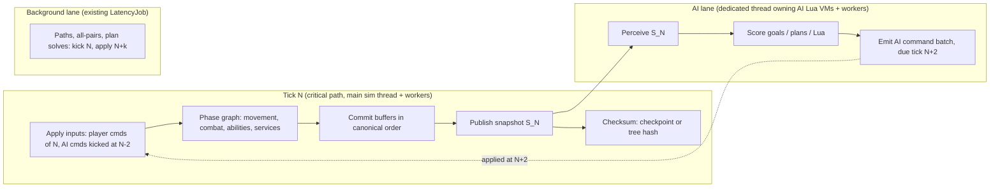

# Design: a simulation that uses every physical core, with the same outcomes and bounded latency

Status: **approved, in progress** (Gabriel, 2026-11-14: "full sim system redesign"). A named exception to the current focus
([`DECISIONS.md`](DECISIONS.md), "Parallel sim redesign"). Roadmap: stage Performance, box `SIMP`, groups `sp0`-`sp7` (one per
step P0-P7 of section 8). Inputs: the worker-count sweep in
[`PERFORMANCE.md`](PERFORMANCE.md) ("Worker-count sweep", 2026-11-14), [`PERF_SERIAL_2026-11-14.md`](PERF_SERIAL_2026-11-14.md),
[`PERF_AUDIT_2026-11-07.md`](PERF_AUDIT_2026-11-07.md) (finding ids J*, S*, L*) and [`OPT_RESEARCH.md`](OPT_RESEARCH.md).

## 1. Goal

Rebuild the per-tick simulation so that:
1. **Outcomes are the same** in the sense of the parity tiers: tier-1 rules, data / Lua handling and feel are unchanged; tier-2
   random-driven outcomes (AI decisions, battle results) keep retail's distribution over many seeds; internals are free.
2. **Rule 3 holds:** every result game logic reads is bit-identical for any worker count, run, and MSVC / clang.
3. **Every physical core does useful work** on large scenes, and adding cores never makes a tick slower.
4. **Latency stays bounded and known** (section 6): a player's order takes effect on the same tick as today; AI reaction delay grows
   by a fixed, small number of ticks; tick wall time meets the existing budget (p99 < 16.7 ms, no tick > 33.3 ms).

## 2. Why the current design stops scaling

Measured (2026-11-14 sweep, median tick, W0 = serial, W15 = 15 workers): land battle 3.46 -> 2.90 ms, water 3.00 -> 2.39 ms, space
1.20 -> 1.00 ms; **3 workers already give all of that**; the galactic scene is *slower* with workers (0.63 -> 0.71-0.83 ms). Where the
serial time goes (W0, share of tick):

| Cost | Land | Water | Galactic | Why it is serial today |
|---|---|---|---|---|
| Tactical AI perception (snapshot, diff, threat grid, signals) | 40 % | 46 % | — | one sim-thread pass that writes AI state as it reads |
| AI goal scoring / planning / Lua | 10-15 % | 6-10 % | 69 % | Lua VMs are single-threaded; AI state (ids, task forces, budgets) shared by all players |
| Per-tick checksum of AI state (`crc.battle.ai`) | 19 % | 16 % | (small) | one system = one big serial hash; captured every tick |
| Tactical services chain (~40 steps after movement) | most of the rest | | | each step reads the previous step's writes and draws from one synced RNG stream |

So the parallel parts (movement, combat sweeps, spatial trees, the AI's per-object fill, stamps) are already parallel; what is left is
**a long serial critical path built from (a) the AI, (b) the checksum, (c) a chain of order-dependent services with one shared RNG
stream.** More `parallel_for` calls cannot fix that. The design below removes the AI from the critical path, makes the checksum cheap,
and turns the services chain into phases that can each run wide.

## 3. Architecture

Three lanes per tick, all scheduled by tick number only:

- **Critical lane (the tick).** Runs on the sim thread, fanning out to workers inside each phase. Contains only what must be current:
  player commands, physics-like systems, rules, story Lua, victory checks.
- **AI lane.** The whole AI (tactical and galactic): perception, goals, plans, free store, AI Lua. It reads only an immutable
  snapshot of tick N and produces a command batch that the critical lane applies at the start of tick N + k_ai (default k_ai = 2).
  While the AI lane works on S_N, the critical lane runs tick N+1 on the other cores.
- **Background lane.** The existing fixed-latency jobs (`alamo/ai/latency_job.hpp`): path recomputes, galactic all-pairs, plan
  solves. Unchanged contract: kick on N, apply on N+k, block if late.

The rule that makes this deterministic is the one the project already uses for background jobs, extended to the AI: **what crosses a
lane boundary is a value copied at a tick, applied at a tick fixed when it was produced, never earlier, and the receiver blocks if it
is late.** Thread timing then decides only *when the CPU does the work*, never *what the sim sees*.

## 4. Building blocks

### 4.1 Topology-aware job system (CP1, J1-J3)
- **Pool = physical cores.** Read `GetLogicalProcessorInformationEx`: one worker per physical core (SMT siblings left to the OS, the
  render thread and audio), minus the sim thread and the AI thread. On a 7800X3D: 8 cores -> sim thread + AI thread + 6 workers. On
  hybrid CPUs, P-cores only for the critical and AI lanes (`EfficiencyClass` from CPU sets); E-cores take background work. On
  dual-CCD parts, keep the pool on one L3 domain (the V-cache CCD on X3D).
- **Three priorities**, strict: critical (the tick's phase jobs) > AI > background. A worker finishing a chunk always looks at the
  critical queue first, so AI and background work only fill gaps in the tick and never delay it.
- **Fork only when it pays.** `parallel_for` gets a cost estimate (items x cost class); below about 50 us of work it runs inline.
  Helpers = min(workers, chunks - 1, work / min_chunk).
- **Waits:** the caller waits for finished chunks, not exited helpers (J1); spin with `_mm_pause` for a few microseconds, then block
  on the counter with `std::atomic::wait` (J2); wake min(copies, idle) workers; no `std::this_thread::yield()` on the sim thread.
- **OS hints:** opt the process out of power throttling (`SetProcessInformation`, execution speed and timer resolution), sim and AI
  threads one priority step up. Wall-clock only; nothing reads it.

All of this is golden-neutral: results already do not depend on the worker count.

**As built (sp1, 2026-11-14; `alamo/jobs/job_system.hpp`, `topology.hpp`).** Port choices where the build differs from the text above:
- *Cost estimate:* measured, not declared. Each `parallel_for` call site (the lambda's type) keeps a wall-clock work-per-item
  estimate (inline: the loop's time; forked: time x threads that ran chunks); estimated work below 50 us runs inline, and at most one
  thread per 25 us of work joins. No call site changed. The first call of a site always forks (no estimate yet).
- *Strict priority:* only a loop's **helpers** run queued critical jobs between chunks, not its owner (the owner's stack may hold the
  job a critical job waits on: a self-wait deadlock found in review). Rule added: a critical job never waits on an AI or background
  counter.
- *Sleep:* one epoch per kind of sleeper (idle workers; waiters), `std::atomic::wait` on it, after a 5 us (waiter) / 30 us (worker)
  `_mm_pause` spin; not one wait per counter.
- *Pool:* P-cores of the largest cache domain (then the larger L3) minus 2; a hybrid part with few P-cores still gets up to 3 workers
  from its other cores. E-cores do not get a background-only queue yet. Workers are kept on the pool's cores (one logical processor
  each) only when workers + 2 fit (the default does; `ALAMO_JOBS_CPUSETS=0` turns it off).
- *OS hints:* power-throttling opt-out in `alamo_game` and `alamo_headless`; the sim thread one step up in `alamo_game` (above-normal
  process) and in `alamo_headless --bench`. The AI thread does not exist yet (P3); its slot is reserved in the worker count.

### 4.2 The snapshot (frozen read view)
- At the end of each tick the critical lane publishes `S_N`: the data the AI and other readers need, as **struct-of-arrays copied into
  a double (triple) buffer**: per-object id, type index, owner, position, facing, health / shield, order state, flags; per-player
  credits, tech, pop cap; the threat inputs; the event lists of the tick (deaths, production done, landings, ability ends: the
  signals the AI derives today in `refresh()`).
- Copying is parallel (one range of objects per worker) and costs about what `BattleAi::fill` costs today, which it replaces.
- Readers hold `S_N` by reference count; the buffer is reused when the last reader releases it. With k_ai = 2 three buffers suffice.
- Static data (type tables, XML) is shared read-only and never copied. The S6 string-keyed lookups are resolved once into a per-battle
  `TypeFacts[type]` table, so the snapshot holds type indices only.
- **Follow-on option: direct writes instead of the end-of-tick copy** (Gabriel, 2026-11-14). The critical lane writes the AI-read
  fields (position, health, owner, order, flags) straight into the buffer of the tick it is running, and publishing becomes a
  buffer-index flip with no copy. The AI-to-sim direction already works this way (orders are written into the slot for tick N+2).
  - What stays: one writer per buffer, and no reader opens it before it is sealed at the fixed tick. Reading a buffer still being
    written shows a half-finished tick whose content depends on thread timing, which breaks rule 3, saves and replays.
  - Stale fields: with three rotating buffers, the next buffer was last written two ticks ago. Either write every AI-read field
    every tick (cheap for fields that change anyway), or patch only the fields changed since (a dirty list; a small copy remains).
  - Cost: every system that writes those fields now writes into the buffer, a much wider change than one publish step.
  - Gain is small: ~2,000 objects × ~64 B ≈ 128 KB, tens of µs to copy. The 1.4 ms of `tac.ai.perception` today is lookups, sort
    and diff, not bytes moved.
  - Order: ship the end-of-tick copy first, profile it, and move the hottest fields to direct writes only if the copy shows up.

### 4.3 Deferred writes, committed in a canonical order
- Inside a phase, a parallel job **never writes shared state**. It writes (a) its own per-index output slot, or (b) records into a
  per-worker buffer: commands, damage, spawns, deaths, events, AI-state mutations.
- At the phase's end the buffers are merged by a **canonical key**, e.g. `(phase, source entity id, sequence within the source)`,
  never by worker or arrival order, and applied serially or in parallel by target.
- This is the "read old, write new, commit in index order" technique already used for movement and combat (OPT_RESEARCH.md §4),
  made general.

### 4.4 Counter-based random streams
- One synced stream drawn in call order is what forces most services to run one after another. Replace it, per system, with
  **counter-based draws**: `rand = hash(session_seed, tick, stream_id, entity_id, draw_index)` (a SplitMix / Philox-style mix), so
  each entity's draws are independent of every other entity's and of thread order.
- The OPT2 t10 PotentialPlan solves already do this (`pp_streams`: seeded by session seed, frame, player, goal source and target).
- **Parity:** the random stream layout and draw order are tier 3 (free). The distribution of each draw is unchanged (same ranges,
  same formulas), so per-seed outcomes move but distributions should not: verified by the tier-2 harness (section 7). Keep the old
  synced path behind a config flag per system, as `stagger` / `pp_streams` do, for A/B runs.

### 4.5 Checksums that do not serialise the tick
- **In `alamo_game`:** capture on checkpoint ticks (`tick % 64 == 0`, the goldens' v2 cadence), on save, and on demand; ring-buffer the
  log. Headless, tests and `--crc-out` keep every tick. Golden-neutral.
- **Everywhere, later:** a **tree hash**: each system hashes fixed blocks (e.g. 256 objects) in parallel, and the system digest is the
  hash of its block digests in order. One golden regeneration; after that capture cost is spread over all cores. Blocks that did not
  change since the last capture reuse their digest (dirty bit per block).

## 5. System by system

| System | Today | Redesign | Parallel shape | Tier |
|---|---|---|---|---|
| Movement (`tac.movement`) | parallel tick + serial commit | unchanged core; space path requests try candidate routes **in parallel**, take the first success in try order (fixes the nebula 24 ms p99 spikes) | per unit, per try | 3 |
| Combat / abilities | parallel sweeps, serial `combat_pre` sync (S10) | bulk SoA sync from the movement output; damage as deferred records committed by (target id, source id, seq) | per unit, per target | 3 (draws: 4.4) |
| Spatial trees | parallel maintain | unchanged | per tree | — |
| Services chain (~40 steps: reinforce, landing, hangars, garrisons, weapons, expiry, pads, fog, queues, victory) | serial, one RNG stream | group into **phases by data they write** (a dependency graph declared per service: reads / writes); services in one phase that touch disjoint data run concurrently; within a service, per-entity work runs wide with 4.3 + 4.4; rule order that retail defines (tier 1, e.g. which target is picked first) stays as an explicit edge in the graph | per phase, per entity | 3, plus 4.4 for draws |
| Tactical AI | inside the tick, ~55-60 % of it | moves to the **AI lane** (section 3): perception from `S_N` replaces `refresh()`; per-object perception, threat-grid cells and goal candidates scored on workers (AI priority); AI state mutations committed in player order; Lua VMs owned by the AI thread | AI lane, wide inside | **2** (AI acts on N, applied N+2) |
| Galactic sim (`gal.sim`, economy, all-pairs) | small; all-pairs already background | unchanged; serial inside galactic mode when the scene is small (forks below threshold run inline, 4.1) | — | — |
| Galactic AI (`ai.goals` 69 %) | inside the tick | AI lane like the tactical AI; goal scoring per (goal, planet) on workers (CP3), equation names resolved to ids at load (S7) | AI lane, wide | **2** |
| Story / mission Lua | inside the tick | **stays in the critical lane**: story scripts are rules (tier 1) and see the current tick | serial | — |
| AI Lua (plans, free store, evaluators) | sim thread | owned by the AI thread (`LuaVm::claim_ownership` at battle start; the frame-boundary hand-off it was made for). Evaluator scripts used inside parallel goal scoring: one VM per worker, built in parallel at load, or C++ versions of the hot equations | one VM per thread | 3 |
| Lua GC | scheduled by tick, parallel across VMs | unchanged; AI-lane VMs collected on the AI lane at the same tick-derived slots | per VM | — |
| Checksum | every tick, serial per system | 4.5 | per block | 3 (tree hash moves goldens once) |

### 5.1 The AI lane in detail
1. End of tick N (critical lane): publish `S_N`; hand the AI lane a job "think on N".
2. AI lane, on its thread with AI-priority helpers: run the tactical AI (or galactic AI) update exactly as today, but every
   read goes to `S_N`, and every order goes into an **AI command batch** tagged `due = N + k_ai` instead of
   `CommandPipeline::execute_direct`. AI-internal state (task forces, budgets, plans, ids) lives only in the AI lane, so nothing races.
3. Start of tick N + k_ai (critical lane): wait for the batch (normally long finished), validate each command against the current
   state with the same rules a player command goes through (a unit that died in the meantime is rejected, as a late player click would
   be), apply in (player, sequence) order, then player commands for the tick in their usual order.
4. Bindings that read back an order the AI just gave (`Is_Moving`, status polling, `BlockOnCommand`) answer from the AI lane's own
   record of issued commands until the snapshot that contains their effect arrives. This is the defined answer for "queued, not
   applied" that the 2026-11-02 investigation (OPT_RESEARCH.md) asked for.
5. Signals the AI reacts to (death, production done, landing, ability end) arrive with `S_N`, so the AI sees them one snapshot
   later than today, plus k_ai.

**Why k_ai = 2:** the AI then has one full tick (33 ms) of wall time before its result is needed, while today's tactical AI takes 0.3-1.8 ms
median and up to about 7 ms p99 on the bench scenes, so the critical lane practically never waits. The exceptions are one-off ticks
(land worst 26 ms; a 190 ms plan load in `nebula_battle`), which must be moved out of the AI update itself (load plan VMs ahead on
workers, S1 / S2) or they become a wait. k_ai = 1 leaves no slack; more than 2 adds
reaction delay for no throughput gain.

**Why this keeps outcomes:** retail's tactical AI already thinks on cadences of seconds (`*_AI_Goal_Cycle_Sleep_Duration`, the 90-frame
path cadence, goal proposal passes of hundreds of frames), and the port already moved plan solves one tick later (OPT2 t10) without a
tier-2 regression. Two ticks (67 ms) is far below those cadences. It is still a behaviour change, so it is verified as tier 2.

### 5.2 Optional second step: AI players in parallel
Once the AI lane exists, the remaining blocker for running players side by side is shared AI state (OPT_RESEARCH.md "Investigation: AI
players' Lua VMs in parallel"): id counters, the shared `Script_<File>` evaluator VMs, shared caches. With per-player id spaces
(`player << 24 | n`), per-player evaluator VMs and the 4.4 streams, each player's update reads `S_N` and its own state only, and the
command batches merge in player order. Worth it only for scenes with many AI players (galactic with every faction an AI: `T7.p0` and
`T7.p1` are 35-39 % each).

## 6. Latency budgets

| Latency | Today | After | Rule |
|---|---|---|---|
| Player order -> effect | applied in the tick it is scheduled for | **unchanged** | player commands are never routed through the AI lane or a snapshot |
| Player input -> on screen | render interpolates the last two ticks | unchanged | presentation reads the published snapshot it already reads |
| AI reaction (event -> AI order applied) | same tick (direct) or +1 (plan solves) | **+2 ticks (67 ms)** fixed | k_ai fixed per world, saved |
| Background results (paths, all-pairs) | +k (existing) | unchanged | LatencyJob contract |
| Tick wall time | p99 2-9 ms, budget 16.7 ms | critical lane only; target <= 1/2 of today's on battles | AI never blocks the tick unless it overruns a full tick |
| Fork overhead | up to tens of us per `parallel_for`, worse on a busy PC | <= a few us; inline below ~50 us of work | 4.1 |

**Overrun rule (deterministic):** if the AI lane is not done when its batch is due, the critical lane **waits** (it does not skip or
reorder). That keeps rule 3; the cost shows up as a tick-time spike and is caught by the profiler and the bench suite. To keep it rare:
AI-priority helpers, k_ai = 2, and the existing staggered per-player clocks (OPT2 t01) so players do not plan on the same tick.

**What is never done:** time-budgeted work ("run the AI until 2 ms are used"), skipping a late result, or applying a result early
because it finished early. Each of those makes the outcome depend on the machine.

## 7. Proving "same outcome"

- **Rule 3:** every step runs the existing worker-count checks (0 / 1 / 4 / default) on MSVC and clang, plus ASan for the job system.
- **Tier 1:** unit tests and `docs/re/` spec checks unchanged; services keep any retail-defined order as explicit graph edges; the
  story Lua stays in the critical lane.
- **Tier 2:** every step that moves AI decisions or random draws (4.4, 5.1, 5.2) ships **behind a config flag** with the old path kept
  (like `stagger`, `pp_streams`), and is judged by the Q4 parity harness over many seeds: win rates, battle lengths, losses, build
  orders, campaign flow within tolerance of retail. One seed moving is not a failure (Parity tiers row).
- **Saves:** the AI lane's in-flight state (the snapshot's inputs or the pending command batch with its due tick) is saved with the
  LatencyJob save rule: keep the inputs, re-run inline on load, apply on the saved tick. A save/load round trip must equal the
  uninterrupted run (existing saveload smoke).
- **Goldens:** golden-neutral steps prove it with byte-identical CRC logs; golden-moving steps regenerate with
  `tools\regen_goldens.cmd` and say so in the commit, one step at a time so each move is attributable.
- **Speed:** the six bench scenes (`tools\benchmark\run_suite.cmd`) on a quiet PC, W0 and default workers, plus a large-scene
  stress (four times the fleets) to show scaling; worker counts 1, 3, 6, 15 to show no regression with more cores.

## 8. Plan

| Step | Content | Moves goldens | Tier | Expected effect (land battle tick) | Exit test |
|---|---|---|---|---|---|
| P0 | Measure: temporary zones splitting `tac.ai.perception` (fill / diff / grid / signals) and the services chain | no | — | none | profile table in PERFORMANCE.md |
| P1 | Job system: physical-core pool, priorities, inline small forks, J1/J2 waits, OS hints (4.1) | no | 3 | galactic back to W0 speed or better; no loss on a busy PC | sweep: no scene slower at any worker count than at W0 |
| P2 | Checkpoint-only checksum in `alamo_game` (4.5 first half); `TypeFacts` (S6) | no | 3 | -16-19 % (game), -some % fill | game bench: sim ms down; CRC logs identical |
| P3 | Snapshot `S_N` + AI command batch + AI thread owning AI VMs, k_ai = 2, tactical AI only (4.2, 5.1) | **yes** | **2** | critical path about -50-55 % | parity harness within tolerance; worker-count checks; saveload smoke |
| P4 | Galactic AI on the AI lane; parallel goal scoring (CP3) and S7 | **yes** | **2** | galactic `ai.goals` off the critical path | same as P3 |
| P5 | Services phase graph, deferred writes, counter-based streams per service (4.3, 4.4, 5) | **yes**, per service | 3 (+2 via draws) | the remaining serial chain runs wide on large scenes | harness; per-service A/B flag |
| P6 | Tree-hash checksum (4.5 second half); parallel path tries in space | yes once / no | 3 | removes the last per-tick serial hash; nebula p99 | CRC regen; nebula p99 < 16.7 ms |
| P7 (optional) | AI players in parallel (5.2) | yes | 2 | many-AI galactic scenes | harness |

Order rationale: P0-P2 are golden-neutral and cheap, and P1 removes the "more cores is slower" problem before anything adds work to
the pool. P3 is the single largest win and the one real design change. P5 is the most work and pays mainly on scenes larger than
today's.

**Ceiling estimate (land battle, 8 physical cores):** today 3.46 ms serial / 2.90 ms at W15. After P2 + P3 the critical lane holds
movement, combat, services and story, about 1.0-1.3 ms of serial work, partly parallel already; P5 brings that toward 0.5-0.8 ms on
large scenes. The AI lane runs about 1.8 ms on its own thread plus helpers, inside its 33-67 ms window. Expected critical-path speed-up
about 2.5-4x, rising with scene size, because the AI and services grow with unit count while the fixed costs do not.

## 9. Risks and open questions
- **AI reaction delay (tier 2).** Two ticks might shift micro-behaviour that matters (e.g. focus fire on a dying target, retreat
  timing). Mitigation: the harness; k_ai is a per-world setting (1 is possible with less slack); bindings answer from issued-command
  records (5.1 step 4).
- **Story scripts that call AI functions** (e.g. AI-related Lua API used by mission scripts) would cross lanes. Needs an inventory of
  bindings by lane; cross-lane calls become commands or snapshot reads.
- **Snapshot size and copy cost** on very large battles: SoA plus copying only changed blocks (dirty bits shared with the tree hash).
- **Services graph correctness:** a missing read/write declaration is a data race. Debug builds check declared sets (record touched
  components and assert); ASan / TSan-style runs on the services phase.
- **Lua 5.0.2 VM count:** per-worker evaluator VMs multiply memory by worker count; build them lazily per worker, or move the hot
  equations to C++.
- **Save format** gains the in-flight AI state (tier 3; save version bump).
- **Measurements so far are from one 8-core CPU** with a partly busy machine; hybrid and dual-CCD CPUs are unmeasured.

## 10. Not proposed
- Results that depend on timing or worker count (time budgets, first-come ordering, skipping late results).
- Moving story / mission Lua off the critical lane.
- Sim / render overlap: measured no gain at today's tick + render times (PERFORMANCE.md, "Tried and not shipped"); revisit only once
  tick + render exceed 16.7 ms on target hardware.
- Replacing Lua 5.0.2's collector or semantics.
