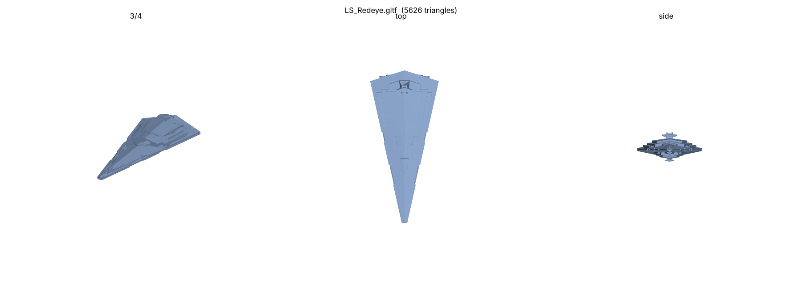
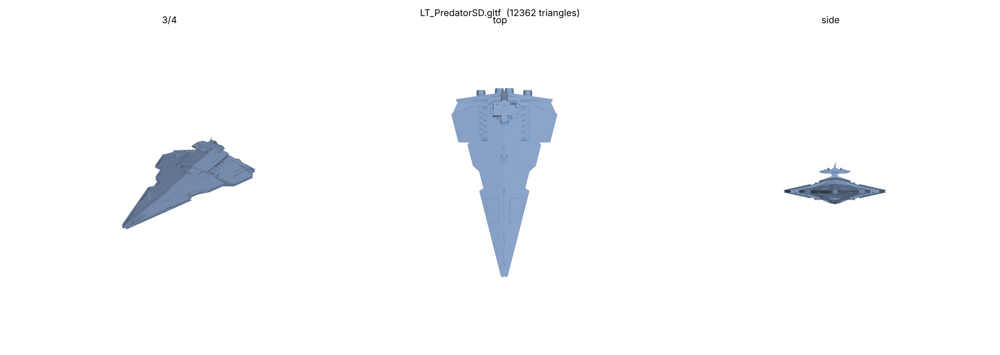
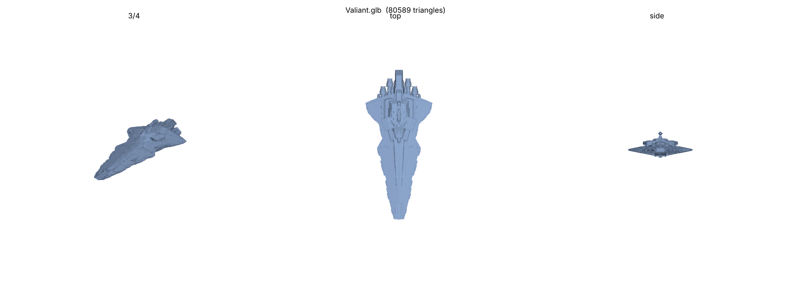
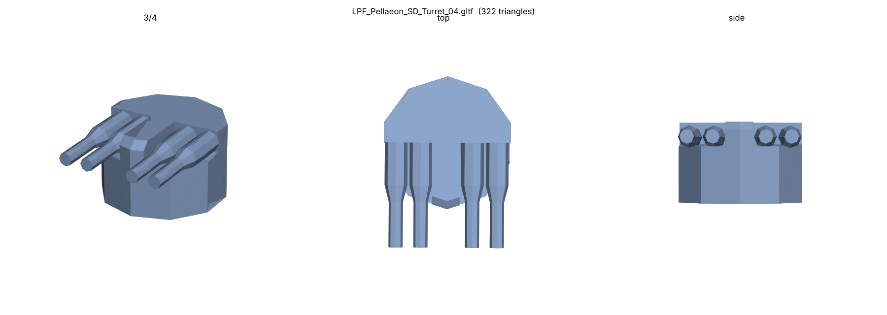
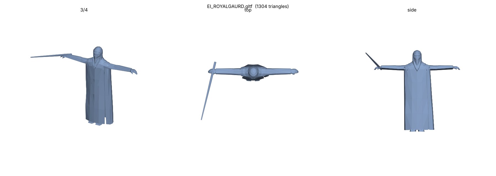
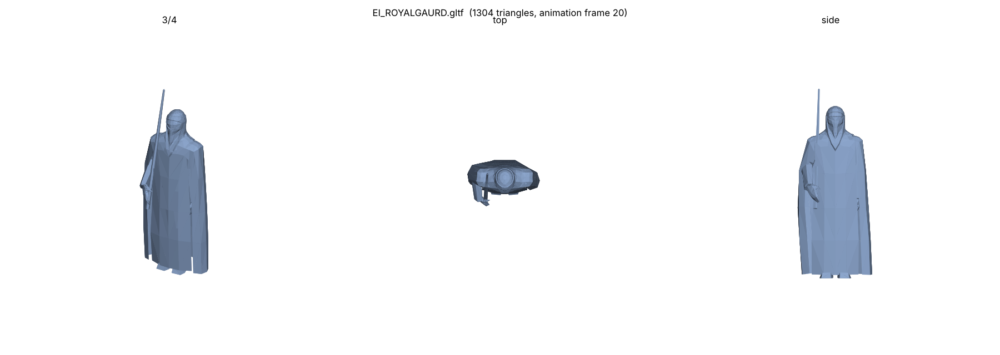
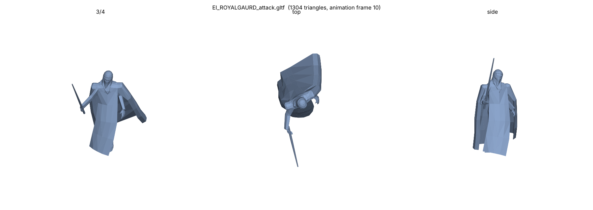
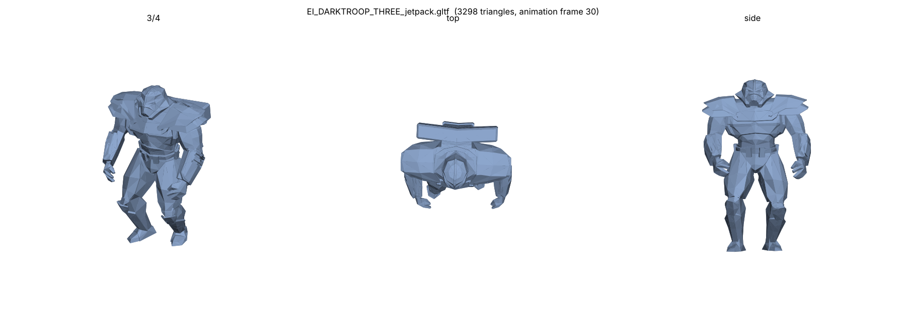

# Format parser validation

Generated by `formats_validate` (C++, `tools/formats/tools/formats_validate.cpp`) on 2026-10-26 (revision 3: closeout A5 field resolutions).
Every file was parsed by the `alamo_formats` library. The parser enforces every declared count and
index (bone, submesh, vertex, index, collision-tree, proxy, connection and animation block sizes)
and throws on any inconsistency. On top of that, the validator runs semantic checks:

- finite positions and unit normals (shadow-volume meshes excluded, because their fin vertices
  legitimately carry zero normals)
- every collision-tree triangle vertex lies inside its dequantised leaf box
- every stored animation quaternion has magnitude 1 ± 0.05
- every DAT key can be found again through the CRC lookup
- every particle emitter: 7 tracks, 3 spawn shapes with a known kind, every property-block mini ID
  in `particle::emitter_fields()` with the catalogued size, `index` equal to the emitter's
  position, and emitter links in range (the one dangling link in the mod data is reported as a
  warning because the runtime ignores it)

It also walks the raw chunk tree of every chunked file. It counts each chunk path and each
mini-chunk ID, and flags any path or mini ID that is not in the library's catalogue
(`known_chunks()` in `chunk.cpp`).

**Result: 2,320 of 2,320 files parse without error. No unknown chunk IDs or mini-chunk IDs were
found in either corpus, including all 48 emitter property IDs across 891 emitters.**

The Python reference parser (`tools/formats/python/alo.py`) was run independently on the same
files and also passed all of them. Its bone, mesh, vertex and triangle counts match the C++ results
for all 504 vanilla models.

Reproduce:

```
cmake -S tools/formats -B build && cmake --build build
build/formats_validate --title "..." <files...> > report.md
```

Notes on the staged-sample table below. Two pairs of DAT files share a name. The larger
`mastertextfile_english.dat` (2,471,126 bytes) and `creditstext_english.dat` (41,532 bytes) are from
`corruption/Data/Text` (FoC). The 1,567,022-byte and 42,076-byte files are from `GameData/Data/Text`
(EaW). The 21 lights and 438 skinned submeshes that exercise the light and skin paths only occur in
the vanilla corpus; the mod samples contain neither.

## Visual verification

Exports from `alo2gltf`, rendered in-container with `python/render_gltf.py`. The renderer applies
the glTF node hierarchy, the rigid skins and, where a frame is given, the ALA animation. Each image
shows three views: 3/4, top and side.

| Model | What it checks |
|---|---|
|  | Static ship (mod), meshes parented to bones |
|  | Large ship (mod, 4.8 MB file) |
|  | Largest sample (46 MB, 310k vertices) |
|  | Barrel mesh on a child bone: static vertices are bone-local |
|  | Rigid-skinned infantry in bind pose: skinned vertices are model-space |
|  | Block-layout ALA (`EI_ROYALGAURD_IDLE_00`), frame 20 |
|  | Block-layout ALA (`EI_ROYALGAURD_ATTACK_00`), frame 10 |
|  | Per-bone-layout ALA (`EI_DARKTROOP_THREE_JETPACK_00`), frame 30 |

Example glTF files (open in Blender with File > Import > glTF 2.0): `examples/LS_Redeye.gltf`,
`examples/LPF_Pellaeon_SD_Turret_04.gltf`, and `examples/EI_ROYALGAURD.gltf`, which includes the
skin and the idle animation.

## Corpus: Staged samples (mod Legeds_ships_transfer + GameData/corruption text, material and environment sets)

**137 / 137 files parsed without error.**

| Kind | Pass | Fail | Pass with warnings |
|---|---:|---:|---:|
| ALA | 8 | 0 | 0 |
| ALO model | 32 | 0 | 0 |
| ALO particles | 59 | 0 | 1 |
| DAT | 4 | 0 | 0 |
| MTD | 1 | 0 | 0 |
| TEE | 9 | 0 | 0 |
| TEM | 24 | 0 | 0 |

### Failures and warnings

| File | Result | Detail |
|---|---|---|
| LV_assault_missile_020_blue.alo | PASS (warn) | dangling emitter link 16 (ignored by runtime) |

### Per-file results

| File | Kind | Bytes | Result | Summary |
|---|---|---:|---|---|
| LHEXPLOSION_EMPIRE_HUGE00.alo | ALO particles | 5567 | PASS | 6 emitters, 44 track keys |
| LHEXPLOSION_THERMAL_EMPIRE.alo | ALO particles | 4644 | PASS | 5 emitters, 32 track keys |
| LHFIRE_EMPIRE_BIG00.alo | ALO particles | 3601 | PASS | 4 emitters, 16 track keys |
| LHHp_AllianceX2.alo | ALO particles | 4409 | PASS | 5 emitters, 11 track keys |
| LHHp_AllianceX3.alo | ALO particles | 1987 | PASS | 2 emitters, 21 track keys |
| LHHp_AllianceX3_Death.alo | ALO particles | 974 | PASS | 1 emitters, 4 track keys |
| LHIMPERIAL_MIDSHIPSMO10.alo | ALO particles | 2697 | PASS | 3 emitters, 8 track keys |
| LHREBELSMOKEDEA10.alo | ALO particles | 2690 | PASS | 3 emitters, 8 track keys |
| LHSSD_FIRESMOKEBAR_SML.alo | ALO particles | 2711 | PASS | 3 emitters, 11 track keys |
| LH_MC90.alo | ALO particles | 1759 | PASS | 2 emitters, 0 track keys |
| LH_MC90X.ALO | ALO model | 2543334 | PASS | 103 bones, 7 meshes, 16806 verts, 17669 tris, 32 proxies, 1 coll-trees |
| LH_MC90X_D.ALO | ALO model | 981110 | PASS | 97 bones, 3 meshes, 6450 verts, 6138 tris, 83 proxies |
| LH_MC90X_D_die_00.ala | ALA | 128814 | PASS | block, 600 frames @ 30 fps, 96 bones (21 rot, 3 trans) |
| LH_damage_elec_SD00.alo | ALO particles | 932 | PASS | 1 emitters, 3 track keys |
| LHexplosion_huge01.alo | ALO particles | 11581 | PASS | 13 emitters, 53 track keys |
| LHexplosion_huge01X.alo | ALO particles | 9069 | PASS | 10 emitters, 53 track keys |
| LHexplosion_huge02.alo | ALO particles | 8224 | PASS | 9 emitters, 52 track keys |
| LHexplosion_huge02_e.alo | ALO particles | 6429 | PASS | 7 emitters, 42 track keys |
| LHexplosion_huge03.alo | ALO particles | 8225 | PASS | 9 emitters, 52 track keys |
| LHexplosion_huge03_e.alo | ALO particles | 6428 | PASS | 7 emitters, 42 track keys |
| LHexplosion_huge03_eX.alo | ALO particles | 6494 | PASS | 7 emitters, 48 track keys |
| LHhp_imperial_damage.alo | ALO particles | 1906 | PASS | 2 emitters, 16 track keys |
| LHimperial_explosion_big00.alo | ALO particles | 5964 | PASS | 7 emitters, 6 track keys |
| LHimperial_midshipsmoke.alo | ALO particles | 2651 | PASS | 3 emitters, 8 track keys |
| LHtw_ptwsa2.alo | ALO particles | 3573 | PASS | 4 emitters, 16 track keys |
| LHweapon_chargedR.alo | ALO particles | 938 | PASS | 1 emitters, 3 track keys |
| LPF_Pellaeon_SD_A.ALO | ALO model | 3043703 | PASS | 194 bones, 21 meshes, 20163 verts, 17809 tris, 60 proxies, 1 coll-trees |
| LPF_Pellaeon_SD_A_D.ALO | ALO model | 2379813 | PASS | 27 bones, 3 meshes, 16071 verts, 9976 tris, 18 proxies |
| LPF_Pellaeon_SD_A_D_DIE_00.ala | ALA | 22613 | PASS | block, 301 frames @ 30 fps, 26 bones (3 rot, 6 trans) |
| LPF_Pellaeon_SD_TurretN_16.ALO | ALO model | 78855 | PASS | 6 bones, 3 meshes, 482 verts, 334 tris, 4 proxies, 3 coll-trees |
| LPF_Pellaeon_SD_TurretN_18.ALO | ALO model | 34816 | PASS | 5 bones, 3 meshes, 204 verts, 144 tris, 3 coll-trees |
| LPF_Pellaeon_SD_TurretN_28.ALO | ALO model | 34776 | PASS | 5 bones, 3 meshes, 204 verts, 144 tris, 3 coll-trees |
| LPF_Pellaeon_SD_TurretN_31.ALO | ALO model | 34896 | PASS | 5 bones, 3 meshes, 204 verts, 144 tris, 3 coll-trees |
| LPF_Pellaeon_SD_TurretN_36.ALO | ALO model | 78775 | PASS | 6 bones, 3 meshes, 482 verts, 334 tris, 4 proxies, 3 coll-trees |
| LPF_Pellaeon_SD_Turret_01.ALO | ALO model | 33504 | PASS | 5 bones, 3 meshes, 208 verts, 144 tris, 1 coll-trees |
| LPF_Pellaeon_SD_Turret_04.ALO | ALO model | 75455 | PASS | 6 bones, 3 meshes, 488 verts, 334 tris, 12 proxies, 1 coll-trees |
| LPF_Pellaeon_SD_Turret_11.ALO | ALO model | 33524 | PASS | 5 bones, 3 meshes, 208 verts, 144 tris, 1 coll-trees |
| LPF_Pellaeon_SD_Turret_23.ALO | ALO model | 75475 | PASS | 6 bones, 3 meshes, 488 verts, 334 tris, 12 proxies, 1 coll-trees |
| LPHp_AllianceX1.alo | ALO particles | 2856 | PASS | 3 emitters, 24 track keys |
| LPHp_AllianceX11.alo | ALO particles | 5479 | PASS | 6 emitters, 31 track keys |
| LPK_Pellaeon_SD.ALO | ALO model | 1369999 | PASS | 173 bones, 8 meshes, 9081 verts, 6371 tris, 58 proxies, 1 coll-trees |
| LPK_Pellaeon_SD_D.ALO | ALO model | 1242760 | PASS | 24 bones, 3 meshes, 8374 verts, 5248 tris, 18 proxies |
| LPK_Pellaeon_SD_D_DIE_00.ala | ALA | 22042 | PASS | block, 300 frames @ 30 fps, 23 bones (3 rot, 6 trans) |
| LP_Damage_Elec_SD00.alo | ALO particles | 1043 | PASS | 1 emitters, 12 track keys |
| LP_Jedicruiser_SML.alo | ALO particles | 1768 | PASS | 2 emitters, 0 track keys |
| LP_LaserLR_Turret_01.ALO | ALO model | 13121 | PASS | 6 bones, 3 meshes, 72 verts, 36 tris, 1 coll-trees |
| LP_LaserLR_Turret_04.ALO | ALO model | 13141 | PASS | 6 bones, 3 meshes, 72 verts, 36 tris, 1 coll-trees |
| LP_LaserNR_Turret_01.ALO | ALO model | 13121 | PASS | 6 bones, 3 meshes, 72 verts, 36 tris, 1 coll-trees |
| LP_LaserNR_Turret_03.ALO | ALO model | 13141 | PASS | 6 bones, 3 meshes, 72 verts, 36 tris, 1 coll-trees |
| LP_Predator.alo | ALO particles | 1761 | PASS | 2 emitters, 0 track keys |
| LPexplosion_chain5_e.alo | ALO particles | 7144 | PASS | 8 emitters, 27 track keys |
| LPexplosion_empire_big00.alo | ALO particles | 6153 | PASS | 7 emitters, 14 track keys |
| LPexplosion_empire_huge00.alo | ALO particles | 8141 | PASS | 9 emitters, 43 track keys |
| LPhp_imperial_damage.alo | ALO particles | 4577 | PASS | 5 emitters, 24 track keys |
| LPhp_imperial_damageS.alo | ALO particles | 4678 | PASS | 5 emitters, 32 track keys |
| LPtw_Turbo.alo | ALO particles | 3620 | PASS | 4 emitters, 16 track keys |
| LR_Nebula.alo | ALO particles | 917 | PASS | 1 emitters, 1 track keys |
| LR_ReJuvenatorSD.ALO | ALO model | 1469745 | PASS | 93 bones, 8 meshes, 9812 verts, 6951 tris, 32 proxies, 1 coll-trees |
| LR_ReJuvenatorSD_D.ALO | ALO model | 1400280 | PASS | 50 bones, 3 meshes, 9468 verts, 4640 tris, 41 proxies |
| LR_ReJuvenatorSD_D_DIE_00.ala | ALA | 18221 | PASS | block, 151 frames @ 30 fps, 49 bones (5 rot, 5 trans) |
| LRexplosion_big00.alo | ALO particles | 9145 | PASS | 10 emitters, 64 track keys |
| LRexplosion_huge01_no_debris.alo | ALO particles | 6486 | PASS | 7 emitters, 47 track keys |
| LSHP_FireStationX1.alo | ALO particles | 3571 | PASS | 4 emitters, 12 track keys |
| LSMFLASHRED3.alo | ALO particles | 5219 | PASS | 6 emitters, 0 track keys |
| LS_ACCLAMATORENGINES_SML.alo | ALO particles | 2617 | PASS | 3 emitters, 0 track keys |
| LS_ISD1.alo | ALO particles | 905 | PASS | 1 emitters, 0 track keys |
| LS_Redeye.ALO | ALO model | 2125319 | PASS | 180 bones, 12 meshes, 14018 verts, 13329 tris, 64 proxies, 1 coll-trees |
| LS_Redeye_D.ALO | ALO model | 992686 | PASS | 80 bones, 4 meshes, 6597 verts, 4821 tris, 75 proxies |
| LS_Redeye_D_die_00.ala | ALA | 14466 | PASS | block, 126 frames @ 25 fps, 79 bones (2 rot, 2 trans) |
| LSexplosion_huge00.alo | ALO particles | 8973 | PASS | 10 emitters, 47 track keys |
| LSheat_glow.alo | ALO particles | 1753 | PASS | 2 emitters, 2 track keys |
| LSlaser_invisible.alo | ALO model | 3125 | PASS | 1 bones, 1 meshes, 16 verts, 8 tris |
| LSunderworlddeath.alo | ALO particles | 2675 | PASS | 3 emitters, 11 track keys |
| LTHp_AllianceX1_Death.alo | ALO particles | 974 | PASS | 1 emitters, 4 track keys |
| LT_PredatorSD.ALO | ALO model | 4866458 | PASS | 112 bones, 16 meshes, 31800 verts, 18623 tris, 37 proxies, 7 coll-trees |
| LT_PredatorSD_D.ALO | ALO model | 2453695 | PASS | 80 bones, 6 meshes, 16527 verts, 8879 tris, 63 proxies |
| LT_PredatorSD_D_die_00.ala | ALA | 36639 | PASS | block, 601 frames @ 30 fps, 79 bones (3 rot, 3 trans) |
| LT_PredatorSML.alo | ALO particles | 1766 | PASS | 2 emitters, 0 track keys |
| LTexplosion_DeathCloneX3_Big.alo | ALO particles | 6332 | PASS | 7 emitters, 31 track keys |
| LTexplosion_krayt.alo | ALO particles | 6167 | PASS | 7 emitters, 25 track keys |
| LVBlink_Medium_Red_6_05.alo | ALO particles | 2794 | PASS | 3 emitters, 16 track keys |
| LVBlink_Medium_White_6_4.alo | ALO particles | 2795 | PASS | 3 emitters, 16 track keys |
| LVShip_Fire.alo | ALO particles | 8096 | PASS | 9 emitters, 39 track keys |
| LVShip_Fire_Explosion.alo | ALO particles | 20380 | PASS | 21 emitters, 250 track keys |
| LVShip_Fire_Very_Small_Explosion.alo | ALO particles | 23296 | PASS | 24 emitters, 284 track keys |
| LV_Damage_Elec_Mid.alo | ALO particles | 2255 | PASS | 2 emitters, 46 track keys |
| LV_Valiant_L.alo | ALO particles | 1816 | PASS | 2 emitters, 5 track keys |
| LV_assault_missile_020.alo | ALO particles | 16269 | PASS | 17 emitters, 162 track keys |
| LV_assault_missile_020_blue.alo | ALO particles | 15310 | PASS | 16 emitters, 153 track keys |
| LV_medium_3_750.alo | ALO particles | 71307 | PASS | 77 emitters, 535 track keys |
| LV_small_w.alo | ALO particles | 14701 | PASS | 16 emitters, 100 track keys |
| LVutral_Republic_Valiant_HTL_01.ALO | ALO model | 1351925 | PASS | 10 bones, 6 meshes, 9035 verts, 7667 tris, 1 coll-trees |
| LVutral_Republic_Valiant_HTL_03.ALO | ALO model | 1351985 | PASS | 10 bones, 6 meshes, 9035 verts, 7667 tris, 1 coll-trees |
| LVutral_Republic_Valiant_Optimize.ALO | ALO model | 46199234 | PASS | 172 bones, 24 meshes, 309879 verts, 218139 tris, 71 proxies, 2 coll-trees |
| LVutral_Republic_Valiant_Optimize_D.ALO | ALO model | 39660133 | PASS | 69 bones, 15 meshes, 267184 verts, 194555 tris, 52 proxies |
| LVutral_Republic_Valiant_Optimize_D_DIE_00.ala | ALA | 75001 | PASS | block, 2920 frames @ 30 fps, 68 bones (1 rot, 1 trans) |
| LVutral_Republic_Valiant_Optimize_D_IDLE_00.ala | ALA | 8759 | PASS | block, 80 frames @ 30 fps, 68 bones (0 rot, 0 trans) |
| LVutral_Republic_Venator_Star_Destroyer_HTL_01.ALO | ALO model | 480923 | PASS | 11 bones, 7 meshes, 3171 verts, 3115 tris, 1 coll-trees |
| LVutral_Republic_Venator_Star_Destroyer_HTL_06.ALO | ALO model | 480903 | PASS | 11 bones, 7 meshes, 3171 verts, 3115 tris, 1 coll-trees |
| MT_commandbar.MTD | MTD | 289741 | PASS | 3577 atlas entries |
| creditstext_english.dat | DAT | 41532 | PASS | 840 strings, unsorted, 0 crc!=crc32(key) |
| creditstext_english.dat | DAT | 42076 | PASS | 832 strings, unsorted, 0 crc!=crc32(key) |
| default_arctic.tee | TEE | 347 | PASS | 2 records |
| default_arctic.tem | TEM | 6467 | PASS | 64 records |
| default_asteroid.tem | TEM | 6450 | PASS | 64 records |
| default_desert.tee | TEE | 345 | PASS | 2 records |
| default_desert.tem | TEM | 6220 | PASS | 64 records |
| default_desert_hot.tem | TEM | 6338 | PASS | 64 records |
| default_forest.tee | TEE | 341 | PASS | 2 records |
| default_forest.tem | TEM | 6596 | PASS | 64 records |
| default_space_lighting.tee | TEE | 359 | PASS | 2 records |
| default_swamp.tee | TEE | 352 | PASS | 2 records |
| default_swamp.tem | TEM | 5423 | PASS | 64 records |
| default_temperate.tee | TEE | 356 | PASS | 2 records |
| default_temperate.tem | TEM | 7304 | PASS | 64 records |
| default_tropical.tem | TEM | 6471 | PASS | 64 records |
| default_urban.tem | TEM | 6495 | PASS | 64 records |
| default_volcanic.tee | TEE | 354 | PASS | 2 records |
| default_volcanic.tem | TEM | 6240 | PASS | 64 records |
| forestset.tem | TEM | 6596 | PASS | 64 records |
| geonosisset.tem | TEM | 6338 | PASS | 64 records |
| hothset.tem | TEM | 6275 | PASS | 64 records |
| kesselset.tem | TEM | 6258 | PASS | 64 records |
| mastertextfile_english.dat | DAT | 1567022 | PASS | 12781 strings, sorted, 0 crc!=crc32(key) |
| mastertextfile_english.dat | DAT | 2471126 | PASS | 19224 strings, sorted, 0 crc!=crc32(key) |
| space_lighting.tee | TEE | 306 | PASS | 2 records |
| swampset.tem | TEM | 5423 | PASS | 64 records |
| tatooineset.tem | TEM | 6028 | PASS | 64 records |
| temperate_greenegyptset.tem | TEM | 7323 | PASS | 64 records |
| temperate_rockbaseset.tem | TEM | 6510 | PASS | 64 records |
| temperate_semi-tropicalset.tem | TEM | 6644 | PASS | 64 records |
| temperate_swampset.tem | TEM | 7304 | PASS | 64 records |
| temperate_tropicalset.tem | TEM | 6279 | PASS | 64 records |
| temperateset.tem | TEM | 7112 | PASS | 64 records |
| testenvironmentset.tee | TEE | 737 | PASS | 5 records |
| urbanset.tem | TEM | 6029 | PASS | 64 records |
| volcanicset.tem | TEM | 6240 | PASS | 64 records |

### Chunk paths encountered

| Path | Count | Meaning |
|---|---:|---|
| `1000` | 8 | animation |
| `1000/1001` | 8 | animation info |
| `1000/1002` | 488 | bone animation |
| `1000/1002/1003` | 488 | bone animation info |
| `1000/1002/1007` | 270 | visibility bitfield |
| `1000/1009` | 7 | rotation block data (i16) |
| `1000/100A` | 7 | translation block data (u16) |
| `2` | 24 | terrain material set |
| `2/3` | 1536 | terrain material (mini-chunks) |
| `200` | 32 | skeleton |
| `200/201` | 32 | skeleton header (u32 bone count + 124 pad) |
| `200/202` | 1570 | bone |
| `200/202/203` | 1570 | bone name |
| `200/202/206` | 1570 | bone v2 (parent, visible, billboard, 3x4 matrix) |
| `400` | 199 | mesh |
| `400/10000` | 215 | submesh data |
| `400/10000/10001` | 215 | submesh info (vertex count, primitive count) |
| `400/10000/10002` | 215 | vertex format name |
| `400/10000/10004` | 215 | index buffer (u16) |
| `400/10000/10007` | 215 | vertex buffer (144-byte vertices) |
| `400/10000/1200` | 41 | collision tree |
| `400/10000/1200/1201` | 41 | collision tree header (bbox, node/tri counts) |
| `400/10000/1200/1202` | 41 | collision tree nodes (10 bytes each) |
| `400/10000/1200/1203` | 41 | collision tree triangle list (u16) |
| `400/10100` | 215 | submesh material |
| `400/10100/10101` | 215 | shader name |
| `400/10100/10103` | 130 | float parameter |
| `400/10100/10105` | 232 | texture parameter |
| `400/10100/10106` | 626 | float4 parameter |
| `400/401` | 199 | mesh name |
| `400/402` | 199 | mesh info (submesh count, bbox, unknown, hidden, collision) |
| `5` | 9 | environment set end marker (empty) |
| `6` | 12 | environment / lighting record (mini-chunks) |
| `600` | 32 | connections |
| `600/601` | 32 | connection counts |
| `600/602` | 199 | object connection |
| `600/603` | 736 | proxy |
| `900` | 59 | particle system |
| `900/0` | 59 | system name |
| `900/1` | 59 | particle-editor system ID (u32) |
| `900/2` | 59 | system u8 leave particles when detached |
| `900/800` | 59 | emitter list |
| `900/800/700` | 420 | emitter |
| `900/800/700/1` | 420 | tracks |
| `900/800/700/1/0` | 2940 | track header |
| `900/800/700/1/1` | 2940 | track keys |
| `900/800/700/16` | 420 | emitter name |
| `900/800/700/2` | 420 | emitter property block (mini-chunks, see particle::emitter_fields) |
| `900/800/700/29` | 420 | spawn shapes (velocity, lifetime, position) |
| `900/800/700/29/1100` | 1260 | spawn shape |
| `900/800/700/29/1100/1101` | 1260 | spawn shape record (64 bytes) |
| `900/800/700/3` | 420 | color texture name |
| `900/800/700/36` | 420 | emitter links (37 spawn-on-death, 39 spawn-during-life) |
| `900/800/700/45` | 420 | bump texture name |

### Mini-chunk IDs encountered

| Container | Mini IDs (count) |
|---|---|
| `1000/1001` | 0x1 (8), 0x2 (8), 0x3 (8), 0xB (8), 0xC (8), 0xD (8) |
| `1000/1002/1003` | 0x4 (488), 0x5 (488), 0x6 (488), 0x7 (488), 0x8 (488), 0x9 (488), 0xA (488), 0xE (488), 0xF (488), 0x10 (488), 0x11 (488) |
| `2/3` | 0x6 (1536), 0x7 (1536), 0x8 (1536), 0x9 (1536), 0xA (1536), 0xB (1536), 0xC (1536), 0xD (1536), 0x12 (1536), 0x13 (1536), 0x14 (1536), 0x23 (1088) |
| `400/10000/1200/1201` | 0x0 (41), 0x1 (41), 0x2 (41), 0x3 (41) |
| `400/10100/10103` | 0x1 (130), 0x2 (130) |
| `400/10100/10105` | 0x1 (232), 0x2 (232) |
| `400/10100/10106` | 0x1 (626), 0x2 (626) |
| `6` | 0x0 (12), 0x1 (12), 0x2 (12), 0x3 (12), 0x4 (12), 0x5 (12), 0x6 (12), 0x7 (12), 0x8 (12), 0x9 (12), 0xA (12), 0xB (12), 0xC (12), 0xD (12), 0xF (12), 0x10 (12), 0x11 (12), 0x12 (12), 0x13 (12), 0x14 (12), 0x15 (8), 0x16 (1), 0x17 (8), 0x18 (1), 0x19 (8), 0x1A (8), 0x1B (8), 0x1C (8), 0x1D (8), 0x1E (8), 0x1F (8), 0x20 (8), 0x21 (8), 0x23 (7), 0x24 (7), 0x28 (7), 0x29 (7), 0x2B (7), 0x2C (7), 0x2D (7), 0x2E (7), 0x2F (7) |
| `600/601` | 0x1 (32), 0x4 (32), 0x9 (31) |
| `600/602` | 0x2 (199), 0x3 (199) |
| `600/603` | 0x5 (736), 0x6 (736), 0x7 (283), 0x8 (13) |
| `900/800/700/1/0` | 0x2 (2940), 0x3 (2940), 0x4 (2940) |
| `900/800/700/1/1` | 0x5 (2622) |
| `900/800/700/2` | 0x4 (420), 0x5 (420), 0x6 (394), 0x7 (420), 0x8 (420), 0x9 (420), 0xA (420), 0xB (420), 0xC (420), 0xF (420), 0x10 (420), 0x12 (420), 0x13 (420), 0x14 (420), 0x15 (420), 0x17 (420), 0x23 (420), 0x24 (420), 0x25 (420), 0x26 (420), 0x27 (420), 0x28 (420), 0x2A (420), 0x2B (420), 0x2C (420), 0x2D (420), 0x2E (420), 0x2F (420), 0x30 (420), 0x31 (420), 0x32 (420), 0x33 (420), 0x34 (420), 0x35 (420), 0x3B (420), 0x3C (420), 0x3D (420), 0x3E (420), 0x3F (420), 0x40 (420), 0x41 (420), 0x42 (420), 0x43 (420), 0x44 (420), 0x46 (420), 0x47 (420), 0x48 (413), 0x49 (394) |
| `900/800/700/36` | 0x37 (420), 0x39 (420) |

### Unknown chunk / mini-chunk IDs

None: every chunk path and every mini-chunk ID in a decoded container is in the catalogue.


## Corpus: Full FoC corruption/Data/models.meg corpus (2183 files extracted in-container)

**2183 / 2183 files parsed without error.**

| Kind | Pass | Fail | Pass with warnings |
|---|---:|---:|---:|
| ALA | 1500 | 0 | 0 |
| ALO model | 504 | 0 | 5 |
| ALO particles | 179 | 0 | 0 |

### Failures and warnings

| File | Result | Detail |
|---|---|---|
| UV_CRUSADERCLASSCORVETTE.ALO | PASS (warn) | 6 non-unit normals |
| UV_CRUSADERCLASSCORVETTE_DC.ALO | PASS (warn) | 6 non-unit normals |
| UV_ECLIPSE_UC.ALO | PASS (warn) | 3 non-unit normals |
| W_CLOUD_CAR.ALO | PASS (warn) | 6 non-unit normals |
| W_HUTTPALACE_VARIANT.ALO | PASS (warn) | 6 non-unit normals |

### Chunk paths encountered

| Path | Count | Meaning |
|---|---:|---|
| `1000` | 1500 | animation |
| `1000/1001` | 1500 | animation info |
| `1000/1002` | 43135 | bone animation |
| `1000/1002/1003` | 43135 | bone animation info |
| `1000/1002/1004` | 28 | per-bone translation track (u16x3/frame) |
| `1000/1002/1006` | 779 | per-bone rotation track (i16x4, const or per frame) |
| `1000/1002/1007` | 4021 | visibility bitfield |
| `1000/1002/1008` | 36 | step-frame bitfield |
| `1000/1009` | 1289 | rotation block data (i16) |
| `1000/100A` | 1177 | translation block data (u16) |
| `1300` | 21 | light |
| `1300/1301` | 21 | light name |
| `1300/1302` | 21 | light info |
| `200` | 504 | skeleton |
| `200/201` | 504 | skeleton header (u32 bone count + 124 pad) |
| `200/202` | 21805 | bone |
| `200/202/203` | 21805 | bone name |
| `200/202/206` | 21805 | bone v2 (parent, visible, billboard, 3x4 matrix) |
| `400` | 4203 | mesh |
| `400/10000` | 4240 | submesh data |
| `400/10000/10001` | 4240 | submesh info (vertex count, primitive count) |
| `400/10000/10002` | 4240 | vertex format name |
| `400/10000/10004` | 4240 | index buffer (u16) |
| `400/10000/10006` | 438 | skin bone map (u32) |
| `400/10000/10007` | 4240 | vertex buffer (144-byte vertices) |
| `400/10000/1200` | 1096 | collision tree |
| `400/10000/1200/1201` | 1096 | collision tree header (bbox, node/tri counts) |
| `400/10000/1200/1202` | 1096 | collision tree nodes (10 bytes each) |
| `400/10000/1200/1203` | 1096 | collision tree triangle list (u16) |
| `400/10100` | 4240 | submesh material |
| `400/10100/10101` | 4240 | shader name |
| `400/10100/10102` | 42 | int parameter |
| `400/10100/10103` | 2195 | float parameter |
| `400/10100/10104` | 14 | float3 parameter |
| `400/10100/10105` | 3678 | texture parameter |
| `400/10100/10106` | 9596 | float4 parameter |
| `400/401` | 4203 | mesh name |
| `400/402` | 4203 | mesh info (submesh count, bbox, unknown, hidden, collision) |
| `600` | 504 | connections |
| `600/601` | 504 | connection counts |
| `600/602` | 4224 | object connection |
| `600/603` | 2621 | proxy |
| `900` | 179 | particle system |
| `900/0` | 179 | system name |
| `900/1` | 179 | particle-editor system ID (u32) |
| `900/2` | 179 | system u8 leave particles when detached |
| `900/800` | 179 | emitter list |
| `900/800/700` | 471 | emitter |
| `900/800/700/1` | 471 | tracks |
| `900/800/700/1/0` | 3297 | track header |
| `900/800/700/1/1` | 3297 | track keys |
| `900/800/700/16` | 471 | emitter name |
| `900/800/700/2` | 471 | emitter property block (mini-chunks, see particle::emitter_fields) |
| `900/800/700/29` | 471 | spawn shapes (velocity, lifetime, position) |
| `900/800/700/29/1100` | 1413 | spawn shape |
| `900/800/700/29/1100/1101` | 1413 | spawn shape record (64 bytes) |
| `900/800/700/3` | 471 | color texture name |
| `900/800/700/36` | 471 | emitter links (37 spawn-on-death, 39 spawn-during-life) |
| `900/800/700/45` | 471 | bump texture name |

### Mini-chunk IDs encountered

| Container | Mini IDs (count) |
|---|---|
| `1000/1001` | 0x1 (1500), 0x2 (1500), 0x3 (1500), 0xB (1461), 0xC (1461), 0xD (1461) |
| `1000/1002/1003` | 0x4 (43135), 0x5 (43135), 0x6 (43135), 0x7 (43135), 0x8 (43135), 0x9 (43135), 0xA (43135), 0xE (42356), 0xF (42356), 0x10 (42356), 0x11 (42356) |
| `400/10000/1200/1201` | 0x0 (1096), 0x1 (1096), 0x2 (1096), 0x3 (1096) |
| `400/10100/10102` | 0x1 (42), 0x2 (42) |
| `400/10100/10103` | 0x1 (2195), 0x2 (2195) |
| `400/10100/10104` | 0x1 (14), 0x2 (14) |
| `400/10100/10105` | 0x1 (3678), 0x2 (3678) |
| `400/10100/10106` | 0x1 (9596), 0x2 (9596) |
| `600/601` | 0x1 (504), 0x4 (504), 0x9 (1) |
| `600/602` | 0x2 (4224), 0x3 (4224) |
| `600/603` | 0x5 (2621), 0x6 (2621), 0x7 (98), 0x8 (792) |
| `900/800/700/1/0` | 0x2 (3297), 0x3 (3297), 0x4 (3297) |
| `900/800/700/1/1` | 0x5 (2096) |
| `900/800/700/2` | 0x4 (471), 0x5 (471), 0x7 (471), 0x8 (471), 0x9 (471), 0xA (471), 0xB (471), 0xC (471), 0xF (471), 0x10 (471), 0x12 (471), 0x13 (471), 0x14 (471), 0x15 (471), 0x17 (471), 0x23 (471), 0x24 (471), 0x25 (471), 0x26 (471), 0x27 (471), 0x28 (471), 0x2A (471), 0x2B (471), 0x2C (471), 0x2D (471), 0x2E (471), 0x2F (471), 0x30 (471), 0x31 (471), 0x32 (471), 0x33 (471), 0x34 (471), 0x35 (471), 0x3B (471), 0x3C (471), 0x3D (471), 0x3E (471), 0x3F (471), 0x40 (471), 0x41 (471), 0x42 (471), 0x43 (471), 0x44 (471), 0x46 (471), 0x47 (470), 0x48 (460), 0x49 (3) |
| `900/800/700/36` | 0x37 (471), 0x39 (471) |

### Unknown chunk / mini-chunk IDs

None: every chunk path and every mini-chunk ID in a decoded container is in the catalogue.


Per-file results for the models.meg corpus: `validation_models_meg.csv`.
